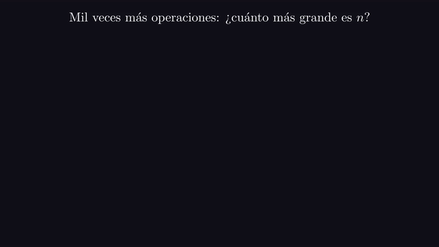
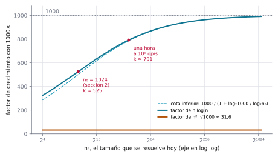
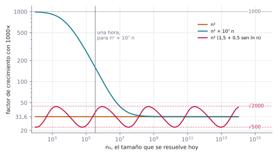

# Ejercicio 1 ★ · Una computadora mil veces más rápida

> ¿Cuánto crece el tamaño de entrada que se resuelve en una hora con un algoritmo
> $\Theta(n^2)$ al pasar a una computadora mil veces más rápida? ¿Y con uno
> $\Theta(n \log n)$? Estima los dos factores.

La respuesta de libro se lee de una tabla: con $n^2$ el tamaño se multiplica por
$\sqrt{1000}$, y con $n \log n$ por "casi mil". Vamos a ver que la primera respuesta es
exacta y no depende de nada, que la segunda depende de dónde estés parado y se acerca a
mil con una lentitud que sorprende, y que ninguna de las dos se puede deducir de la
notación $\Theta$ sola.

Todos los números de este documento los imprime [`ejercicio-01.py`](ejercicio-01.py),
que además corre las pruebas y regenera las dos figuras. Solo necesita matplotlib:

```bash
python ejercicio-01.py
```

## 1. El problema

Fijamos un escenario de referencia: una computadora que hace $V = 10^9$ operaciones
por segundo y un algoritmo que, sobre entradas de tamaño $n$, hace $f(n)$ operaciones
en el modelo RAM. En una hora el presupuesto es $T = 3600 \cdot V$ operaciones, y el
mayor tamaño que se resuelve es

$$n(T) = \max \lbrace n : f(n) \le T \rbrace.$$

**Factor de crecimiento.** La computadora nueva tiene presupuesto $1000\,T$, y lo que
pide el ejercicio es

$$k = \frac{n(1000\,T)}{n(T)}.$$

Tres precisiones que el enunciado tiene que dar, y que no da:

- **Qué máquina y qué plazo.** Para $n^2$ el factor no depende de ninguno de los dos.
  Para $n \log n$ depende, y la sección 4 dice cuánto.
- **Qué quiere decir $\Theta(n^2)$.** Es una familia entera de funciones, y el factor
  cambia según cuál de ellas sea el costo. Suponemos que el costo es $c \cdot g(n)$ más
  términos despreciables. La sección 5 muestra qué pasa si no se supone nada más que
  $\Theta$.
- **La base del logaritmo.** No importa: en la cuenta solo aparece un cociente de
  logaritmos.

## 2. Un ejemplo chico antes de la cuenta

Supongamos que hoy se resuelve justo $n_0 = 1024$ en una hora, con cualquiera de los
dos algoritmos. Para el de costo $n^2$, eso quiere decir que la hora alcanza para
$1024^2 = 1\,048\,576$ operaciones. Para el de costo $n \log_2 n$, que alcanza para
$1024 \cdot 10 = 10\,240$. Son dos máquinas de juguete distintas, pero el factor solo
depende del presupuesto relativo. Ahora le damos a cada una mil veces más operaciones y
buscamos el mayor $n$ que cabe:

```
   costo      ops hoy      ops 1000x    n nuevo   factor
     n^2    1,048,576  1,048,576,000     32,381     31.6
 n log n       10,240     10,240,000    537,900    525.3
log2 del n nuevo de n log n: 19.0  (el de n0 es 10)
```

Para $n^2$ sale 31,6, el mismo $\sqrt{1000}$ que sale en la sección 3 con
$n_0 \approx 1{,}9 \cdot 10^6$: el punto de partida no importa. Para $n \log n$ sale
525, poco más de la mitad de 1000, y la última línea dice por qué. Fíjate: con
$n \log_2 n$ operaciones, cada elemento cuesta $\log_2 n$. Los elementos de hoy cuestan
10 cada uno y los de la entrada nueva cuestan 19, casi el doble. La máquina mil veces
más rápida paga mil veces más operaciones, pero cada elemento nuevo le sale 1,9 veces
más caro, así que compra unas $1000 / 1{,}9 \approx 525$ veces más elementos.

Esa es toda la idea de la sección 4: **la máquina nueva tiene que pagar elementos más
caros**. Con $n^2$ pasa lo mismo, pero ahí el encarecimiento es proporcional al tamaño
y se cancela en la cuenta. Con $n \log n$ no se cancela.

## 3. $\Theta(n^2)$: el factor es $\sqrt{1000}$

**Lema.** Si $f(n) = c\,n^d$ con $c > 0$ y $d > 0$, el cociente entre los tamaños que
caben en $1000\,T$ y en $T$, sin redondear, es $1000^{1/d}$.

*Demostración.* Los tamaños que caben, sin redondear, son $x_0 = (T/c)^{1/d}$ y
$x_1 = (1000\,T/c)^{1/d}$, y su cociente es $1000^{1/d}$. $\square$

La constante $c$ se cancela, y el presupuesto $T$ también. El factor no depende de la
velocidad de la máquina, ni de que el plazo sea una hora, ni de lo bien o mal que esté
programado el algoritmo. Para $n^2$ da $\sqrt{1000} \approx 31{,}62$, y para $n^3$ da
10. En el escenario de una hora:

```
   costo          hoy        1000x   factor
     n^2    1,90·10^6    6,00·10^7    31.62
```

El lema vale para $f = c\,n^2$ exacto. El enunciado dice $\Theta(n^2)$, y un algoritmo
real tiene términos de orden menor. Para que el factor siga tendiendo a $\sqrt{1000}$
basta con que $f(n)/n^2$ tenga límite.

**Teorema.** Si $f$ es no decreciente y $f(n)/n^2 \to c > 0$, entonces
$n(1000\,T)/n(T) \to \sqrt{1000}$ cuando $T \to \infty$.

*Demostración.* Fijemos $\varepsilon \in (0, c)$. Como $f(n)/n^2 \to c$, existe $N$
tal que

$$(c - \varepsilon)\, n^2 \le f(n) \le (c + \varepsilon)\, n^2 \quad \text{para todo } n \ge N.$$

Si $T \ge f(N)$, todo $n \le N$ cabe en el presupuesto porque $f$ es no decreciente,
así que $n(T) \ge N$. Por la definición de $n(T)$,

$$f(n(T)) \le T < f(n(T) + 1).$$

La desigualdad de la izquierda da $(c - \varepsilon)\, n(T)^2 \le T$, o sea
$n(T) \le \sqrt{T/(c - \varepsilon)}$. La de la derecha da
$T < (c + \varepsilon)(n(T) + 1)^2$, o sea $n(T) > \sqrt{T/(c + \varepsilon)} - 1$.
Aplicando las dos cotas a $T$ y a $1000\,T$,

```math
\frac{\sqrt{1000\,T/(c + \varepsilon)} - 1}{\sqrt{T/(c - \varepsilon)}}
\ <\ \frac{n(1000\,T)}{n(T)}\ <\
\frac{\sqrt{1000\,T/(c - \varepsilon)}}{\sqrt{T/(c + \varepsilon)} - 1}.
```

Cuando $T \to \infty$, el extremo izquierdo tiende a
$\sqrt{1000\,(c - \varepsilon)/(c + \varepsilon)}$ y el derecho a
$\sqrt{1000\,(c + \varepsilon)/(c - \varepsilon)}$. Como $\varepsilon$ es arbitrario,
el cociente tiende a $\sqrt{1000}$. $\square$

El paso que todo el mundo se salta está en la primera línea. El argumento necesita que
las dos constantes que encierran a $f(n)/n^2$ se puedan acercar tanto como se quiera, y
eso lo da el límite, no $\Theta$. Con $f \in \Theta(n^2)$ solo hay dos constantes
fijas $c_1 \le c_2$, y la misma cuenta deja al factor encerrado en una banda de ancho
fijo. La sección 5 muestra que esa banda no es un defecto del argumento: hay funciones
que la recorren entera.

## 4. $\Theta(n \log n)$: el factor depende de dónde estés parado

**La ecuación.** Sea $f(n) = c\,n \log n$ y escribamos $n_1 = k\,n_0$. La condición
$f(n_1) = 1000\, f(n_0)$ es

$$c\, k n_0 (\log n_0 + \log k) = 1000\, c\, n_0 \log n_0 .$$

La constante $c$ se cancela otra vez. Dividiendo por $n_0 \log n_0$ y despejando,

$$k = \frac{1000}{1 + \log k / \log n_0} \qquad (\star)$$

Es la observación del ejemplo chico escrita como fórmula. Como
$1 + \log k / \log n_0 = \log n_1 / \log n_0$, la ecuación dice
$k = 1000 \cdot \log n_0 / \log n_1$: mil, dividido entre cuánto se encareció cada
elemento. Y aparece $n_0$, que con $n^2$ se había cancelado. **El factor de
$n \log n$ depende del tamaño que ya se resuelve hoy.** La constante $c$ no aparece en
$(\star)$: solo decide qué $n_0$ cabe en una hora.



*Animación 1. En escala logarítmica, mil veces más operaciones suben la raya tres
décadas. Con $n^2$ el tamaño avanza siempre $3/2$ de década, que es $\sqrt{1000}$, esté
donde esté; con $n \log n$ el avance depende de dónde se empieza. El barrido va del
ejemplo de la sección 2 al escenario de una hora. En mejor calidad:
[MP4](animaciones/ejercicio-01-factor.mp4).*

**Lema.** Si $n_0 \ge 2$, la ecuación $(\star)$ tiene una sola solución $k > 1$, y esa
solución cumple

$$\frac{1000}{1 + \log 1000 / \log n_0} \ <\ k\ <\ 1000 .$$

*Demostración.* La función $g(x) = x \log x$ es estrictamente creciente en
$[1, \infty)$, porque su derivada es $\log x + \log e > 0$. Como $g(n_0) > 0$, también
$g(n_1) = 1000\, g(n_0) > g(n_0)$, así que $n_1$ existe, es único y es mayor que $n_0$:
$k > 1$. Entonces $\log k > 0$, el denominador de $(\star)$ es mayor que 1, y
$k < 1000$. Y como $k < 1000$, $\log k < \log 1000$, el denominador es menor que
$1 + \log 1000 / \log n_0$, y $k$ es mayor que la cota. $\square$

Cuando $n_0 \to \infty$ la cota inferior tiende a 1000, así que $k$ también. Pero la
diferencia relativa con 1000 es de alrededor de
$\log 1000 / \log n_0 \approx 10 / \log_2 n_0$, que decrece como el inverso del
*logaritmo* de $n_0$. El script despeja la cota para tres objetivos:

```
factor >= 900: hace falta log2 n0 >= 88.3, o sea n0 con unas 27 cifras decimales
factor >= 950: hace falta log2 n0 >= 187.9, o sea n0 con unas 57 cifras decimales
factor >= 990: hace falta log2 n0 >= 985.2, o sea n0 con unas 297 cifras decimales
```

Para un algoritmo $n \log n$, ningún tamaño de entrada que vaya a existir alcanza un
factor de 990.

**Cómo se calcula $k$.** En $(\star)$ la incógnita está a los dos lados. Iteramos
$\varphi(k) = 1000 / (1 + \log k / \log n_0)$ empezando en $k = 1000$. En el escenario
de una hora, donde se resuelve $n_0 = 9{,}86 \cdot 10^{10}$:

```
n0 = 9,86·10^10,  L = log2 n0 = 36.52
k:  1000 -> 785.62 -> 791.55 -> 791.36 -> 791.37 -> 791.37 -> ...
punto fijo: k = 791.37
cota inferior: 785.6
|phi'(k)| = k / (1000 · L · ln 2) = 0.0313
comparación con la búsqueda binaria: n1 / n0 = 791.37
```

El primer iterado es justo la cota inferior del lema, porque $\varphi(1000)$ es esa
fórmula. La iteración converge, y rápido, por dos razones que se ven derivando:

```math
\varphi'(k) = -\frac{\varphi(k)^2}{1000\, k \log_2 n_0 \ln 2},
\qquad \text{que en el punto fijo vale } -\frac{k}{1000 \log_2 n_0 \ln 2}.
```

El valor absoluto es 0,0313, así que cada vuelta divide el error por más de 30. Y el
signo es negativo: $\varphi$ es decreciente, así que los iterados caen alternadamente a
un lado y al otro del punto fijo ($785{,}62 < 791{,}37 < 791{,}55$), y cada par de
iterados consecutivos encierra la solución. El resultado coincide con lo que da buscar
directamente, por búsqueda binaria, el mayor $n$ que cabe en $1000\,T$:
$9{,}86 \cdot 10^{10}$ pasa a $7{,}80 \cdot 10^{13}$.

**Si el plazo no es una hora.** Como el factor depende de $n_0$, depende del
presupuesto. El de $n^2$ no:

```
 presupuesto  n0 de n log n  log2 n0  cota inf.  factor n log n  factor n^2
   1 segundo      3,96·10^7     25.2      716.9           726.4       31.62
    1 minuto      1,94·10^9     30.9      755.9           763.2       31.62
      1 hora     9,86·10^10     36.5      785.6           791.4       31.62
       1 día     2,11·10^12     40.9      804.2           809.1       31.62
       1 año     6,41·10^14     49.2      831.5           835.2       31.62
     1 siglo     5,67·10^16     55.7      848.1           851.1       31.62
```

Pasar de un segundo a un siglo multiplica el presupuesto por más de tres mil millones,
y el factor de $n \log n$ solo sube de 726 a 851. En las seis filas la cota inferior
queda a menos del 1,5 % del valor exacto, así que por sí sola ya es una buena
estimación.



*Figura 1. El factor que compra una máquina mil veces más rápida, según el tamaño $n_0$
que se resuelve hoy. El eje horizontal es doblemente logarítmico, porque la curva de
$n \log n$ se acerca a 1000 al ritmo de $\log n_0$. Los dos puntos rojos son el
ejemplo de la sección 2 y el escenario de una hora a $10^9$ operaciones por segundo. La
recta de $n^2$ no se mueve.*

## 5. Lo que $\Theta$ no dice

El teorema de la sección 3 supone que $f(n)/n^2$ tiene límite. Veamos qué pasa con
cuatro funciones de $\Theta(n^2)$ en el escenario de una hora:

```
                 costo          hoy        1000x   factor
                   n^2    1,90·10^6    6,00·10^7    31.62
                 7 n^2    7,17·10^5    2,27·10^7    31.62
 3n^2 + 10 n log n + 7    1,10·10^6    3,46·10^7    31.62
          n^2 + 10^7 n    3,48·10^5    5,52·10^7   158.69
con 3n^2 + 10 n log n + 7 y n0 = 1,10·10^6: 3 n0^2 / (10 n0 log2 n0) = 16 380
con n^2 + 10^7 n y n0 = 3,48·10^5: 10^7 n0 / n0^2 = 28.7
```

- **La constante no importa.** $7n^2$ resuelve una entrada más chica que $n^2$, pero la
  multiplica por lo mismo.
- **Los términos de orden menor casi nunca importan.** $3n^2 + 10\,n \log_2 n + 7$ da
  31,62: con $n_0 = 1{,}10 \cdot 10^6$, el término $3n_0^2$ es 16 380 veces más grande
  que $10\,n_0 \log_2 n_0$.
- **A veces importan.** Con $n^2 + 10^7\,n$ el factor es 158,69. En una hora se
  resuelve $n_0 = 3{,}48 \cdot 10^5$, y ahí el término "de orden menor" $10^7 n_0$ es
  28,7 veces más grande que $n_0^2$. A ese tamaño el algoritmo se comporta como uno
  lineal, y por eso el factor está más cerca de 1000 que de 31,6. El teorema de la
  sección 3 sigue valiendo para esta función, pero el límite solo se nota cuando $n_0$
  pasa con holgura de $10^7$, que es donde $n^2$ alcanza a $10^7 n$ (figura 2, curva
  azul).

Sin la hipótesis del límite, la misma demostración da solo una banda.

**Lema de la banda.** Si $f$ es no decreciente y $c_1 n^2 \le f(n) \le c_2 n^2$ para
todo $n$ suficientemente grande, entonces, cuando $T \to \infty$, el factor queda
asintóticamente entre $\sqrt{1000\, c_1/c_2}$ y $\sqrt{1000\, c_2/c_1}$.

*Demostración.* Es la del teorema de la sección 3 con las constantes fijas $c_1$ y
$c_2$ en lugar de $c - \varepsilon$ y $c + \varepsilon$: el extremo izquierdo tiende a
$\sqrt{1000\,c_1/c_2}$ y el derecho a $\sqrt{1000\,c_2/c_1}$. $\square$

Falta ver que la banda no es holgura de la demostración. Tomemos

$$f(n) = n^2 \left(1{,}5 + 0{,}5 \sin \ln n\right).$$

**Lema.** Esta $f$ es creciente y pertenece a $\Theta(n^2)$, pero $f(n)/n^2$ no tiene
límite.

*Demostración.* Sea $h(n) = 1{,}5 + 0{,}5 \sin \ln n$, que oscila entre 1 y 2. Así
$n^2 \le f(n) \le 2n^2$ y $f \in \Theta(n^2)$. Además $(\ln f)' = 2/n + h'/h$, con
$|h'| \le 0{,}5/n$ y $h \ge 1$, y eso da $(\ln f)' \ge 1{,}5/n > 0$: $f$ es creciente.
Pero $f(n)/n^2 = h(n)$ se acerca a 1 y a 2 infinitas veces, así que no converge.
$\square$

Y el factor oscila con ella, para siempre:

```
n^2 (1,5 + 0,5 sen ln n), n0 entre 10^2 y 10^14: factor entre 22.4 y 44.0
la cota de la sección 5 con c1 = 1, c2 = 2: entre raíz(500) = 22.4 y raíz(2000) = 44.7
```

Con $c_1 = 1$ y $c_2 = 2$, el lema de la banda deja al factor entre $\sqrt{500}$ y
$\sqrt{2000}$, de 22,4 a 44,7. La curva roja de la figura 2 llena casi toda la banda y
no se estabiliza nunca. Así que, si lo único que se sabe es que el costo está en
$\Theta(n^2)$, la pregunta "¿por cuánto se multiplica el tamaño?" no tiene respuesta:
puede ser cualquier número de esa banda, según el tamaño de partida.



*Figura 2. Tres funciones de $\Theta(n^2)$ y el factor que compra cada una con una
máquina mil veces más rápida, según el tamaño que se resuelve hoy. $n^2$ da siempre
31,6. $n^2 + 10^7 n$ empieza comportándose como lineal (factor cerca de 1000) y solo
llega a 31,6 cuando $n_0$ pasa de $10^7$. La función oscilante nunca se estabiliza, y
recorre casi toda la banda que permiten sus constantes.*

## 6. Qué compra una máquina más rápida, y qué compra un algoritmo mejor

Con la misma búsqueda del mayor $n$ que cabe, esto es lo que compra la máquina mil
veces más rápida en el escenario de una hora:

```
   costo   qué compra la máquina 1000 veces más rápida
       n                       multiplica n por 1000,0
 n log n                        multiplica n por 791,4
     n^2                         multiplica n por 31,6
     n^3                         multiplica n por 10,0
     2^n                                le suma 10 a n
 2^(n/2)                                le suma 20 a n
log2 1000 = 9.97
```

Las respuestas al ejercicio son la segunda y la tercera fila. Se suele decir que mejorar
el algoritmo vale más que esperar por el hardware, y aquí se puede medir cuánto más:

```
n^2 en la máquina 1000 veces más rápida: 6,00·10^7
n log n en la máquina de siempre:        9,86·10^10
cociente: 1 643
```

Cambiar un algoritmo cuadrático por uno $n \log n$ en la máquina vieja resuelve
entradas 1 643 veces más grandes que comprar la máquina mil veces más rápida y quedarse
con el cuadrático.

Todo lo anterior vale para cualquier aceleración $s$, no solo para 1000: el factor de
$n \log n$ es la solución de $(\star)$ con $s$ en lugar de 1000, y el lema de la
sección 4 vale igual, con $\log s$ en la cota inferior. La última fila de la tabla es la
primalidad por división, que sobre un número de $b$ bits hace hasta $2^{b/2}$
divisiones: mil veces más cómputo solo le suma 20 bits al número más grande que se
puede probar. Cuando el costo es exponencial en el tamaño, la máquina más rápida suma
una constante en vez de multiplicar.

Antes de dibujar, el script se comprueba a sí mismo. Compara la búsqueda binaria del
mayor $n$ con un oráculo que prueba $n = 1, 2, 3, \dots$ hasta pasarse, para seis
funciones de costo y todos los presupuestos hasta 2000. Comprueba que el $k$ de la
iteración satisface $(\star)$ y coincide con resolver $x \log x = 1000\, n_0 \log n_0$
por bisección para $n_0 = 2^2, \dots, 2^{60}$, que las cotas del lema de la sección 4
valen para $\log_2 n_0$ de 1 a 3000, que el cociente de los $n(T)$ enteros de $n^2$ se
acerca a $\sqrt{1000}$, y que la función oscilante es creciente en
$n = 1, \dots, 200\,000$:

```
15 116 comprobaciones, 0 fallos
```

La regla práctica que te llevas: **$\Theta$ dice cómo crece el costo, no cuánto compra
una máquina más rápida.** Para lo segundo hace falta que el término principal, con su
constante, domine a los tamaños de los que se habla. Toda tabla que estima tamaños con
$n^2$ y $n \log_2 n$ exactos hace esa suposición sin decirla.

## 7. Resumen

- El factor es $k = n(1000\,T)/n(T)$, y para que tenga una respuesta hay que suponer que
  el costo es $c \cdot g(n)$ salvo términos despreciables, no solo que está en
  $\Theta(g(n))$.
- Con $n^2$ el factor es $\sqrt{1000} \approx 31{,}6$. La constante y el presupuesto se
  cancelan, y el factor sigue tendiendo a $\sqrt{1000}$ para toda $f$ no decreciente con
  $f(n)/n^2 \to c$.
- Con $n \log n$ el factor es la solución de $k = 1000/(1 + \log k / \log n_0)$: mil,
  dividido entre cuánto se encareció cada elemento. Con $10^9$ operaciones por segundo
  y una hora vale 791,4.
- Ese factor depende de $n_0$, está entre $1000/(1 + \log 1000/\log n_0)$ y 1000, y se
  acerca a 1000 al ritmo de $1/\log n_0$: para llegar a 990 hace falta un $n_0$ de 297
  cifras.
- Con $\Theta$ a secas el factor no está determinado. $n^2 + 10^7 n$ da 158,7 en una
  hora, y $n^2(1{,}5 + 0{,}5 \sin \ln n)$ oscila entre 22,4 y 44,0 sin estabilizarse.
- Cambiar $n^2$ por $n \log n$ en la máquina de siempre compra 1 643 veces más que la
  máquina mil veces más rápida.

<details>
<summary>Salida completa de <code>python ejercicio-01.py</code></summary>

```
§2. Ejemplo chico: hoy se resuelve n0 = 1024 en una hora
--------------------------------------------------------
   costo      ops hoy      ops 1000x    n nuevo   factor
     n^2    1,048,576  1,048,576,000     32,381     31.6
 n log n       10,240     10,240,000    537,900    525.3
log2 del n nuevo de n log n: 19.0  (el de n0 es 10)

§3 y §4. El escenario de referencia: 10^9 op/s, una hora
--------------------------------------------------------
   costo          hoy        1000x   factor
     n^2    1,90·10^6    6,00·10^7    31.62
 n log n   9,86·10^10   7,80·10^13   791.37
raíz de 1000 = 31.6228

§4. La iteración de punto fijo, en el escenario de una hora
-----------------------------------------------------------
n0 = 9,86·10^10,  L = log2 n0 = 36.52
k:  1000 -> 785.62 -> 791.55 -> 791.36 -> 791.37 -> 791.37 -> ...
punto fijo: k = 791.37
cota inferior: 785.6
|phi'(k)| = k / (1000 · L · ln 2) = 0.0313
comparación con la búsqueda binaria: n1 / n0 = 791.37

§4. El factor de n log n depende del presupuesto; el de n^2, no
---------------------------------------------------------------
 presupuesto  n0 de n log n  log2 n0  cota inf.  factor n log n  factor n^2
   1 segundo      3,96·10^7     25.2      716.9           726.4       31.62
    1 minuto      1,94·10^9     30.9      755.9           763.2       31.62
      1 hora     9,86·10^10     36.5      785.6           791.4       31.62
       1 día     2,11·10^12     40.9      804.2           809.1       31.62
       1 año     6,41·10^14     49.2      831.5           835.2       31.62
     1 siglo     5,67·10^16     55.7      848.1           851.1       31.62

§4. Qué tan grande tiene que ser n0 para acercarse a 1000
---------------------------------------------------------
factor >= 900: hace falta log2 n0 >= 88.3, o sea n0 con unas 27 cifras decimales
factor >= 950: hace falta log2 n0 >= 187.9, o sea n0 con unas 57 cifras decimales
factor >= 990: hace falta log2 n0 >= 985.2, o sea n0 con unas 297 cifras decimales

§5. Tres funciones Θ(n²) y sus factores, en el escenario de una hora
--------------------------------------------------------------------
                 costo          hoy        1000x   factor
                   n^2    1,90·10^6    6,00·10^7    31.62
                 7 n^2    7,17·10^5    2,27·10^7    31.62
 3n^2 + 10 n log n + 7    1,10·10^6    3,46·10^7    31.62
          n^2 + 10^7 n    3,48·10^5    5,52·10^7   158.69
con 3n^2 + 10 n log n + 7 y n0 = 1,10·10^6: 3 n0^2 / (10 n0 log2 n0) = 16 380
con n^2 + 10^7 n y n0 = 3,48·10^5: 10^7 n0 / n0^2 = 28.7
n^2 (1,5 + 0,5 sen ln n), n0 entre 10^2 y 10^14: factor entre 22.4 y 44.0
la cota de la sección 5 con c1 = 1, c2 = 2: entre raíz(500) = 22.4 y raíz(2000) = 44.7

§6. Cambiar de máquina contra cambiar de algoritmo
--------------------------------------------------
n^2 en la máquina 1000 veces más rápida: 6,00·10^7
n log n en la máquina de siempre:        9,86·10^10
cociente: 1 643

   costo   qué compra la máquina 1000 veces más rápida
       n                       multiplica n por 1000,0
 n log n                        multiplica n por 791,4
     n^2                         multiplica n por 31,6
     n^3                         multiplica n por 10,0
     2^n                                le suma 10 a n
 2^(n/2)                                le suma 20 a n
log2 1000 = 9.97

Pruebas
-------
15 116 comprobaciones, 0 fallos

figuras: ejercicio-01-factor.svg, ejercicio-01-theta.svg
```

</details>
