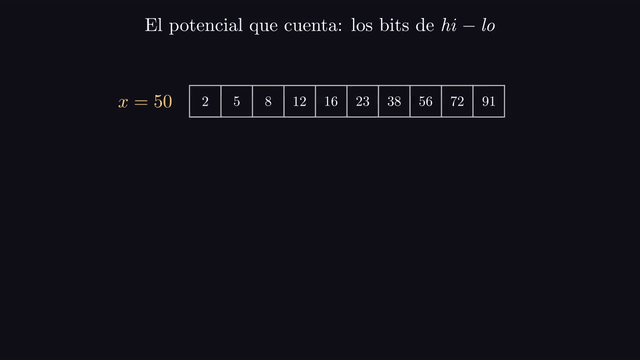
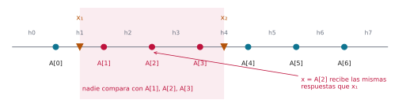
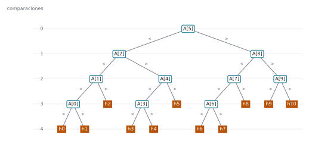
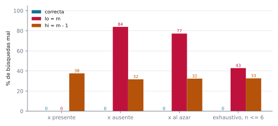
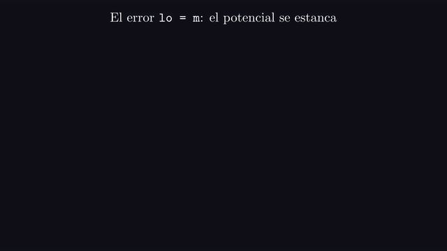

# Ejercicio 2 ★ · Invariante, potencial y cota de información de la búsqueda binaria

> Da el invariante y el potencial de la búsqueda binaria, y la cota de información que
> la hace óptima.

La búsqueda binaria es el algoritmo que todo el mundo cree saber escribir y que casi
todo el mundo escribe mal alguna vez. Vamos a recorrerla con las tres herramientas que
pide el enunciado: un invariante que dice por qué contesta bien, un potencial que dice
por qué termina y cuánto tarda, y una cota de información que dice que ningún algoritmo
de comparaciones puede hacerlo mejor. Al final vas a ver que cada herramienta atrapa un
error distinto.

Todos los números de este documento los imprime [`ejercicio-02.py`](ejercicio-02.py),
que además corre las pruebas y regenera las tres figuras. Solo necesita matplotlib:

```bash
python ejercicio-02.py
```

## 1. El problema

**Búsqueda en un arreglo ordenado.** La entrada es un arreglo $A[0..n-1]$ ordenado de
forma no decreciente y un valor $x$. La salida es una posición $i$ con $A[i] = x$ o, si
$x$ no está, el **hueco** donde caería: la cantidad $g$ de elementos menores que $x$.
Hay $n + 1$ huecos, $h_0, h_1, \dots, h_n$, y $h_g$ es el que queda entre $A[g-1]$ y
$A[g]$.

El modelo es el de comparaciones: el algoritmo solo accede a los datos comparando $x$
con un elemento $A[i]$. El costo es el número de comparaciones.

Tres precisiones que un enunciado tiene que dar, y que casi nunca se dan:

- **Repetidos.** Si $x$ aparece varias veces, cualquier posición donde esté es una
  respuesta correcta.
- **Qué devolver si $x$ no está.** "No está" a secas tira información. Devolver el hueco
  no le cuesta nada al algoritmo, y es justo lo que va a contar la cota de la sección 6.
- **Qué contesta una comparación.** Aquí, tres cosas: $<$, $=$ o $>$. Muchas
  bibliotecas solo preguntan "¿$a < b$?", y la sección 8 muestra que eso cambia la cota
  en una comparación exacta.

## 2. Un ejemplo chico antes de la prueba

Busquemos en un arreglo de diez elementos, primero un valor que no está y después uno
que sí. La búsqueda lleva una **ventana** de candidatos, las posiciones
$\mathit{lo}, \mathit{lo} + 1, \dots, \mathit{hi} - 1$ donde todavía puede estar $x$.
Empieza con $\mathit{lo} = 0$ y $\mathit{hi} = n$, y en cada paso compara $x$ con el
elemento del medio, $A[m]$ con $m = \lfloor (\mathit{lo} + \mathit{hi})/2 \rfloor$.
La columna `bits` es la cantidad de bits de $\mathit{hi} - \mathit{lo}$, el tamaño de la
ventana, y va a importar en la sección 5.

```
x = 50
paso  lo  hi hi - lo bits   m  A[m]  respuesta
   1   0  10      10    4   5    23  x > 23
   2   6  10       4    3   8    72  x < 72
   3   6   8       2    2   7    56  x < 56
   4   6   7       1    1   6    38  x > 38
       7   7       0    0
resultado: no está, cae en el hueco 7, con 4 comparaciones
```

```
x = 16
paso  lo  hi hi - lo bits   m  A[m]  respuesta
   1   0  10      10    4   5    23  x < 23
   2   0   5       5    3   2     8  x > 8
   3   3   5       2    2   4    16  x = 16
resultado: está en la posición 4, con 3 comparaciones
```

El arreglo es `2 5 8 12 16 23 38 56 72 91`. Fíjate en dos cosas de la primera tabla.

- **Lo que queda fuera de la ventana ya está decidido.** Después del paso 1,
  $\mathit{lo} = 6$, y los seis elementos de la izquierda (de 2 a 23) son todos menores
  que 50. Después del paso 2, $\mathit{hi} = 8$, y los de la derecha (72 y 91) son
  todos mayores. Al final la ventana queda vacía en $\mathit{lo} = \mathit{hi} = 7$:
  siete elementos menores que 50 y el resto mayores, así que 50 va en el hueco $h_7$.
  Eso es el invariante de la sección 4.
- **La ventana se parte por la mitad, o menos.** Los tamaños son 10, 4, 2, 1 y 0, y sus
  cantidades de bits son 4, 3, 2, 1 y 0: bajan exactamente de a uno. Eso es el
  potencial de la sección 5, y dice por qué hicieron falta 4 comparaciones.

## 3. El algoritmo

**Cómo se le ocurre a uno.** La búsqueda lineal compara $x$ con $A[0]$, y si no son
iguales descarta un solo elemento. Comparar con el del medio descarta la mitad, porque
el arreglo está ordenado: si $x < A[m]$, también es menor que todo lo que hay a la
derecha de $m$. La pregunta que más información da es la que parte en dos lo que
todavía no se sabe.

La ventana es semiabierta: los candidatos son
$A[\mathit{lo}], \dots, A[\mathit{hi} - 1]$.

```python
def binary_search(A, x, compare):
    lo, hi = 0, len(A)
    while lo < hi:
        m = (lo + hi) // 2
        r = compare(x, A[m])            # -1, 0 o 1
        if r == 0:
            return ("está", m)
        if r < 0:
            hi = m
        else:
            lo = m + 1
    return ("hueco", lo)
```

`compare` es un objeto que contesta la comparación y cuenta cuántas veces se le
preguntó. Así el script mide el costo en el modelo, y no en segundos.

## 4. El invariante

**El invariante que uno escribe primero** es "si $x$ está en $A$, está en la ventana".
Es verdadero, y además es inductivo. Pero al terminar con la ventana vacía solo permite
concluir que $x$ no está, y no dice dónde caería. Para justificar la salida completa
hay que reforzarlo, y afirmar algo sobre todo lo que quedó fuera de la ventana, no solo
sobre $x$:

**Invariante (I).** $0 \le \mathit{lo} \le \mathit{hi} \le n$, y $A[i] < x$ para todo
$i < \mathit{lo}$, y $A[i] > x$ para todo $i \ge \mathit{hi}$.

(I) implica el primero: si $A[p] = x$, entonces $A[p]$ no es ni menor ni mayor que $x$,
así que $\mathit{lo} \le p < \mathit{hi}$.

**Teorema.** Si $A$ está ordenado, (I) vale al comienzo de cada vuelta, y la búsqueda
devuelve una posición de $x$ si $x$ está, y el hueco correcto si no está.

*Demostración.* *Inicialización.* Con $\mathit{lo} = 0$ y $\mathit{hi} = n$, las dos
afirmaciones sobre los elementos son sobre conjuntos vacíos.

*Mantenimiento.* Supongamos (I) y $\mathit{lo} < \mathit{hi}$. El primer paso es el que
todo el mundo se salta: $m = \lfloor (\mathit{lo} + \mathit{hi})/2 \rfloor$ cumple
$\mathit{lo} \le m < \mathit{hi}$, porque $\mathit{lo} < \mathit{hi}$. Así que $A[m]$
existe y está dentro de la ventana. Hay tres casos, uno por respuesta. Si $x = A[m]$,
el algoritmo devuelve $m$, que es correcto. Si $x < A[m]$, entonces para todo $i \ge m$
se tiene $A[i] \ge A[m] > x$: **aquí se usa que el arreglo está ordenado**. Poner
$\mathit{hi} = m$ conserva la segunda afirmación, y $\mathit{lo} \le m$ conserva la
primera parte de (I). Si $x > A[m]$, entonces para todo $i \le m$ se tiene
$A[i] \le A[m] < x$; poner $\mathit{lo} = m + 1$ conserva la primera afirmación, y
$m + 1 \le \mathit{hi}$.

*Conclusión.* Si el algoritmo devolvió una posición, es correcta por el primer caso.
Si no, el ciclo terminó con $\mathit{lo} \ge \mathit{hi}$, y con (I),
$\mathit{lo} = \mathit{hi}$. Entonces cada elemento es menor que $x$ (los de posición
menor que $\mathit{lo}$) o mayor (el resto). Así que $x$ no está, y exactamente
$\mathit{lo}$ elementos son menores que $x$: cae en el hueco $h_{\mathit{lo}}$, que es
lo que devuelve el algoritmo. $\square$


*Animación 1. La búsqueda de $x = 50$ de la sección 2. Lo que queda fuera de la ventana
ya está decidido: a la izquierda, menor que $x$; a la derecha, mayor. Con la ventana
vacía, eso dice en qué hueco cae $x$. En mejor calidad:
[MP4](animaciones/ejercicio-02-invariante.mp4).*

Antes de escribir la demostración conviene comprobar el invariante en muchas
ejecuciones con `assert`. Si estuviera mal escrito, el `assert` lo diría en un segundo.
El script vigila (I) y los dos potenciales de la sección siguiente en cada vuelta,
sobre arreglos con repetidos:

```
20 000 búsquedas sobre arreglos ordenados con repetidos, 54 438 vueltas vigiladas, 0 fallos
sobre 20 000 arreglos desordenados: el invariante se rompe en 62.6% de las búsquedas y la respuesta está mal en 44.4%
```

La segunda línea muestra dónde se usa la precondición. Sobre arreglos desordenados, el
mantenimiento falla en el 62,6 % de las búsquedas, porque $x < A[m]$ ya no dice nada de
lo que hay a la derecha de $m$. La respuesta sale mal en el 44,4 %. La diferencia son
búsquedas en las que el invariante se rompió y aun así la respuesta acertó por
casualidad.

## 5. El potencial

**Terminación.** Sea $\Phi = \mathit{hi} - \mathit{lo}$, el tamaño de la ventana. Es un
entero, y por (I) nunca es negativo. Llamemos $s \ge 1$ al tamaño al empezar una vuelta
que no encuentra a $x$. Como $m - \mathit{lo} = \lfloor s/2 \rfloor$, el tamaño nuevo
es $\lfloor s/2 \rfloor$ si $x < A[m]$, y $\lceil s/2 \rceil - 1$ si $x > A[m]$. Los
dos son a lo sumo $\lfloor s/2 \rfloor$, que es menor que $s$. Así que $\Phi$ baja en
cada vuelta, y el ciclo termina. Pero el valor inicial de $\Phi$ solo acota las vueltas
en $n$, que es lo que cuesta la búsqueda lineal.

Para contar comparaciones sirve un potencial más fino: $\Psi$, la cantidad de bits de
$\mathit{hi} - \mathit{lo}$, que vale
$\lfloor \log_2 (\mathit{hi} - \mathit{lo}) \rfloor + 1$, o 0 si la ventana está vacía.

**Lema.** La búsqueda binaria hace a lo sumo
$\lfloor \log_2 n \rfloor + 1 = \lceil \log_2 (n+1) \rceil$ comparaciones, y esa cota
se alcanza cuando $x$ es menor que $A[0]$.

*Demostración.* El tamaño nuevo es a lo sumo $\lfloor s/2 \rfloor$, que es $s$ sin su
último bit, así que tiene un bit menos: $\Psi$ baja al menos 1 en cada comparación que
no encuentra a $x$. Cada comparación se hace con la ventana no vacía, o sea con
$\Psi \ge 1$. Si la búsqueda hace $c$ comparaciones, las $c - 1$ primeras no
encontraron a $x$, así que antes de la última $\Psi$ vale a lo sumo
$\lfloor \log_2 n \rfloor + 1 - (c - 1)$. Como ahí $\Psi \ge 1$, queda
$c \le \lfloor \log_2 n \rfloor + 1$. Ese número es $\lceil \log_2 (n+1) \rceil$: si
$2^k \le n < 2^{k+1}$, los dos valen $k + 1$. Y si $x < A[0]$, todas las respuestas son
$<$, el tamaño pasa siempre de $s$ a $\lfloor s/2 \rfloor$, y se hacen exactamente
$\lfloor \log_2 n \rfloor + 1$ comparaciones. $\square$



*Animación 2. El tamaño de la ventana, en binario. Cada comparación deja a lo sumo
$\lfloor s/2 \rfloor$, que es $s$ sin su último bit, así que hay a lo sumo tantas
comparaciones como bits tiene $n$. En mejor calidad:
[MP4](animaciones/ejercicio-02-bits.mp4).*

El ejemplo de la sección 2 ya lo mostraba: 4 comparaciones con $n = 10$, que tiene 4
bits. El script lo comprueba corriendo la búsqueda sobre todos los resultados
posibles, $n$ valores presentes y $n + 1$ huecos, para cada $n$ hasta 300:

```
n de 0 a 300, todos los resultados posibles: 90 601 búsquedas, todas correctas, peor caso = ceil(log2(n+1)) en los 301 valores
con n = 1 000 000: x menor que todos usa 20 comparaciones = bits de n; una búsqueda lineal usaría hasta 1 000 000
```

El costo es $O(\log n)$ comparaciones y $O(1)$ memoria: dos índices.

## 6. La cota de información

La sección 5 dice cuánto cuesta *este* algoritmo. Ahora la pregunta cambia de sujeto:
cuánto cuesta *cualquier* algoritmo del modelo de comparaciones.

**El árbol de decisión.** Fijemos $n$ y un algoritmo. Su primera comparación no depende
de $x$, porque todavía no sabe nada. La segunda depende solo de la respuesta a la
primera, y así sucesivamente. Todas las ejecuciones posibles forman un árbol: cada nodo
interno es una comparación de $x$ con algún $A[i]$, con una rama por respuesta, y cada
hoja es una salida. El peor caso del algoritmo es la altura del árbol.

**La trampa de las tres ramas.** Cada comparación tiene tres respuestas, así que el
árbol es ternario. Contar todas las salidas posibles, $n$ posiciones más $n + 1$ huecos,
y exigir una hoja para cada una solo da $\lceil \log_3 (2n+1) \rceil$, que es bastante
menos que lo que hace la búsqueda binaria:

```
        n  ceil(log3(2n+1))  ceil(log2(n+1))
       10                 3                4
     1000                 7               10
  1000000                14               20
```

La salida es mirar solo las búsquedas en las que $x$ **no está**. En ellas ninguna
comparación puede contestar $=$, así que sus ejecuciones solo bajan por las ramas $<$ y
$>$, que forman un árbol binario.

**Teorema.** Todo algoritmo de comparaciones hace, en el peor caso, al menos
$\lceil \log_2 (n+1) \rceil$ comparaciones.

*Demostración.* Primero, dos valores en huecos distintos llegan a hojas distintas. Sean
$x_1$ y $x_2$ dos valores en huecos distintos, $x_1$ a la izquierda, y supongamos que
un algoritmo correcto los lleva a la misma hoja. Entre sus huecos hay al menos un
elemento $A[j]$, con $x_1 < A[j] < x_2$. El algoritmo no comparó con ningún elemento
entre los dos huecos: si lo hubiera hecho, $x_1$ habría recibido $<$ y $x_2$ habría
recibido $>$, y sus caminos se habrían separado. Tomemos ahora $x = A[j]$. Todo
elemento con el que el algoritmo compara está a la izquierda de los dos huecos o a la
derecha, y con cada uno $A[j]$ recibe la misma respuesta que $x_1$. Así que $x = A[j]$
recorre el mismo camino y llega a la misma hoja, donde el algoritmo dice que $x$ no
está. Pero $A[j]$ sí está, y el algoritmo se equivoca.

Entonces los $n + 1$ huecos necesitan $n + 1$ hojas distintas en la parte binaria del
árbol. Un árbol binario de altura $h$ tiene a lo sumo $2^h$ hojas: con $h = 0$ es una
sola hoja, y en general la raíz tiene a lo sumo dos subárboles de altura $h - 1$. Así
que $2^h \ge n + 1$, y como la altura es un entero,
$h \ge \lceil \log_2 (n+1) \rceil$. $\square$



*Figura 1. El argumento con $x_1$ en el hueco $h_1$ y $x_2$ en el $h_4$. Si llegan a la
misma hoja, ninguna comparación separó a $x_1$ de $x_2$, así que el algoritmo no comparó
con $A[1]$, $A[2]$ ni $A[3]$. Entonces $x = A[2]$ recibe las mismas respuestas que
$x_1$, y el algoritmo contesta que no está.*


*Animación 3. El argumento del testigo de la figura 1, en movimiento, y después la
cuenta de hojas: cada nivel de un árbol binario a lo sumo duplica las hojas, y los once
huecos de $n = 10$ piden altura 4. En mejor calidad:
[MP4](animaciones/ejercicio-02-testigo.mp4).*

**Corolario.** La búsqueda binaria es óptima exactamente, para todo $n$ y sin ninguna
constante de por medio: el lema de la sección 5 y el teorema dan el mismo número,
$\lceil \log_2 (n+1) \rceil$.

El árbol de la búsqueda binaria se puede construir sin dibujarlo a mano: se corre sobre
un valor de cada hueco y se pegan los caminos donde coinciden. Para $n = 10$:

```
hojas de hueco: 11, todas distintas: True
profundidad de cada hueco: h0:4 h1:4 h2:3 h3:4 h4:4 h5:3 h6:4 h7:4 h8:3 h9:3 h10:3
altura: 4,  ceil(log2 11) = 4
```



*Figura 2. El árbol de decisión de la búsqueda binaria con $n = 10$, obtenido
corriéndola con un valor de cada hueco. Cada nodo compara $x$ con el elemento que
indica, y tiene además una rama $=$ que termina la búsqueda (no dibujada). Las once
hojas de hueco son distintas y ninguna está a más de 4 comparaciones, que es
$\lceil \log_2 11 \rceil$. Leído de izquierda a derecha, el árbol recorre el arreglo en
orden: $h_0, A[0], h_1, A[1], \dots, A[9], h_{10}$.*

**Comprobación contra todos los algoritmos.** La cota también se puede verificar por
fuerza bruta, no sobre un algoritmo sino sobre todos. En cualquier momento de cualquier
ejecución, lo que el algoritmo sabe es una ventana de candidatos contiguos: comparar con
un elemento de fuera de la ventana tiene la respuesta ya sabida. Comparar con el
candidato $j$ de una ventana de $s$ deja $j$ candidatos a la izquierda y $s - 1 - j$ a
la derecha, y el $=$ termina. Así que el mejor peor caso posible con $s$ candidatos es

$$\mathrm{opt}(0) = 0, \qquad
\mathrm{opt}(s) = 1 + \min_{0 \le j < s} \max\big(\mathrm{opt}(j),\ \mathrm{opt}(s - 1 - j)\big),$$

que el script calcula para todo $s \le 1000$ y compara con lo que mide:

```
       n  peor caso medido  ceil(log2(n+1))  óptimo por DP
       1                 1                1              1
       2                 2                2              2
       3                 2                2              2
       4                 3                3              3
       7                 3                3              3
       8                 4                4              4
      10                 4                4              4
      15                 4                4              4
      16                 5                5              5
     100                 7                7              7
     255                 8                8              8
     256                 9                9              9
    1000                10               10             10
   10000                14               14              —
 1000000                20               20              —
DP sobre todos los algoritmos: óptimo = ceil(log2(n+1)) para todo n <= 1000
```

Las tres columnas son iguales en toda la tabla, y la programación dinámica coincide con
la cota en los mil valores. El peor caso sube en $n = 2, 4, 8, 16, \dots, 256$: con
$n = 2^k - 1$ elementos el árbol queda completo, y uno más obliga a agregar un nivel.

## 7. Los errores que el invariante y el potencial anuncian

Las dos maneras más comunes de escribir mal la búsqueda binaria cambian un solo
carácter: **`hi = m - 1`** en lugar de `hi = m`, cuando $x < A[m]$, y **`lo = m`** en
lugar de `lo = m + 1`, cuando $x > A[m]$.

Probémoslas contra el oráculo, que mira el arreglo entero, con cuatro baterías de
pruebas. En las tres primeras el arreglo tiene entre 1 y 15 valores distintos, y lo que
cambia es cómo se elige $x$. Una búsqueda que no termina en $2n + 5$ vueltas cuenta como
fallo.

```
            batería  casos    correcta      lo = m  hi = m - 1
         x presente   4000        0.0%        0.0%       37.6%
          x ausente   4000        0.0%       83.9%       31.7%
          x al azar   4000        0.0%       77.2%       32.4%
 exhaustivo, n <= 6     49        0.0%       42.9%       32.7%
```



*Figura 3. Porcentaje de búsquedas en que cada variante se equivoca o no termina, según
cómo se generaron las pruebas. Con la batería "x presente", `lo = m` es indistinguible
de la búsqueda correcta.*

**`hi = m - 1` rompe el invariante.** Cuando $x < A[m]$, además de descartar $A[m]$
descarta $A[m-1]$, del que no se sabe nada: puede ser igual a $x$. La segunda parte de
(I) deja de valer. El potencial, en cambio, baja más rápido que antes, así que la
búsqueda siempre termina, pero a veces con una respuesta equivocada:

```
hi = m - 1 con x presente: cuando falla, contesta ['hueco']
```

Con $x$ en el arreglo, dice que no está. Todas las baterías lo atrapan, entre un 31,7 %
y un 37,6 % de las veces.

**`lo = m` conserva el invariante y rompe el potencial.** Cuando $x > A[m]$, poner
$\mathit{lo} = m$ deja a $A[m]$ dentro de la ventana, pero (I) sigue valiendo: todo lo
que hay a la izquierda de $m$ es a lo sumo $A[m]$, que es menor que $x$. Lo que se
rompe es el potencial: el tamaño nuevo es $\mathit{hi} - m = \lceil s/2 \rceil$, que es
menor que $s$ salvo cuando $s = 1$. Con un solo candidato, $m = \mathit{lo}$, y si
$x > A[m]$ la ventana no cambia.

**Lema.** La variante `lo = m` es parcialmente correcta: si termina, la respuesta es
correcta. Y no termina si y solo si $x$ no está y $x > A[0]$.

*Demostración.* La correctitud parcial es el teorema de la sección 4, cuyo
mantenimiento sigue valiendo con $\mathit{lo} = m$. Para la terminación hay tres casos.
Si $x$ está, la ventana siempre lo contiene, por (I); cuando queda un solo candidato,
ese candidato es $x$, y la comparación contesta $=$. Si $x$ no está y $x < A[0]$,
todas las respuestas son $<$, $\mathit{lo}$ se queda en 0, y con un candidato la
respuesta $x < A[0]$ vacía la ventana. Si $x$ no está y $x > A[0]$, el candidato
$A[\mathit{lo}]$ es siempre menor que $x$: al principio porque $A[0] < x$, y después
porque $\mathit{lo}$ solo se mueve a una posición con $A[m] < x$. Mientras haya dos
candidatos o más, $m > \mathit{lo}$, y la respuesta $<$ deja
$\mathit{hi} = m > \mathit{lo}$, así que la ventana nunca se vacía. Llega a un
candidato con $A[\mathit{lo}] < x$, y ahí se queda. $\square$



*Animación 4. La variante `lo = m` con $x = 7$ en $2, 4, \dots, 20$. Con un solo
candidato menor que $x$, la ventana no cambia y el potencial se queda en 1 para siempre.
En mejor calidad: [MP4](animaciones/ejercicio-02-estancada.mp4).*

El script confirma las dos afirmaciones en todos los casos de las cuatro baterías:

```
lo = m con x ausente: 3 356 de 4 000 no terminan
lo = m, en las cuatro baterías: 0 respuestas equivocadas que terminan; 'no termina si y solo si x no está y x > A[0]' se cumple en 12 048 de 12 048 casos
con A = 2, 4, ..., 20, lo = m no termina en los huecos 1, 2, 3, 4, 5, 6, 7, 8, 9, 10
```

Ahora mira la primera fila de la tabla. La batería "x presente", que elige $x$ entre los
elementos del arreglo, es la que casi todo el mundo escribe primero, y no ve este error
nunca. ¿Quién avisa de que hay que probar con $x$ ausente? El potencial: solo deja de
bajar con un candidato y respuesta $>$, y con $x$ presente esa situación no se da.

| variante | invariante (I) | potencial | qué se ve en las pruebas |
|---|---|---|---|
| `hi = m - 1` | se rompe | baja más rápido | respuestas equivocadas, con cualquier batería |
| `lo = m` | se conserva | se estanca con $s = 1$ | no termina, solo con $x$ ausente y mayor que $A[0]$ |

Cada herramienta atrapa su error: el invariante, el que da respuestas falsas; el
potencial, el que no termina.

## 8. Si cada pregunta solo contesta sí o no

Muchas bibliotecas no comparan en tres vías: solo preguntan "¿$a < b$?", y la respuesta
es sí o no. La cota cambia, porque ahora el árbol es binario desde el principio y no
hace falta separar los casos en que $x$ no está.

**Teorema.** Si cada pregunta tiene dos respuestas, todo algoritmo necesita al menos
$\lceil \log_2 (2n+1) \rceil = \lceil \log_2 (n+1) \rceil + 1$ preguntas en el peor
caso, una más que antes.

*Demostración.* Hay $2n + 1$ resultados que necesitan hojas distintas. Las $n$
posiciones tienen salidas distintas entre sí y distintas de "no está". Los $n + 1$
huecos necesitan hojas distintas por el mismo argumento de la sección 6: preguntar por
cualquier elemento entre dos huecos, en cualquiera de los dos sentidos, separa a $x_1$
de $x_2$. Un árbol binario con $2n + 1$ hojas tiene altura al menos
$\lceil \log_2 (2n+1) \rceil$. Si $\mathrm{bits}(m)$ es la cantidad de bits de $m$, se
tiene $\lceil \log_2 m \rceil = \mathrm{bits}(m - 1)$, y entonces

$$\lceil \log_2 (2n+1) \rceil = \mathrm{bits}(2n) = \mathrm{bits}(n) + 1
= \lceil \log_2 (n+1) \rceil + 1. \qquad \square$$

**El algoritmo.** El ciclo busca la cantidad de elementos menores que $x$, con el
invariante "$A[i] < x$ para $i < \mathit{lo}$ y $A[i] \ge x$ para $i \ge \mathit{hi}$" y
el mismo potencial, así que da a lo sumo $\lceil \log_2 (n+1) \rceil$ vueltas. Una
pregunta más decide si $A[\mathit{lo}]$ es $x$.

```python
def two_way_binary_search(A, x, less):
    lo, hi = 0, len(A)
    while lo < hi:                       # invariante: A[:lo] < x <= A[hi:]
        m = (lo + hi) // 2
        if less(A[m], x):
            lo = m + 1
        else:
            hi = m
    if lo < len(A) and not less(x, A[lo]):
        return ("está", lo)
    return ("hueco", lo)
```

```
     n  peor caso medido  ceil(log2(2n+1))  ceil(log2(n+1)) + 1
     1                 2                 2                    2
     2                 3                 3                    3
    10                 5                 5                    5
   100                 8                 8                    8
  1000                11                11                   11
```

También es óptima, en su modelo. La comparación de más es el precio de no tener la
respuesta $=$, y la cota lo dice antes de medir: la información que da una pregunta
depende de cuántas respuestas tiene.

Antes de dibujar, el script se comprueba a sí mismo: 30 000 búsquedas contra el oráculo
en arreglos de 0 a 40 elementos con repetidos, todos los resultados posibles para cada
$n \le 300$, las identidades de bits de las secciones 5 y 8 para $n < 100\,000$, la
programación dinámica hasta $n = 1000$, el árbol de decisión para $n$ de 1 a 64, y
30 000 búsquedas de la versión de dos vías:

```
351 664 comprobaciones, 0 fallos
```

La regla práctica que te llevas: **una cota de información cuenta respuestas en un
modelo, y hay que elegir bien qué respuestas contar.** Contar todas las salidas en el
árbol ternario daba una cota floja; contar solo los huecos, donde el árbol es binario,
da la cota exacta. Y cambiar cuántas respuestas tiene cada pregunta cambia la cota.

## 9. Resumen

- El invariante de la búsqueda binaria es (I): todo lo que está a la izquierda de
  $\mathit{lo}$ es menor que $x$ y todo lo que está desde $\mathit{hi}$ es mayor. Es más
  fuerte que "si $x$ está, está en la ventana", y por eso justifica también el hueco.
- El mantenimiento usa dos cosas que es fácil saltarse: que $m$ cae dentro de la
  ventana, y que el arreglo está ordenado. Sin orden, el invariante se rompe en el
  62,6 % de las búsquedas medidas.
- El potencial $\mathit{hi} - \mathit{lo}$ da la terminación. Su cantidad de bits baja
  al menos 1 por comparación, y da la cuenta exacta:
  $\lfloor \log_2 n \rfloor + 1 = \lceil \log_2 (n+1) \rceil$, que se alcanza con $x$
  menor que todos.
- La cota de información mira solo las búsquedas sin éxito: los $n + 1$ huecos
  necesitan hojas distintas, y en esas ejecuciones el árbol es binario. Da
  $\lceil \log_2 (n+1) \rceil$, igual a la cota superior para todo $n$. Una
  programación dinámica sobre todos los algoritmos lo confirma hasta $n = 1000$.
- `hi = m - 1` rompe el invariante y da respuestas falsas. `lo = m` conserva el
  invariante, rompe el potencial y no termina exactamente cuando $x$ no está y es mayor
  que $A[0]$. La batería que elige $x$ dentro del arreglo no lo ve nunca.
- Con preguntas de sí o no, la cota sube a
  $\lceil \log_2 (2n+1) \rceil = \lceil \log_2 (n+1) \rceil + 1$, y la versión de dos
  vías la alcanza.

<details>
<summary>Salida completa de <code>python ejercicio-02.py</code></summary>

```
§2. Ejemplo chico: A = 2 5 8 12 16 23 38 56 72 91
-------------------------------------------------
x = 50
paso  lo  hi hi - lo bits   m  A[m]  respuesta
   1   0  10      10    4   5    23  x > 23
   2   6  10       4    3   8    72  x < 72
   3   6   8       2    2   7    56  x < 56
   4   6   7       1    1   6    38  x > 38
       7   7       0    0
resultado: no está, cae en el hueco 7, con 4 comparaciones

x = 16
paso  lo  hi hi - lo bits   m  A[m]  respuesta
   1   0  10      10    4   5    23  x < 23
   2   0   5       5    3   2     8  x > 8
   3   3   5       2    2   4    16  x = 16
resultado: está en la posición 4, con 3 comparaciones

§4. El invariante y los potenciales, vigilados con assert
---------------------------------------------------------
20 000 búsquedas sobre arreglos ordenados con repetidos, 54 438 vueltas vigiladas, 0 fallos
sobre 20 000 arreglos desordenados: el invariante se rompe en 62.6% de las búsquedas y la respuesta está mal en 44.4%

§5 y §6. Peor caso de la búsqueda binaria, cota y óptimo
--------------------------------------------------------
       n  peor caso medido  ceil(log2(n+1))  óptimo por DP
       1                 1                1              1
       2                 2                2              2
       3                 2                2              2
       4                 3                3              3
       7                 3                3              3
       8                 4                4              4
      10                 4                4              4
      15                 4                4              4
      16                 5                5              5
     100                 7                7              7
     255                 8                8              8
     256                 9                9              9
    1000                10               10             10
   10000                14               14              —
 1000000                20               20              —
n de 0 a 300, todos los resultados posibles: 90 601 búsquedas, todas correctas, peor caso = ceil(log2(n+1)) en los 301 valores
DP sobre todos los algoritmos: óptimo = ceil(log2(n+1)) para todo n <= 1000
con n = 1 000 000: x menor que todos usa 20 comparaciones = bits de n; una búsqueda lineal usaría hasta 1 000 000

§6. La cuenta ingenua contra la cuenta por huecos
-------------------------------------------------
        n  ceil(log3(2n+1))  ceil(log2(n+1))
       10                 3                4
     1000                 7               10
  1000000                14               20

§6. El árbol de decisión para n = 10
------------------------------------
hojas de hueco: 11, todas distintas: True
profundidad de cada hueco: h0:4 h1:4 h2:3 h3:4 h4:4 h5:3 h6:4 h7:4 h8:3 h9:3 h10:3
altura: 4,  ceil(log2 11) = 4

§7. Dos errores plantados contra cuatro baterías de pruebas
-----------------------------------------------------------
            batería  casos    correcta      lo = m  hi = m - 1
         x presente   4000        0.0%        0.0%       37.6%
          x ausente   4000        0.0%       83.9%       31.7%
          x al azar   4000        0.0%       77.2%       32.4%
 exhaustivo, n <= 6     49        0.0%       42.9%       32.7%
lo = m con x ausente: 3 356 de 4 000 no terminan
lo = m, en las cuatro baterías: 0 respuestas equivocadas que terminan; 'no termina si y solo si x no está y x > A[0]' se cumple en 12 048 de 12 048 casos
con A = 2, 4, ..., 20, lo = m no termina en los huecos 1, 2, 3, 4, 5, 6, 7, 8, 9, 10
hi = m - 1 con x presente: cuando falla, contesta ['hueco']

§8. Si cada pregunta solo contesta sí o no
------------------------------------------
     n  peor caso medido  ceil(log2(2n+1))  ceil(log2(n+1)) + 1
     1                 2                 2                    2
     2                 3                 3                    3
    10                 5                 5                    5
   100                 8                 8                    8
  1000                11                11                   11

Pruebas
-------
351 664 comprobaciones, 0 fallos

figuras: ejercicio-02-arbol.svg, ejercicio-02-testigo.svg, ejercicio-02-errores.svg
```

</details>

