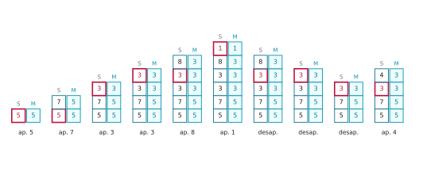
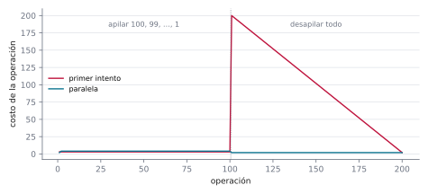
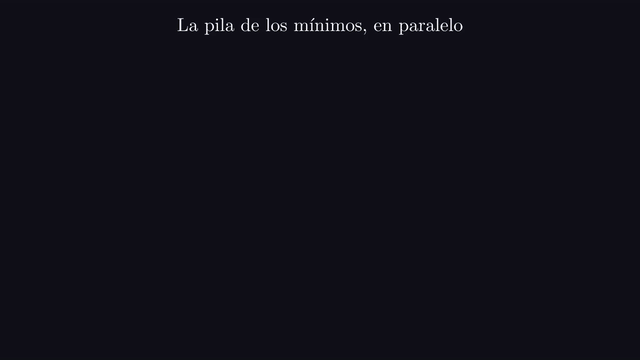
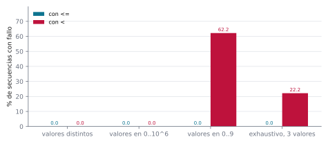
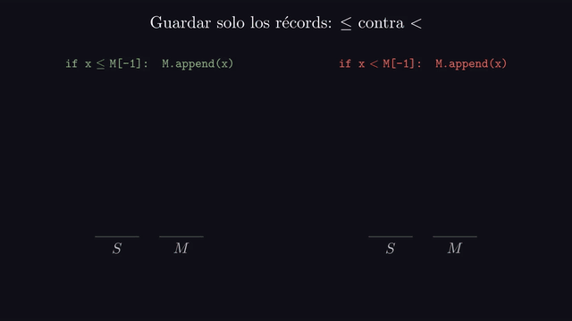

# Ejercicio 3 ★ · Una pila con mínimo en $O(1)$ en el peor caso

> Una pila con una operación `minimo` que cuesta $O(1)$ en el peor caso. Diseña la
> estructura, enuncia el invariante que la hace correcta y da el costo de cada
> operación.

Agregarle un mínimo a una pila parece pedir una idea nueva, y no la pide: basta darse
cuenta de que los mínimos se recuperan en el orden inverso al que se producen, que es
exactamente el orden de una pila. Vamos a ver por qué el primer intento falla, cuál es
el invariante que hace correcta la estructura buena (y por qué el que uno escribe
primero no alcanza), cuánto cuesta, y qué pasa cuando se intenta ahorrar memoria.

Todos los números de este documento los imprime [`ejercicio-03.py`](ejercicio-03.py),
que además corre las pruebas y regenera las tres figuras. Solo necesita matplotlib:

```bash
python ejercicio-03.py
```

## 1. El problema

**Pila con mínimo.** Una pila con cinco operaciones sobre elementos de un orden total:
`push(x)`, `pop()` (que devuelve el elemento sacado), `top()`, `min()` y
`empty()`. Para medir, el script cuenta una unidad por cada celda que se lee o se
escribe y una por cada comparación.

Tres precisiones que un enunciado tiene que dar, y que casi nunca se dan:

- **Peor caso, no amortizado.** Se pide que **cada** operación cueste $O(1)$: no en
  promedio, ni repartido sobre una secuencia, sino cada llamada por separado.
- **La pila vacía.** `pop`, `top` y `min` exigen que la pila no esté vacía.
  Es una precondición, no un caso que la estructura tenga que resolver.
- **Valores repetidos.** El mínimo puede aparecer varias veces. Parece un detalle, y
  la sección 7 muestra que es exactamente donde se rompe la versión que ahorra memoria.

## 2. Un ejemplo chico antes de la prueba

Diez operaciones sobre las dos versiones de la estructura que aparecen en este
documento. Las dos guardan los elementos en una pila común $S$ y, al lado, una segunda
pila $M$ con mínimos. En la versión **paralela** (sección 4), $M$ tiene una celda por
cada elemento de $S$, y la de altura $i$ es el mínimo de $S$ hasta esa altura. En la
**compacta** (sección 6), $M$ guarda solo algunos de esos valores. Cada pila se lee de
abajo hacia arriba, de izquierda a derecha, y la última columna es lo que contesta
`min()` después de cada operación:

```
   operación  S                M paralela       M compacta   min
      push 5  5                5                5            5
      push 7  5 7              5 5              5            5
      push 3  5 7 3            5 5 3            5 3          3
      push 3  5 7 3 3          5 5 3 3          5 3 3        3
      push 8  5 7 3 3 8        5 5 3 3 3        5 3 3        3
      push 1  5 7 3 3 8 1      5 5 3 3 3 1      5 3 3 1      1
         pop  5 7 3 3 8        5 5 3 3 3        5 3 3        3
         pop  5 7 3 3          5 5 3 3          5 3 3        3
         pop  5 7 3            5 5 3            5 3          3
      push 4  5 7 3 4          5 5 3 3          5 3          3
```



*Figura 1. La pila paralela después de cada una de las diez operaciones. A la izquierda
$S$, a la derecha $M$. En rojo, el elemento de $S$ que es el mínimo actual. Cada celda
de $M$ es el mínimo de la columna de $S$ hasta su altura.*

Fíjate en el primer `pop`. Sale el 1, y el mínimo vuelve a ser 3. ¿De dónde sale ese 3?
Es el mínimo que había **antes** del `push` del 1, y la pila $M$ lo tiene guardado justo
debajo. Esa es la información que hace falta recordar, y la que el primer intento de la
sección siguiente pierde.

## 3. Cómo se le ocurre a uno

**El primer intento** guarda el mínimo en una sola variable $m$. `push` es fácil: si
$x < m$, el mínimo pasa a ser $x$. `pop` no: si el elemento que sale es justo $m$,
el mínimo anterior se perdió, y la única manera de recuperarlo es recorrer toda la
pila. Eso cuesta $\Theta(n)$, y hay secuencias que lo pagan en cada operación: `push` de
$n, n-1, \dots, 1$ y después `pop` hasta vaciarla. Cada `pop` saca el mínimo actual.

```
     n       estructura  costo total  peor operación  costo / operación
    10   primer intento          140              20                7.0
    10         paralela           58               4                2.9
   100   primer intento       10 400             200               52.0
   100         paralela          598               4                3.0
  1000   primer intento    1 004 000            2000              502.0
  1000         paralela        5 998               4                3.0
```



*Figura 2. El costo de cada operación al hacer `push` de 100, 99, …, 1 y después `pop`
hasta vaciarla. El primer intento paga un recorrido de la pila en cada `pop`, y el total
crece como $n^2$. La pila paralela no pasa de 4 en ninguna operación.*

La observación que arregla el problema está en el ejemplo chico: el mínimo después de un
`pop` es el mínimo que había antes del `push` correspondiente. Los mínimos se
recuperan en el orden inverso al que se fueron produciendo, último en entrar, primero
en salir. Es decir, **los mínimos también forman una pila**, y basta con guardarlos en
una.

## 4. La estructura y su invariante

```python
class MinStack:
    def __init__(self):
        self.S, self.M = [], []

    def push(self, x):
        self.S.append(x)
        self.M.append(x if not self.M or x < self.M[-1] else self.M[-1])

    def pop(self):
        self.M.pop()
        return self.S.pop()

    def top(self):
        return self.S[-1]

    def min(self):
        return self.M[-1]
```

La versión del script es la misma, más la cuenta de costos.

**El invariante que uno escribe primero** es "el tope de $M$ es el mínimo de $S$". Es
verdadero, pero no es inductivo. Después de un `pop`, el tope nuevo de $M$ es lo
que estaba debajo, y la afirmación anterior no dice nada de eso. Hay que reforzarlo, y
afirmarlo para todos los prefijos de la pila:

**Invariante (P).** $|M| = |S|$, y $M[i] = \min(S[0], \dots, S[i])$ para todo
$0 \le i < |S|$.

Es un invariante de la estructura y no de un ciclo, así que los tres pasos se leen así:
lo establece el constructor, lo conserva cada operación que modifica la estructura, y
cada consulta lo usa para contestar.

**Teorema.** (P) vale después de toda secuencia válida de operaciones, y `min()`
devuelve el mínimo de la pila.

*Demostración.* *Inicialización.* El constructor deja $S$ y $M$ vacías: $|M| = |S| = 0$,
y no hay ningún $i$ del que afirmar algo.

*Mantenimiento.* Las dos operaciones que modifican la estructura son `push` y
`pop`; `top` y `min` no tocan nada. En `push(x)`, si $S$ estaba vacía, se
mete $x$ en las dos, y $M[0] = x = \min(S[0])$. Si no, por (P) aplicado a la última
posición, $M[-1] = \min(S)$, así que lo que entra en $M$ es $\min(x, \min(S))$, que es
el mínimo de la pila nueva. Las posiciones viejas no cambian, ni sus prefijos, y las dos
pilas crecen en uno. En `pop()` se saca el tope de las dos; las posiciones que
quedan no cambiaron, ni sus prefijos, así que (P) sigue valiendo para ellas, y las dos
pilas bajan en uno.

*Conclusión.* `min()` devuelve $M[|S| - 1]$, que por (P) es
$\min(S[0], \dots, S[|S|-1])$, el mínimo de toda la pila. `pop` y `top` contestan
sobre $S$, que es una pila común. $\square$



*Animación 1. Las diez operaciones de la sección 2. Cada celda de $M$ es el mínimo del
prefijo de $S$ hasta su altura; al hacer `pop`, el mínimo de antes estaba guardado justo
debajo. En mejor calidad: [MP4](animaciones/ejercicio-03-paralela.mp4).*

El paso que todo el mundo se salta está en `push`: usa (P) para la última posición,
$M[-1] = \min(S)$, que es lo que hace correcta la posición nueva. Y `pop` necesita
que (P) valga para la penúltima, que es la que queda arriba. Por eso el invariante tiene
que hablar de todas las posiciones y no solo del tope.

Antes de escribir esto conviene vigilar (P) con `assert` después de cada operación,
sobre secuencias al azar con valores repetidos:

```
3 000 secuencias, 91 018 operaciones, el invariante se cumple después de cada una
```

## 5. El costo

**Lema.** Cada operación de la pila paralela hace a lo sumo 4 pasos, sea cual sea el
tamaño de la pila. La memoria es de $2n$ celdas para $n$ elementos.

*Demostración.* Ninguna operación tiene ciclos. `push(x)` lee el tope de $M$, compara,
y escribe en $S$ y en $M$: 4 pasos. `pop()` saca el tope de $M$ y el de $S$: 2.
`top()` lee el tope de $S$ y `min()` el de $M$: 1 cada una. Cada elemento ocupa una
celda en $S$ y otra en $M$. $\square$

| operación | qué hace | costo |
|---|---|---|
| `push(x)` | lee el tope de $M$, compara, escribe en $S$ y en $M$ | 4 |
| `pop()` | saca el tope de $M$ y el de $S$ | 2 |
| `top()` | lee el tope de $S$ | 1 |
| `min()` | lee el tope de $M$ | 1 |

Ninguna depende del tamaño de la pila: las cuatro son $O(1)$ en el peor caso, cada
llamada por separado. El script mide el costo máximo de cada operación sobre 200 000
operaciones al azar, para las tres versiones de este documento: la paralela, la compacta
de la sección 6 y la **codificada** de la sección 8, que no usa $M$:

```
    estructura    push        pop   top     min
      paralela       4          2     1       1
      compacta       4          4     1       1
    codificada       3          3     2       1
```

La memoria es $n$ celdas más que una pila común. Las secciones 6 y 8 bajan ese extra.

## 6. Ahorrar memoria: guardar solo los récords

En el ejemplo chico, la columna de $M$ paralela repite mucho: `5 5 3 3 3`. Solo hace
falta guardar un valor cuando el mínimo cambia o se repite. Llamemos **récord** a un
elemento $S[i]$ que es menor o igual que todos los que tiene debajo. La versión compacta
guarda en $M$ solo los récords:

```python
def push(self, x):
    self.S.append(x)
    if not self.M or x <= self.M[-1]:
        self.M.append(x)

def pop(self):
    x = self.S.pop()
    if x == self.M[-1]:
        self.M.pop()
    return x
```

**Invariante (R).** $M$ es la sucesión de los récords de $S$, en el orden en que están
en $S$.

**Lema.** La versión compacta conserva (R), y con (R) el tope de $M$ es el mínimo de
$S$.

*Demostración.* *El tope es el mínimo.* La última aparición del mínimo de $S$ es un
récord, porque es menor o igual que todo lo de debajo. Y nada de lo que está por encima
de ella es récord: ya no es el mínimo, así que es mayor que esa aparición, que tiene
debajo.

*Mantenimiento.* Que un elemento sea récord depende solo de lo que tiene debajo, así que
un `push` o un `pop` no cambia la condición de los demás. En `push(x)`, $x$ es récord si
y solo si $x \le \min(S)$, que por (R) es el tope de $M$: es exactamente la condición
del `if`. En `pop()`, el elemento $y$ que sale es récord si y solo si es menor o
igual que todo lo de debajo, es decir, si y solo si $y = \min(S)$, que por (R) es el
tope de $M$. Y si es récord, es el último, así que sacar el tope de $M$ lo saca a él.
$\square$

El costo sigue siendo constante, como mostró la tabla de la sección 5. Lo que cambia es
la memoria, y aquí el peor caso y el caso típico se separan mucho. La tabla cuenta
cuántos valores guarda $M$ después de hacer `push` de $n$ elementos en orden
decreciente, en una permutación al azar (promedio de muchas) y con valores al azar en
$0..9$; la columna $H_n$ es lo que predice el lema que sigue:

```
     n  decreciente  permutación al azar    H_n  valores en 0..9
    10           10                 2.92   2.93              3.4
   100          100                 5.18   5.19             12.6
  1000         1000                 7.52   7.49            102.9
 10000        10000                 9.68   9.79           1003.1
```

**Lema.** Si se hace `push` de una permutación uniforme de $n$ elementos distintos, el
número esperado de récords es $H_n = 1 + 1/2 + \dots + 1/n \approx \ln n$.

*Demostración.* El elemento de la posición $i$ es récord si y solo si es el menor de
los $i$ primeros. En una permutación uniforme cada uno de esos $i$ tiene la misma
probabilidad de ser el menor, $1/i$. Sumando sobre las posiciones, por linealidad de la
esperanza, el número esperado de récords es $H_n$. $\square$

Con una sucesión decreciente, en cambio, todo es récord, y $M$ guarda $n$ valores,
igual que la versión paralela. Con valores en $0..9$, cada 0 que llega después del
primero es récord, y se guarda alrededor de un décimo de los elementos. El caso típico
ahorra mucho, pero la garantía es la del peor caso: $n$ celdas extra.

## 7. El error que el invariante anuncia

La definición de récord dice **menor o igual**. Es tentador escribir `x < self.M[-1]`
en `push`, que parece guardar todavía menos. Comparemos las dos versiones contra el
oráculo, que es una lista común y la función `min`, con cuatro baterías de pruebas. Cada
secuencia consulta el mínimo después de cada operación, y cuenta como fallo si alguna
consulta da un valor equivocado o encuentra $M$ vacía con $S$ no vacía.

```
               batería  secuencias   con <=    con <
     valores distintos       4 000     0.0%     0.0%
    valores en 0..10^6       4 000     0.0%     0.0%
       valores en 0..9       4 000     0.0%    62.2%
 exhaustivo, 3 valores       3 750     0.0%    22.2%
```



*Figura 3. Porcentaje de secuencias en que cada versión de la pila compacta falla,
según cómo se eligen los valores. La última batería son todas las secuencias válidas de
hasta seis operaciones con valores 0, 1 y 2.*

Las dos primeras baterías no encuentran nada. La primera no puede: sin valores
repetidos, "menor" y "menor o igual" son lo mismo. La segunda tiene repetidos en teoría,
pero con treinta operaciones sobre un millón de valores casi nunca aparece uno. La
secuencia más corta que rompe la versión con $<$ tiene tres operaciones:

```
la secuencia más corta que rompe la versión con <: push 0, push 0, pop
```

El segundo 0 no entra en $M$, porque no es menor que el primero. Pero `pop`
compara por valor: el 0 que sale es igual al tope de $M$, y se lleva de $M$ el primer
0. Queda $S$ con un 0 y $M$ vacía.



*Animación 2. La versión compacta con $\le$ y con $<$, lado a lado, sobre la secuencia
más corta que rompe la de $<$. En mejor calidad:
[MP4](animaciones/ejercicio-03-repetidos.mp4).*

**Lema.** En la versión con $<$, `pop` rompe el invariante exactamente cuando el
elemento que sale es igual al mínimo y queda otra copia del mínimo debajo.

*Demostración.* Con $<$, $M$ guarda los récords estrictos: los elementos menores que
todo lo de debajo, y su tope sigue siendo el mínimo de $S$. Sea $y$ el elemento que
sale. Si $y$ no es el mínimo, no es récord y el código no toca $M$. Si $y$ es el mínimo
y es su única copia, es récord estricto, es el tope de $M$ y el código lo saca. Si $y$
es el mínimo y hay otra copia debajo, $y$ no es récord estricto y no está en $M$, pero
es igual al tope de $M$ y el código saca ese tope, que pertenece a la otra copia.
$\square$

El script lo confirma en todos los fallos de la batería exhaustiva:

```
en el exhaustivo, 831 de 831 fallos ocurren al hacer pop del mínimo cuando quedaba otra copia de él debajo
```

¿Quién avisa de que hay que probar con repetidos? El mantenimiento de (R) en
`pop`. Ese paso usa que "el elemento que sale es récord si y solo si es igual al
tope de $M$", y con récords estrictos esa equivalencia es falsa exactamente en el caso
que dice el lema.

## 8. ¿Y con memoria extra $O(1)$?

Si los elementos son enteros y se puede hacer aritmética con ellos, alcanza una sola
variable $m$ con el mínimo actual. El truco es guardar en la celda de un récord un
número que delate que es récord y que permita recuperar el mínimo anterior.

```python
def push(self, x):
    if not self.S:
        self.S.append(x)
        self.m = x
    elif x >= self.m:
        self.S.append(x)
    else:                                  # récord: guardar 2x - m
        self.S.append(2 * x - self.m)
        self.m = x

def pop(self):
    c = self.S.pop()
    if c < self.m:                         # era un récord: el valor real es m
        x, self.m = self.m, 2 * self.m - c
        return x
    return c
```

Sean $v_0, \dots, v_{k-1}$ los valores de la pila, de abajo hacia arriba, y
$m_i = \min(v_0, \dots, v_i)$. La celda $i$ guarda $c_i = 2v_i - m_{i-1}$ si $i \ge 1$ y
$v_i < m_{i-1}$ (un récord estricto), y $c_i = v_i$ en otro caso.

**Lema.** $c_i < m_i$ si y solo si la celda $i$ es un récord estricto. En consecuencia
la versión codificada es correcta, y si los valores están en $[-V, V]$, las celdas
guardan números en $[-3V, V]$.

*Demostración.* Si es récord, $m_i = v_i$ y $c_i = v_i - (m_{i-1} - v_i) < v_i = m_i$.
Si no, $c_i = v_i \ge m_i$. Así que al hacer `pop` de la celda de arriba, con
$m = m_{k-1}$: si $c < m$, era un récord, su valor real es $m$, y el mínimo anterior es
$m_{k-2} = 2m - c$; si no, el valor real es $c$ y el mínimo no cambia. `top` hace la
misma cuenta sin sacar nada. Por último, un récord guarda $2x - m$ con $x \ge -V$ y
$m \le V$, que es al menos $-3V$. $\square$

El truco sale del modelo de comparaciones: usa restas y multiplicaciones sobre los
valores. Y las celdas tienen que ser más anchas que los valores:

```
90 976 operaciones con valores en [-1000, 1000], todas correctas
lo que se guarda en las celdas va de -2964 a 1000; la cota es [-3V, V] = [-3000, 1000]
```

Antes de dibujar, el script se comprueba a sí mismo: las cuatro estructuras contra una
lista común en 4 000 secuencias de hasta 80 operaciones, el invariante (R) de la
compacta contra la sucesión de récords calculada por fuerza bruta en 3 000 secuencias,
el costo constante de cada operación, y la versión con $\le$ en todas las secuencias
del exhaustivo:

```
857 843 comprobaciones, 0 fallos
```

La regla práctica que te llevas: **un invariante que solo habla del tope de una
estructura casi nunca es inductivo.** La operación que saca algo necesita saber qué
queda debajo, y el invariante tiene que decirlo.

## 9. Resumen

- La pila con mínimo son dos pilas paralelas: $S$ con los elementos y $M$ con los
  mínimos de cada prefijo. Funciona porque los mínimos se recuperan en orden inverso, y
  eso es una pila.
- El invariante es $M[i] = \min(S[0..i])$ para **todo** $i$. Decirlo solo del tope es
  verdadero, pero no es inductivo: `pop` necesita saber qué hay en la penúltima
  posición.
- Cada operación cuesta a lo sumo 4 pasos en el peor caso, sin amortizar. El primer
  intento, con una sola variable, paga $\Theta(n)$ por `pop` y $\Theta(n^2)$ en
  total en la secuencia decreciente.
- Guardando solo los récords, la memoria extra es $H_n \approx \ln n$ en promedio con
  datos al azar, pero sigue siendo $n$ en el peor caso.
- Los récords tienen que ser con $\le$. Con $<$, la estructura falla en el 62,2 % de
  las secuencias con valores en $0..9$ y en ninguna con valores distintos. El paso de
  `pop` en la demostración es el que dice que hay que probar con repetidos.
- Con enteros y aritmética, una sola variable alcanza: un récord guarda $2x - m$. El
  precio es salir del modelo de comparaciones y celdas que aguanten el triple del rango.

<details>
<summary>Salida completa de <code>python ejercicio-03.py</code></summary>

```
§2. Ejemplo chico: la pila paralela y la compacta, paso a paso
--------------------------------------------------------------
   operación  S                M paralela       M compacta   min
      push 5  5                5                5            5
      push 7  5 7              5 5              5            5
      push 3  5 7 3            5 5 3            5 3          3
      push 3  5 7 3 3          5 5 3 3          5 3 3        3
      push 8  5 7 3 3 8        5 5 3 3 3        5 3 3        3
      push 1  5 7 3 3 8 1      5 5 3 3 3 1      5 3 3 1      1
         pop  5 7 3 3 8        5 5 3 3 3        5 3 3        3
         pop  5 7 3 3          5 5 3 3          5 3 3        3
         pop  5 7 3            5 5 3            5 3          3
      push 4  5 7 3 4          5 5 3 3          5 3          3

§4. El invariante de la pila paralela, vigilado con assert
----------------------------------------------------------
3 000 secuencias, 91 018 operaciones, el invariante se cumple después de cada una

§3 y §5. Costo por operación: el primer intento contra la pila paralela
-----------------------------------------------------------------------
     n       estructura  costo total  peor operación  costo / operación
    10   primer intento          140              20                7.0
    10         paralela           58               4                2.9
   100   primer intento       10 400             200               52.0
   100         paralela          598               4                3.0
  1000   primer intento    1 004 000            2000              502.0
  1000         paralela        5 998               4                3.0

§5. Costo máximo de cada operación sobre 200 000 operaciones al azar
--------------------------------------------------------------------
    estructura    push        pop   top     min
      paralela       4          2     1       1
      compacta       4          4     1       1
    codificada       3          3     2       1

§6. Cuántos récords guarda la pila compacta después de n push
-------------------------------------------------------------
     n  decreciente  permutación al azar    H_n  valores en 0..9
    10           10                 2.92   2.93              3.4
   100          100                 5.18   5.19             12.6
  1000         1000                 7.52   7.49            102.9
 10000        10000                 9.68   9.79           1003.1

§7. La pila compacta con < en vez de <=, contra cuatro baterías
---------------------------------------------------------------
               batería  secuencias   con <=    con <
     valores distintos       4 000     0.0%     0.0%
    valores en 0..10^6       4 000     0.0%     0.0%
       valores en 0..9       4 000     0.0%    62.2%
 exhaustivo, 3 valores       3 750     0.0%    22.2%
la secuencia más corta que rompe la versión con <: push 0, push 0, pop
en el exhaustivo, 831 de 831 fallos ocurren al hacer pop del mínimo cuando quedaba otra copia de él debajo

§8. La versión con memoria extra O(1), sobre enteros
----------------------------------------------------
90 976 operaciones con valores en [-1000, 1000], todas correctas
lo que se guarda en las celdas va de -2964 a 1000; la cota es [-3V, V] = [-3000, 1000]

Pruebas
-------
857 843 comprobaciones, 0 fallos

figuras: ejercicio-03-traza.svg, ejercicio-03-costos.svg, ejercicio-03-errores.svg
```

</details>

