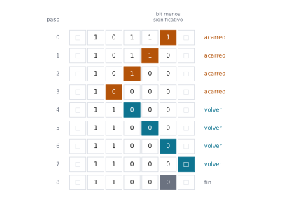
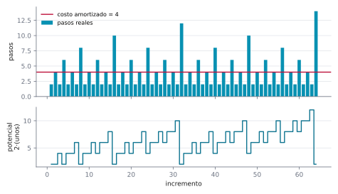
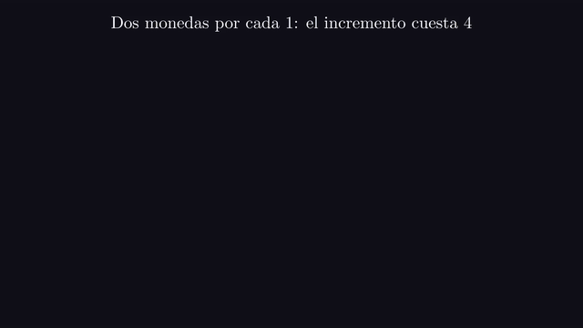
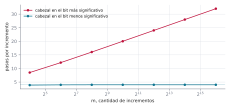
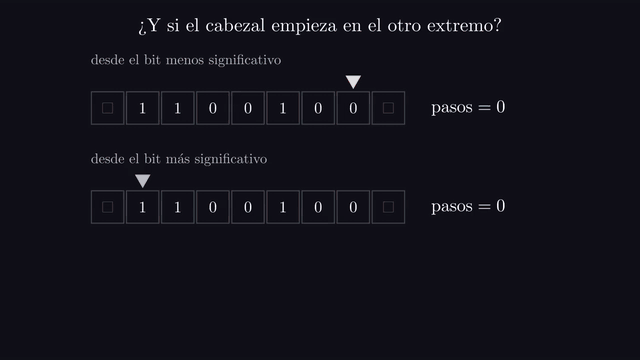

# Ejercicio 4 ★★ · El contador binario en una máquina de Turing

> Una máquina de Turing de una cinta suma 1 a un número escrito en binario, con el
> cabezal empezando en el bit menos significativo y volviendo a él al terminar.
> Demuestra con un potencial que $m$ incrementos desde 0 cuestan $O(m)$ pasos en total,
> aunque uno solo pueda costar $\Theta(\log m)$.

En la RAM, el contador binario es el ejemplo de manual del análisis amortizado, y el
potencial "cantidad de unos" lo resuelve en una línea. En una máquina de Turing el
cabezal se mueve y tiene que volver, y esa vuelta cambia la cuenta: el potencial de
manual deja de alcanzar. Vamos a construir la máquina, contar exactamente cuánto cuesta
un incremento, ver por qué falla el primer potencial y cuál funciona, y comprobar que la
hipótesis sobre dónde empieza el cabezal no es un detalle.

Todos los números de este documento los imprime [`ejercicio-04.py`](ejercicio-04.py),
que simula la máquina transición por transición, corre las pruebas y regenera las tres
figuras. Solo necesita matplotlib:

```bash
python ejercicio-04.py
```

## 1. La máquina

El número se escribe en la cinta con el bit más significativo a la izquierda y el menos
significativo en la posición 0. La celda de la derecha del bit menos significativo
queda en blanco (□). La cinta empieza con un solo 0, y el cabezal está sobre él.

Tres precisiones que un enunciado tiene que dar, y que casi nunca se dan:

- **Dónde está el cabezal.** Empieza y termina en el bit menos significativo. La
  sección 6 muestra que, si empezara en el otro extremo, el total cambiaría de orden.
- **Qué es un paso.** Una transición: leer un símbolo, escribir uno, moverse una celda.
- **Desde dónde se cuenta.** Los $m$ incrementos empiezan con la cinta en 0, así que el
  potencial de la sección 5 empieza en 0.

La máquina tiene dos estados de trabajo, `carry`, que propaga el acarreo hacia la
izquierda, y `back`, que vuelve al bit menos significativo, y uno final, `halt`:

| estado | lee | escribe | se mueve | pasa a | qué significa |
|---|---|---|---|---|---|
| `carry` | 1 | 0 | izquierda | `carry` | $1 + 1 = 10$: el acarreo sigue |
| `carry` | 0 | 1 | derecha | `back` | $0 + 1 = 1$: se acabó la suma |
| `carry` | □ | 1 | derecha | `back` | el número crece un bit |
| `back` | 0 | 0 | derecha | `back` | camino de vuelta |
| `back` | □ | □ | izquierda | `halt` | el blanco de la derecha: un paso atrás |

Dos detalles de diseño. Primero, la máquina no puede contar cuánto se alejó, porque
tiene una cantidad finita de estados y el acarreo puede recorrer cualquier distancia. El
blanco de la derecha es lo que le marca el camino de vuelta. Segundo, el estado
`back` nunca lee un 1: el acarreo convirtió en 0 todo lo que la vuelta recorre. Por
eso la tabla tiene cinco transiciones y no seis, y las pruebas comprueban que las cinco
se usan.

## 2. Un ejemplo chico antes de la prueba

Los diez primeros incrementos desde 0. La columna $t$ es la cantidad de unos con que
termina el número antes de sumar, y "pasos" es lo que cuesta el incremento. Las dos
últimas columnas son el costo amortizado, que es el costo real más lo que cambia un
potencial, con los dos potenciales de las secciones 4 y 5: la cantidad de unos de la
cinta, y el doble de esa cantidad.

```
   de     a  t  pasos  unos antes  unos después  amort. con unos  amort. con 2·unos
    0     1  0      2           0             1                3                  4
    1    10  1      4           1             1                4                  4
   10    11  0      2           1             2                3                  4
   11   100  2      6           2             1                5                  4
  100   101  0      2           1             2                3                  4
  101   110  1      4           2             2                4                  4
  110   111  0      2           2             3                3                  4
  111  1000  3      8           3             1                6                  4
 1000  1001  0      2           1             2                3                  4
 1001  1010  1      4           2             2                4                  4
```

Fíjate en la columna de pasos: $2, 4, 2, 6, 2, 4, 2, 8, \dots$, y siempre vale $2t + 2$.
La mitad de los incrementos caen sobre un número par, que termina en 0, y cuestan 2. Uno
de cada cuatro cuesta 4, uno de cada ocho cuesta 6. Los caros son raros, y esa rareza es
lo que el potencial va a contabilizar.

## 3. Un incremento caro, paso a paso

Sumarle 1 a 10111 (el 23) es caro: termina en tres unos. Cada fila es un paso: su
número, el estado y la cinta, con la celda del cabezal entre corchetes.

```
 0    carry   □   1   0   1   1  [1]  □ 
 1    carry   □   1   0   1  [1]  0   □ 
 2    carry   □   1   0  [1]  0   0   □ 
 3    carry   □   1  [0]  0   0   0   □ 
 4     back   □   1   1  [0]  0   0   □ 
 5     back   □   1   1   0  [0]  0   □ 
 6     back   □   1   1   0   0  [0]  □ 
 7     back   □   1   1   0   0   0  [□]
 8     halt   □   1   1   0   0  [0]  □ 
8 pasos = 2·3 + 2, y el cabezal termina en la posición 0
```



*Figura 1. El incremento de 10111 a 11000, con el tiempo hacia abajo. Cada fila es la
cinta antes de un paso, y la celda coloreada es la del cabezal: naranja mientras
propaga el acarreo, azul mientras vuelve. El cabezal recorre dos veces los tres unos
finales: a la ida los convierte en ceros, y a la vuelta pasa por encima.*

**Lema.** Un incremento sobre un número que termina en $t$ unos cuesta exactamente
$2t + 2$ pasos y deja el cabezal en la posición 0. Entre los incrementos sobre
$0, \dots, m - 1$, el más caro cuesta $2\lfloor \log_2 m \rfloor + 2$, que es
$\Theta(\log m)$.

*Demostración.* La tabla de transiciones da el costo exacto. `carry` lee los $t$ unos
finales, cada uno en un paso, y los convierte en 0. Un paso más escribe el 1, sobre el
primer 0 o sobre el blanco de la izquierda, y se mueve a la derecha. `back` recorre
los $t$ ceros que dejó el acarreo, un paso cada uno. Un último paso lee el blanco de la
derecha y retrocede al bit menos significativo. En total, $(t + 1) + (t + 1) = 2t + 2$.
Entre $0, \dots, m - 1$, el que más unos finales tiene es el mayor de la forma
$2^j - 1$, con $j = \lfloor \log_2 m \rfloor$. $\square$

El script lo comprueba en cada incremento:

```
en los 65 536 incrementos de 0 a 65 536, cada uno costó exactamente 2t + 2 pasos
```

Multiplicar ese peor caso por $m$ solo da $O(m \log m)$ para el total. El potencial es
lo que baja la cuenta a $O(m)$.

## 4. El potencial que uno escribe primero

La deuda que deja pendiente un contador son sus unos: cada uno va a ser borrado por
algún acarreo futuro, y borrarlo cuesta. La primera idea es entonces $\Phi_1$, la
cantidad de unos en la cinta. Un incremento sobre un número con $t$ unos finales borra
$t$ unos y escribe uno, así que $\Delta \Phi_1 = 1 - t$, y el costo amortizado es

$$\hat c = (2t + 2) + (1 - t) = t + 3.$$

No es constante: es la columna "amort. con unos" de la tabla de la sección 2, que vale
3, 4, 3, 5, 3, 4, 3, 6. El potencial paga un paso por cada uno que se borra, pero cada
uno borrado cuesta **dos** pasos, uno a la ida y otro a la vuelta. Esa vuelta es el paso
que todo el mundo se salta cuando copia el argumento del contador en la RAM, donde un
incremento cuesta $t + 1$ cambios de bit y no hay que volver a ningún lado.

## 5. El potencial que funciona

Duplicamos la deuda:

$$\Phi = 2 \cdot (\text{cantidad de unos en la cinta}).$$

**Teorema.** Con $\Phi = 2 \cdot (\text{unos})$, cada incremento tiene costo amortizado
exactamente 4, y $m$ incrementos desde 0 cuestan exactamente
$4m - 2 \cdot (\text{unos de } m)$ pasos, que es menos que $4m$.

*Demostración.* Un incremento sobre un número con $t$ unos finales tiene costo real
$2t + 2$, por el lema de la sección 3, y $\Delta\Phi = 2(1 - t)$, así que su costo
amortizado es $\hat c = (2t + 2) + 2(1 - t) = 4$. Sumando los $m$ incrementos, los
potenciales se telescopian:

$$\sum_{i=1}^{m} c_i = \sum_{i=1}^{m} \hat c_i - (\Phi_m - \Phi_0) = 4m - \Phi_m .$$

Para que esto acote el total hacen falta las dos condiciones de siempre, y las dos se
cumplen: $\Phi_0 = 0$, porque la cinta empieza con un solo 0, y $\Phi_m \ge 0$, porque
cuenta unos. Y la cuenta es exacta, no solo una cota: después de $m$ incrementos la
cinta tiene escrito $m$, así que $\Phi_m = 2 \cdot (\text{unos de } m)$. $\square$

El script lo vigila con `assert` en cada incremento y lo compara con el total medido:

```
costo amortizado = 4 en los 65 536 incrementos; el potencial empieza en 0 y nunca es negativo
```

```
       m  total medido  4m - 2·unos(m)  total / m  incremento más caro  2·floor(log2 m) + 2
      10            36              36     3.6000                    8                    8
     100           394             394     3.9400                   14                   14
   1 000         3 988           3 988     3.9880                   20                   20
  10 000        39 990          39 990     3.9990                   28                   28
  65 536       262 142         262 142     4.0000                   34                   34
 100 000       399 988         399 988     3.9999                   34                   34
la fórmula 4m - 2·unos(m) se cumple para todo m de 1 a 100 000
```

La columna "incremento más caro" crece como $2\log_2 m$, y la columna "total / m" se
queda en 4. Las dos cosas son ciertas a la vez, que es lo que pedía el enunciado: una
operación suelta puede costar $\Theta(\log m)$, y la secuencia entera cuesta $O(m)$.



*Figura 2. Arriba, los pasos reales de cada uno de los primeros 64 incrementos y el
costo amortizado, que vale 4 en todos. Abajo, el potencial $2 \cdot$(unos). Sube 2 en
cada incremento barato y cae en los caros justo lo que estos cuestan de más.*

**La misma cuenta, con monedas.** El potencial dice lo mismo que esta contabilidad: cada
1 de la cinta lleva pegadas dos monedas. Un incremento cobra 4: gasta 2 en el paso que
escribe el 1 y en el paso final que retrocede, y deja las otras 2 pegadas al 1 nuevo.
Cuando un acarreo borra un 1, sus dos monedas pagan el paso de ida que lo convierte en
0 y el paso de vuelta que pasa por encima. Ninguna cuenta queda en rojo, porque cada 1
que se borra trae sus monedas.



*Animación 1. El incremento de 10111, pagado con monedas: cada 1 lleva dos, una paga la
ida del acarreo y otra la vuelta. El incremento trae 4, gasta 2 y deja 2 pegadas al 1
nuevo. En mejor calidad: [MP4](animaciones/ejercicio-04-monedas.mp4).*

## 6. ¿Y si el cabezal empieza en el bit más significativo?

El enunciado pone el cabezal en el bit menos significativo. Parece un detalle de
comodidad, pero el teorema de la sección 5 lo usa: el costo real $2t + 2$ solo cuenta
los unos finales, porque el cabezal ya está donde empieza la suma. Si empieza en el bit
más significativo, la máquina tiene que caminar hasta el final del número, sumar y
volver al principio, y esa caminata no la paga ningún uno.

```
       m  total, desde el menos signif.  total, desde el más signif.  por incremento  2·log2 m
      16                             62                          136            8.50       8.0
      64                            254                          778           12.16      12.0
     256                          1 022                        4 108           16.05      16.0
   1 024                          4 094                       20 494           20.01      20.0
   4 096                         16 382                       98 320           24.00      24.0
  16 384                         65 534                      458 770           28.00      28.0
  65 536                        262 142                    2 097 172           32.00      32.0
```

**Teorema.** Si el cabezal empieza en el bit más significativo, $m$ incrementos desde 0
cuestan al menos $\lfloor m/2 \rfloor (\log_2 m - 1)$ pasos. Así que ningún potencial
que empiece en 0 y no se vuelva negativo da costo amortizado constante.

*Demostración.* Cada incremento tiene que llegar al bit menos significativo, así que
cuesta al menos la cantidad de bits del número. Los $\lfloor m/2 \rfloor$ incrementos
que empiezan en un valor $v \ge m/2$ actúan sobre números de al menos $\log_2 m - 1$
bits, así que entre todos cuestan al menos $\lfloor m/2 \rfloor (\log_2 m - 1)$ pasos.
Si hubiera un potencial que empezara en 0, no se volviera negativo y diera costo
amortizado constante $c$, el total sería a lo sumo $c\,m$, contra la cota. $\square$



*Figura 3. Pasos por incremento, en promedio sobre los $m$ primeros, según dónde empieza
el cabezal. Desde el bit menos significativo se queda en 4. Desde el más significativo
crece como $2 \log_2 m$, una recta en el eje logarítmico.*



*Animación 2. El mismo tipo de incremento con el cabezal en cada extremo del número, y
el promedio de pasos por incremento de las dos máquinas. En mejor calidad:
[MP4](animaciones/ejercicio-04-cabezal.mp4).*

Antes de dibujar, el script se comprueba a sí mismo. Después de cada uno de los 65 536
primeros incrementos, la cinta tiene escrito el número en binario, el cabezal está en
la posición 0 y la celda de la derecha sigue en blanco. En 1024 incrementos, todo par
(estado, símbolo) que aparece tiene transición, y se usan las cinco. Cada incremento
cuesta $2t + 2$, su costo amortizado es 4 y el total acumulado es
$4m - 2 \cdot$(unos de $m$). Y la variante desde el bit más significativo suma bien
durante 16 384 incrementos:

```
294 913 comprobaciones, 0 fallos
```

La regla práctica que te llevas: **un potencial paga lo que la operación hace de más, y
para saber cuánto hay que contar todos los pasos del modelo, incluidos los que no
cambian nada.** En la RAM, borrar un uno cuesta un paso; en la cinta cuesta dos, porque
el cabezal tiene que volver, y el potencial tiene que pagar los dos.

## 7. Resumen

- La máquina suma 1 con cinco transiciones: el acarreo va hacia la izquierda
  convirtiendo unos en ceros, escribe un 1, y vuelve hasta el blanco que marca el final
  del número.
- Un incremento sobre un número que termina en $t$ unos cuesta $2t + 2$ pasos. El más
  caro de los $m$ primeros cuesta $2\lfloor \log_2 m \rfloor + 2 = \Theta(\log m)$.
- El potencial "cantidad de unos" da costo amortizado $t + 3$, que no es constante: no
  paga la vuelta del cabezal.
- El potencial $2 \cdot$(cantidad de unos) da costo amortizado exactamente 4. Empieza en
  0 y no es negativo, así que $m$ incrementos cuestan a lo sumo $4m$ pasos, y de hecho
  exactamente $4m - 2 \cdot$(unos de $m$).
- Con el cabezal en el bit más significativo, cada incremento camina todo el número y el
  total es $\Theta(m \log m)$. La posición inicial del cabezal es la hipótesis que hace
  funcionar el argumento.

<details>
<summary>Salida completa de <code>python ejercicio-04.py</code></summary>

```
§2. Los primeros diez incrementos, con dos potenciales
------------------------------------------------------
   de     a  t  pasos  unos antes  unos después  amort. con unos  amort. con 2·unos
    0     1  0      2           0             1                3                  4
    1    10  1      4           1             1                4                  4
   10    11  0      2           1             2                3                  4
   11   100  2      6           2             1                5                  4
  100   101  0      2           1             2                3                  4
  101   110  1      4           2             2                4                  4
  110   111  0      2           2             3                3                  4
  111  1000  3      8           3             1                6                  4
 1000  1001  0      2           1             2                3                  4
 1001  1010  1      4           2             2                4                  4

§3. Un incremento caro, paso a paso: 10111 + 1
----------------------------------------------
 0    carry   □   1   0   1   1  [1]  □ 
 1    carry   □   1   0   1  [1]  0   □ 
 2    carry   □   1   0  [1]  0   0   □ 
 3    carry   □   1  [0]  0   0   0   □ 
 4     back   □   1   1  [0]  0   0   □ 
 5     back   □   1   1   0  [0]  0   □ 
 6     back   □   1   1   0   0  [0]  □ 
 7     back   □   1   1   0   0   0  [□]
 8     halt   □   1   1   0   0  [0]  □ 
8 pasos = 2·3 + 2, y el cabezal termina en la posición 0

§3. Costo de cada incremento: 2t + 2
------------------------------------
en los 65 536 incrementos de 0 a 65 536, cada uno costó exactamente 2t + 2 pasos

§5. Costo total de m incrementos desde 0
----------------------------------------
       m  total medido  4m - 2·unos(m)  total / m  incremento más caro  2·floor(log2 m) + 2
      10            36              36     3.6000                    8                    8
     100           394             394     3.9400                   14                   14
   1 000         3 988           3 988     3.9880                   20                   20
  10 000        39 990          39 990     3.9990                   28                   28
  65 536       262 142         262 142     4.0000                   34                   34
 100 000       399 988         399 988     3.9999                   34                   34
la fórmula 4m - 2·unos(m) se cumple para todo m de 1 a 100 000

§5. El potencial 2·(unos en la cinta), vigilado con assert
----------------------------------------------------------
costo amortizado = 4 en los 65 536 incrementos; el potencial empieza en 0 y nunca es negativo

§6. Si el cabezal empieza en el bit más significativo
-----------------------------------------------------
       m  total, desde el menos signif.  total, desde el más signif.  por incremento  2·log2 m
      16                             62                          136            8.50       8.0
      64                            254                          778           12.16      12.0
     256                          1 022                        4 108           16.05      16.0
   1 024                          4 094                       20 494           20.01      20.0
   4 096                         16 382                       98 320           24.00      24.0
  16 384                         65 534                      458 770           28.00      28.0
  65 536                        262 142                    2 097 172           32.00      32.0

Pruebas
-------
294 913 comprobaciones, 0 fallos

figuras: ejercicio-04-espacio-tiempo.svg, ejercicio-04-potencial.svg, ejercicio-04-cabezal.svg
```

</details>

