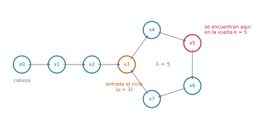
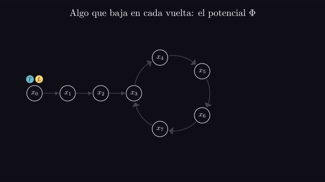
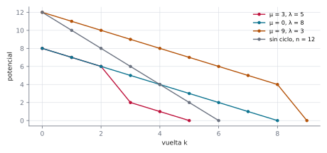
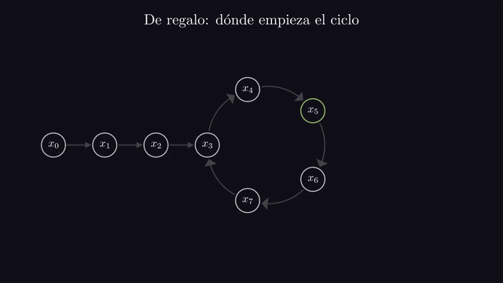
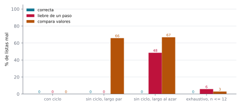

# Ejercicio 5 ★★ · Detección de ciclos con dos punteros

> Detección de ciclos en una lista enlazada con dos punteros que avanzan a velocidades
> 1 y 2 (algoritmo de Floyd). Demuestra que se encuentran si y solo si hay un ciclo, con
> un invariante, y que termina, con un potencial. Da el costo.

La tortuga y la liebre es uno de esos algoritmos que se aprenden de memoria y se
justifican con un dibujo. Aquí lo vamos a justificar con las dos herramientas que pide
el enunciado: un invariante que dice dónde está cada puntero, y del que sale el "si y
solo si", y un potencial que baja en cada vuelta. Después contamos las lecturas, vemos
que ningún algoritmo puede hacer muchas menos, y plantamos dos errores que atacan
partes distintas de la demostración.

Todos los números de este documento los imprime [`ejercicio-05.py`](ejercicio-05.py),
que además corre las pruebas y regenera las tres figuras. Solo necesita matplotlib:

```bash
python ejercicio-05.py
```

## 1. El problema

**Detección de ciclos.** Una lista enlazada es una sucesión de nodos, cada uno con un
puntero `next` al siguiente. Se da la cabeza, y hay que decidir si la lista termina
(algún `next` es `None`) o si vuelve sobre sí misma. El costo es la cantidad de punteros
que se leen.

Tres precisiones que un enunciado tiene que dar, y que casi nunca se dan:

- **Qué puede hacer el algoritmo.** Solo seguir punteros y preguntar si dos punteros
  señalan el mismo nodo. No conoce $n$, la cantidad de nodos, ni puede marcar nodos.
- **Qué es "encontrarse".** Estar en **el mismo nodo**, no en dos nodos con el mismo
  valor. La sección 8 muestra qué se rompe si se confunden.
- **Los casos chicos.** La lista vacía, la de un nodo que termina y la de un nodo que se
  apunta a sí mismo son entradas válidas, y el algoritmo tiene que contestarlas bien.

Llamemos $x_i$ al nodo al que se llega con $i$ pasos desde la cabeza, así que $x_0$ es
la cabeza y $x_{i+1}$ es el `next` de $x_i$. Como cada nodo tiene un solo `next`, hay
solo dos formas posibles. **Sin ciclo**, $x_0, \dots, x_{n-1}$ son distintos y el `next`
de $x_{n-1}$ es `None`. **Con ciclo**, hay una **cola** de $\mu \ge 0$ nodos
$x_0, \dots, x_{\mu-1}$ y un **ciclo** de $\lambda \ge 1$ nodos
$x_\mu, \dots, x_{\mu+\lambda-1}$, cuyo último nodo apunta de nuevo a $x_\mu$. En total
$n = \mu + \lambda$ nodos distintos, y para $i \ge \mu$ el camino da vueltas:
$x_i = x_{\mu + (i - \mu) \bmod \lambda}$.

**Lema.** Con ciclo, $x_i = x_j$ con $i < j$ si y solo si $i \ge \mu$ y $\lambda$ divide
a $j - i$. Sin ciclo, $x_i \ne x_j$ siempre.

*Demostración.* Los nodos $x_0, \dots, x_{\mu+\lambda-1}$ son distintos. Si $i < \mu$,
$x_i$ es un nodo de la cola, que solo aparece en el índice $i$. Si $i \ge \mu$, también
$j \ge \mu$, y $x_i = x_j$ si y solo si

$$(i - \mu) \bmod \lambda = (j - \mu) \bmod \lambda,$$

es decir, si y solo si $\lambda$ divide a $j - i$. Sin ciclo, los $x_i$ son distintos
por definición. $\square$



*Figura 1. Una lista con $\mu = 3$ y $\lambda = 5$, con la forma de la letra ρ. En
naranja, la entrada al ciclo. En rojo, el nodo donde Floyd encuentra a la tortuga con la
liebre, calculado corriendo el algoritmo: $x_5$, en la vuelta 5.*

## 2. Un ejemplo chico antes de la prueba

El algoritmo de Floyd, que la sección 3 escribe completo, mueve dos punteros desde la
cabeza: la **tortuga** avanza un nodo por vuelta y la **liebre** avanza dos. Si alguna
vez están en el mismo nodo, hay ciclo; si la liebre llega al final, no lo hay. En la
lista de la figura 1, la columna $k$ es el número de vuelta, y la columna $D$ es
cuántos pasos tendría que dar la liebre dentro del ciclo para alcanzar a la tortuga;
solo tiene sentido cuando la tortuga ya está en el ciclo. La última columna es un
número que baja en cada vuelta, el potencial de la sección 4, y $k^*$, en la última
línea, es la vuelta en que se encuentran.

```
 k  tortuga en  liebre en  tortuga en el ciclo   D  potencial
 0          x0         x0                   no   —          8
 1          x1         x2                   no   —          7
 2          x2         x4                   no   —          6
 3          x3         x6                   sí   2          2
 4          x4         x3                   sí   1          1
 5          x5         x5                   sí   0          0
Floyd: hay ciclo en 5 vueltas; k* = 5, n = 8
```

Las tres primeras vueltas la tortuga recorre la cola. En la vuelta 3 entra al ciclo, y
la liebre, que ya estaba dentro, queda a 2 pasos de alcanzarla. Desde ahí, cada vuelta
la liebre gana un paso: la distancia baja a 1, después a 0, y se encuentran en $x_5$.
Fíjate en que la vuelta 5 es el primer múltiplo de $\lambda = 5$ que es al menos
$\mu = 3$. Sin ciclo, la liebre llega al final y el algoritmo se detiene:

```
n = 7: no hay ciclo en 3 vueltas y 10 lecturas; 3·floor(n/2) + (n mod 2) = 10
n = 8: no hay ciclo en 4 vueltas y 12 lecturas; 3·floor(n/2) + (n mod 2) = 12
```

## 3. El invariante: se encuentran si y solo si hay ciclo

El algoritmo, con la liebre leyendo cada puntero una sola vez:

```python
def floyd(head):
    t = h = head
    while h is not None:
        h1 = h.next                # primera lectura de la liebre
        if h1 is None:
            break
        h = h1.next                # segunda lectura de la liebre
        t = t.next                 # la lectura de la tortuga
        if t is h:
            return "hay ciclo"
    return "no hay ciclo"
```

**Invariante (I).** Después de $k$ vueltas completas sin devolver nada, la tortuga está
en $x_k$ y la liebre en $x_{2k}$.

**Teorema.** (I) vale al final de cada vuelta completa, y el algoritmo contesta "hay
ciclo" si y solo si la lista tiene un ciclo. En ese caso lo hace al final de la vuelta

$$k^* = \lambda \left\lceil \frac{\max(\mu, 1)}{\lambda} \right\rceil.$$

*Demostración.* *Inicialización.* Con $k = 0$ las dos están en la cabeza, $x_0$.

*Mantenimiento.* Una vuelta completa encontró que $x_{2k+1}$ existe (si no, el ciclo
termina antes), y mueve la liebre a $x_{2k+2}$ y la tortuga a $x_{k+1}$. El paso que
todo el mundo se salta es que la tortuga puede moverse: $x_{k+1}$ existe porque
$k + 1 \le 2k + 1$ y la liebre ya pasó por ahí. **La tortuga nunca se cae de la lista
porque va detrás de la liebre.**

*Conclusión.* Por (I), el algoritmo contesta "hay ciclo" al final de la vuelta $k \ge 1$
si y solo si $x_k = x_{2k}$, como nodos. Si se encuentran, hay ciclo: $x_k = x_{2k}$ con
$k < 2k$ es un nodo visitado dos veces, y por el lema de la sección 1, sin ciclo eso no
pasa. Si hay ciclo, se encuentran: ningún `next` es `None`, así que la salida "no hay
ciclo" nunca se toma, y por el mismo lema $x_k = x_{2k}$ si y solo si $k \ge \mu$ y
$\lambda$ divide a $2k - k = k$. La primera vuelta $k \ge 1$ que cumple eso es $k^*$.
$\square$


*Animación 1. La lista de la figura 1: después de $k$ vueltas, la tortuga está en $x_k$
y la liebre en $x_{2k}$, y se encuentran en $k^* = 5$. Sin ciclo, la liebre llega al
final y nunca se cruzan. En mejor calidad:
[MP4](animaciones/ejercicio-05-invariante.mp4).*

Sin ciclo, entonces, el algoritmo nunca contesta "hay ciclo", y contesta "no hay ciclo"
en cuanto termina, que es lo que demuestra la sección 4. El script lo comprueba en todas
las listas chicas, vigilando (I) y el potencial en cada vuelta:

```
3 660 listas con ciclo (mu de 0 a 60, lambda de 1 a 60): todas detectadas en k* = lambda·ceil(max(mu,1)/lambda) vueltas, 3 lecturas por vuelta
121 listas sin ciclo (n de 0 a 120): todas bien, en floor(n/2) vueltas y 3·floor(n/2) + (n mod 2) lecturas
invariante de posiciones y potencial vigilados en cada vuelta de cada lista
```

## 4. El potencial: termina

**Cómo se le ocurre a uno.** Dos corredores en una pista circular, uno al doble de
velocidad que el otro. Una vez que los dos están en la pista, el rápido le descuenta al
lento un paso por vuelta, así que la distancia entre ellos es una cantidad que baja.
Eso es un potencial. Falta resolver qué baja antes de que la tortuga llegue a la pista,
y qué baja si no hay pista.

**Teorema.** El algoritmo termina: sin ciclo, después de exactamente
$\lfloor n/2 \rfloor$ vueltas; con ciclo, después de a lo sumo $n$.

*Demostración.* *Sin ciclo.* Sea $\Phi = n - 2k$, la cantidad de nodos desde la liebre
hasta el final, contando el suyo. Una vuelta completa necesita que $x_{2k+1}$ exista, o
sea $2k + 1 \le n - 1$, así que $\Phi \ge 2$ al empezarla, y la vuelta lo baja en 2.
Como $\Phi$ es un entero que no puede bajar para siempre, el ciclo termina, después de
exactamente $\lfloor n/2 \rfloor$ vueltas.

*Con ciclo*, en dos fases. Mientras la tortuga está en la cola ($k < \mu$), sea
$\Phi = (\mu - k) + \lambda$, que baja 1 por vuelta. Cuando la tortuga está en el ciclo
($k \ge \mu$ y $k \ge 1$), la liebre también lo está, porque $2k \ge k \ge \mu$. Sea
entonces $\Phi = D$, la cantidad de pasos que tendría que dar la liebre dentro del ciclo
para alcanzar a la tortuga. Como la liebre está en $x_{2k}$ y la tortuga en $x_k$,
$D \equiv k - 2k = -k \pmod \lambda$, con $0 \le D < \lambda$. En cada vuelta la tortuga
avanza 1 y la liebre 2, así que si $D > 0$, $D$ baja exactamente en 1. Y $D = 0$ es
estar en el mismo nodo: el algoritmo se detiene. En el cambio de fase el potencial
también baja: en la vuelta $\mu - 1$ vale $1 + \lambda$, y en la vuelta $\mu$ vale
$D \le \lambda - 1$. (Con $\mu = 0$, empieza en $\lambda$ y la primera vuelta lo deja en
$\lambda - 1$ o lo lleva a 0.) Así que $\Phi$ es un entero no negativo que baja en cada
vuelta, y el algoritmo termina después de a lo sumo $\Phi_0 = \mu + \lambda = n$
vueltas. $\square$

Que la diferencia de velocidades sea 1 es lo que hace que $D$ baje de a uno, y por eso
no puede saltarse el 0.



*Animación 2. El potencial vuelta a vuelta: primero lo que le falta a la tortuga para
entrar al ciclo, más $\lambda$; después, la distancia $D$ de la liebre a la tortuga, que
baja de a uno hasta 0. En mejor calidad: [MP4](animaciones/ejercicio-05-potencial.mp4).*



*Figura 2. El potencial en cada vuelta, para tres listas con ciclo y una sin ciclo.
Siempre baja y termina en 0. La caída brusca de la curva roja es el cambio de fase: en
la vuelta 3 la tortuga entra al ciclo y el potencial pasa a ser la distancia que le
falta a la liebre, que es 2.*

## 5. El costo

**Lema.** Sin ciclo, el algoritmo lee $3\lfloor n/2 \rfloor + (n \bmod 2)$ punteros. Con
ciclo lee $3k^*$, y $k^* \le n$, con igualdad si y solo si $\mu = 0$. La memoria es
$O(1)$.

*Demostración.* Cada vuelta completa lee tres punteros: dos la liebre y uno la tortuga.
Sin ciclo hay $\lfloor n/2 \rfloor$ vueltas, y si $n$ es impar una lectura más, la que
encuentra el `None`. Con ciclo hay $k^*$ vueltas. Si $\mu \ge 1$, entre los $\lambda$
enteros consecutivos $\mu, \mu + 1, \dots, \mu + \lambda - 1$ hay exactamente un
múltiplo de $\lambda$, así que $k^* \le \mu + \lambda - 1 = n - 1$. Si $\mu = 0$,
$k^* = \lambda = n$. La memoria son dos punteros, y uno auxiliar para no leer dos veces
el mismo `next`. $\square$

En el peor caso, entonces, $3n$ lecturas, y se alcanza exactamente cuando la lista
entera es un ciclo:

```
     n  peor con ciclo  dónde (mu, lambda)  sin ciclo  peor / n
     1               3              (0, 1)          1      3.00
     2               6              (0, 2)          3      3.00
    10              30             (0, 10)         15      3.00
   100             300            (0, 100)        150      3.00
  1000            3000           (0, 1000)       1500      3.00
```

## 6. ¿Se puede con menos lecturas?

**Teorema.** Todo algoritmo correcto lee los $n$ punteros de la lista sin ciclo de $n$
nodos.

*Demostración.* Tomemos la lista sin ciclo de $n$ nodos y un algoritmo que contesta bien
"no hay ciclo". Supongamos que nunca leyó el `next` de algún nodo $x_j$. Cambiemos ese
puntero para que apunte a la cabeza: la lista nueva tiene un ciclo. Pero el algoritmo
hace exactamente lo mismo sobre las dos, porque el único puntero distinto es uno que no
lee, y los nodos que solo se alcanzan a través de él tampoco los ve. Así que contesta
"no hay ciclo" sobre la lista nueva, y se equivoca. $\square$

Floyd lee a lo sumo $3n$: está a un factor 3 de la cota. La alternativa obvia, recordar
en un conjunto todos los nodos vistos, alcanza la cota, pero a cambio de guardar $n$
nodos:

```
               lista  Floyd: lecturas  conjunto: lecturas  conjunto: nodos guardados
mu = 0, lambda = 1000             3000                1000                       1000
mu = 500, lambda = 500             1500                1000                       1000
mu = 999, lambda = 1             2997                1000                       1000
mu = 1000, lambda = 0             1500                1000                       1000
```

Floyd cambia memoria por lecturas: paga hasta tres veces más punteros leídos, y a cambio
usa memoria constante en vez de lineal.

## 7. De regalo: dónde empieza el ciclo

**Lema.** Si, cuando se encuentran en $x_{k^*}$, se pone un puntero en la cabeza, se
deja el otro en $x_{k^*}$ y se los avanza a los dos de a un paso, se encuentran por
primera vez exactamente en $x_\mu$, la entrada al ciclo, después de $\mu$ pasos.

*Demostración.* Después de $j$ pasos están en $x_j$ y en $x_{k^* + j}$. Si $j \ge \mu$,
son el mismo nodo por el lema de la sección 1: los dos índices son al menos $\mu$ y su
diferencia, $k^*$, es múltiplo de $\lambda$. Si $j < \mu$, no lo son: $x_j$ está en la
cola y $x_{k^*+j}$ en el ciclo. $\square$

Dar una vuelta desde ahí cuenta $\lambda$. Son $2\mu + \lambda$ lecturas más, a lo sumo
$2n$.



*Animación 3. Desde el punto de encuentro, un puntero vuelve a la cabeza y los dos
avanzan de a uno: se cruzan en la entrada del ciclo, después de $\mu$ pasos. En mejor
calidad: [MP4](animaciones/ejercicio-05-entrada.mp4).*

```
1 640 listas (mu de 0 a 40, lambda de 1 a 40): mu y lambda recuperados en todas
```

## 8. Dos errores plantados

Dos maneras de escribir mal el algoritmo, cada una contra una parte distinta de la
demostración. **La liebre de un paso** comprueba solo que la liebre exista, y después da
dos pasos con `h = h.next.next`. **Comparar valores** pregunta `t.value == h.value` en
vez de `t is h`. Probemos las dos contra cuatro baterías de listas cuyos nodos guardan
valores al azar en $0..9$. Una ejecución que revienta cuenta como fallo.

```
los nodos guardan valores al azar en 0..9
                  batería  listas           correcta  liebre de un paso    compara valores
                con ciclo    2000               0.0%               0.0%               0.0%
     sin ciclo, largo par    2000               0.0%               0.0%              65.8%
 sin ciclo, largo al azar    2000               0.0%              48.5%              66.8%
      exhaustivo, n <= 12     104               0.0%               5.8%               2.9%
```



*Figura 3. Porcentaje de listas en que cada variante contesta mal o revienta, según la
batería. Ninguna de las dos variantes falla nunca sobre listas con ciclo.*

**La liebre de un paso rompe el mantenimiento de (I),** que necesita que $x_{2k+1}$
exista antes de dar los dos pasos.

**Lema.** La liebre de un paso revienta si y solo si la lista no tiene ciclo y su largo
$n$ es impar.

*Demostración.* Con ciclo no hay ningún `None`, así que nunca revienta. Sin ciclo, la
liebre pisa solo índices pares, y revienta exactamente cuando está en el último nodo,
$x_{n-1}$: el primer paso llega a `None` y el segundo intenta leer su `next`. Eso pasa
si y solo si $n - 1$ es par. $\square$

```
la liebre de un paso revienta, entre las listas sin ciclo de 1 a 40 nodos, exactamente en las de largo impar: True
```

Una batería con solo listas con ciclo no lo puede ver, porque ahí no hay ningún `None`.
Una con listas sin ciclo de largo par tampoco.

**Comparar valores rompe la conclusión de (I).** La dirección "si se encuentran, hay
ciclo" usa que $x_k$ y $x_{2k}$ son **el mismo nodo**. Dos nodos distintos con el mismo
valor no prueban nada, y la variante contesta "hay ciclo" en listas que terminan. Sobre
listas con ciclo contesta bien, a veces antes de tiempo. Y con valores todos distintos
no falla nunca:

```
comparar valores, con valores todos distintos: 0 errores en 200 listas sin ciclo
```

| variante | qué parte rompe | qué baterías la ven |
|---|---|---|
| liebre de un paso | el mantenimiento de (I): $x_{2k+1}$ tiene que existir | sin ciclo y de largo impar |
| compara valores | la conclusión de (I): mismo nodo, no mismo valor | sin ciclo y con valores repetidos |

Las dos fallan solo en listas sin ciclo. La batería que casi todo el mundo escribe
primero, la de listas con ciclo para ver si las detecta, no ve ninguna de las dos.

Antes de dibujar, el script se comprueba a sí mismo: respuesta, vueltas y lecturas
exactas para todas las listas con $\mu$ y $\lambda$ hasta 80, el invariante y el
potencial en cada vuelta, 300 listas al azar de hasta 6000 nodos contra la búsqueda que
recuerda los nodos vistos, la entrada al ciclo para $\mu$ y $\lambda$ hasta 60, y la
cota $k^* \le n$:

```
52 063 comprobaciones, 0 fallos
```

La regla práctica que te llevas: **cada paso de la demostración es una prueba que hay
que escribir.** El mantenimiento usa que $x_{2k+1}$ existe, así que hay que probar
listas que terminan en índice impar; la conclusión usa que encontrarse es ser el mismo
nodo, así que hay que probar valores repetidos. Las pruebas que salen del enunciado,
"listas con ciclo", no tocan ninguno de los dos pasos.

## 9. Resumen

- Una lista con ciclo tiene forma de ρ: una cola de $\mu$ nodos y un ciclo de $\lambda$.
  Dos pasos llegan al mismo nodo si y solo si los dos están en el ciclo y su diferencia
  es múltiplo de $\lambda$.
- El invariante es que después de $k$ vueltas la tortuga está en $x_k$ y la liebre en
  $x_{2k}$. Se encuentran si y solo si $x_k = x_{2k}$: nunca sin ciclo, y en la vuelta
  $k^* = \lambda\lceil \max(\mu,1)/\lambda \rceil \le n$ con ciclo.
- El potencial es, sin ciclo, lo que le falta a la liebre para llegar al final; con
  ciclo, primero lo que le falta a la tortuga para entrar, y después la distancia de la
  liebre a la tortuga, que baja de a uno hasta 0.
- Floyd lee a lo sumo $3n$ punteros, con memoria $O(1)$. Cualquier algoritmo necesita
  $n$ lecturas, y recordar los nodos vistos las alcanza a cambio de memoria lineal.
- Cuando se encuentran, avanzar desde la cabeza y desde el punto de encuentro a la misma
  velocidad lleva a la entrada del ciclo.
- La liebre que mira un solo paso revienta en listas sin ciclo de largo impar, y
  comparar valores da falsos positivos con valores repetidos. Ninguna de las dos falla
  con listas que tienen ciclo.

<details>
<summary>Salida completa de <code>python ejercicio-05.py</code></summary>

```
§2. Ejemplo chico: cola de 3 nodos y ciclo de 5
-----------------------------------------------
 k  tortuga en  liebre en  tortuga en el ciclo   D  potencial
 0          x0         x0                   no   —          8
 1          x1         x2                   no   —          7
 2          x2         x4                   no   —          6
 3          x3         x6                   sí   2          2
 4          x4         x3                   sí   1          1
 5          x5         x5                   sí   0          0
Floyd: hay ciclo en 5 vueltas; k* = 5, n = 8

§2. Sin ciclo: n = 7 y n = 8
----------------------------
n = 7: no hay ciclo en 3 vueltas y 10 lecturas; 3·floor(n/2) + (n mod 2) = 10
n = 8: no hay ciclo en 4 vueltas y 12 lecturas; 3·floor(n/2) + (n mod 2) = 12

§3 a §5. Todas las listas chicas
--------------------------------
3 660 listas con ciclo (mu de 0 a 60, lambda de 1 a 60): todas detectadas en k* = lambda·ceil(max(mu,1)/lambda) vueltas, 3 lecturas por vuelta
121 listas sin ciclo (n de 0 a 120): todas bien, en floor(n/2) vueltas y 3·floor(n/2) + (n mod 2) lecturas
invariante de posiciones y potencial vigilados en cada vuelta de cada lista

§5. Peor caso: lecturas de punteros entre todas las listas de n nodos
---------------------------------------------------------------------
     n  peor con ciclo  dónde (mu, lambda)  sin ciclo  peor / n
     1               3              (0, 1)          1      3.00
     2               6              (0, 2)          3      3.00
    10              30             (0, 10)         15      3.00
   100             300            (0, 100)        150      3.00
  1000            3000           (0, 1000)       1500      3.00

§6. Floyd contra recordar los nodos vistos, n = 1000
----------------------------------------------------
               lista  Floyd: lecturas  conjunto: lecturas  conjunto: nodos guardados
mu = 0, lambda = 1000             3000                1000                       1000
mu = 500, lambda = 500             1500                1000                       1000
mu = 999, lambda = 1             2997                1000                       1000
mu = 1000, lambda = 0             1500                1000                       1000

§7. De regalo: dónde empieza el ciclo y cuánto mide
---------------------------------------------------
1 640 listas (mu de 0 a 40, lambda de 1 a 40): mu y lambda recuperados en todas

§8. Dos errores plantados contra cuatro baterías de pruebas
-----------------------------------------------------------
los nodos guardan valores al azar en 0..9
                  batería  listas           correcta  liebre de un paso    compara valores
                con ciclo    2000               0.0%               0.0%               0.0%
     sin ciclo, largo par    2000               0.0%               0.0%              65.8%
 sin ciclo, largo al azar    2000               0.0%              48.5%              66.8%
      exhaustivo, n <= 12     104               0.0%               5.8%               2.9%
la liebre de un paso revienta, entre las listas sin ciclo de 1 a 40 nodos, exactamente en las de largo impar: True
comparar valores, con valores todos distintos: 0 errores en 200 listas sin ciclo

Pruebas
-------
52 063 comprobaciones, 0 fallos

figuras: ejercicio-05-rho.svg, ejercicio-05-potencial.svg, ejercicio-05-errores.svg
```

</details>

