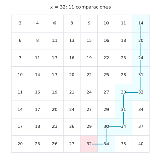
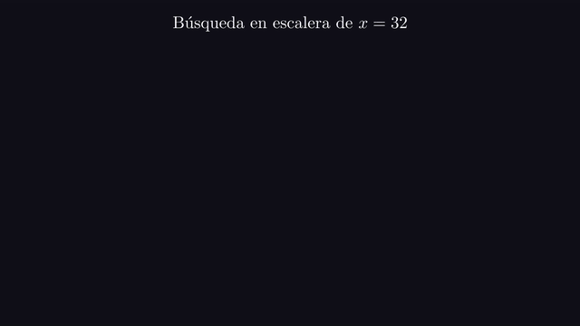
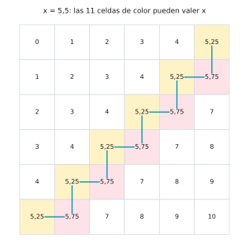
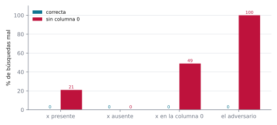
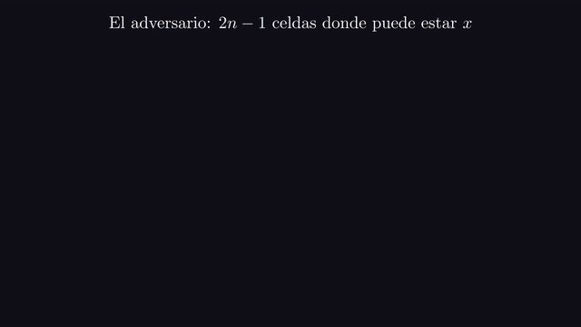

# Ejercicio 6 ★★ · Búsqueda en una matriz con filas y columnas ordenadas

> Una matriz $n \times n$ tiene filas y columnas ordenadas de forma creciente. Diseña un
> algoritmo que decida si contiene un valor $x$ en $O(n)$ comparaciones, demuestra su
> correctitud con un invariante, y demuestra con un adversario que no se puede en
> $o(n)$.

El algoritmo cabe en ocho líneas, la búsqueda en escalera (*saddleback search*), que
Gries (1981) usa como ejemplo de derivación de programas y Bird (2006) vuelve a
estudiar. Lo interesante es todo lo demás. El invariante dice qué parte de la matriz
ya está descartada, y de ahí sale la correctitud. Un potencial cuenta las preguntas. Y
un adversario que esconde $x$ en dos antidiagonales da una cota que no es solo
$\Omega(n)$, como pide el enunciado, sino exactamente la cantidad de preguntas que hace
la escalera. Al final, ese mismo adversario sirve para encontrar un error que ninguna
prueba con $x$ ausente puede ver.

Todos los números de este documento los imprime [`ejercicio-06.py`](ejercicio-06.py),
que además corre las pruebas y regenera las tres figuras. Solo necesita matplotlib:

```bash
python ejercicio-06.py
```

## 1. El problema

**Búsqueda en matriz ordenada.** La entrada es una matriz $M$ de $n \times n$ con
$M[i][j] < M[i][j+1]$ y $M[i][j] < M[i+1][j]$, y un valor $x$. Hay que decidir si alguna
celda vale $x$. Cada pregunta compara $x$ con una celda, y el costo es la cantidad de
preguntas.

Tres precisiones que un enunciado tiene que dar, y que casi nunca se dan:

- **Qué quiere decir "creciente".** Aquí, estrictamente. Con valores repetidos el
  algoritmo funciona igual, porque cada descarte usa solo $\ge$ o $\le$. Y la cota
  inferior también vale, porque el adversario de la sección 5 usa una matriz estricta,
  y un algoritmo que acierta con repetidos tiene que acertar con ella.
- **Qué es una pregunta.** Una comparación de tres salidas, $<$, $=$ o $>$, entre $x$ y
  una celda. El código de abajo la escribe con dos `if`, pero cuenta una.
- **Qué hay que contestar.** Solo sí o no. Devolver la posición no cuesta nada más, y la
  cota inferior vale igual, porque quien sabe la posición también sabe contestar sí o
  no.

## 2. Un ejemplo chico antes del algoritmo

Dos búsquedas en una matriz de $5 \times 5$:

```
  3   4   6   8   9
  4   5   9  12  14
  7   9  11  13  16
  9  10  14  16  19
 12  15  16  17  22
x = 21: M[0][4]=9 -> M[1][4]=14 -> M[2][4]=16 -> M[3][4]=19 -> M[4][4]=22 -> M[4][3]=17
   no está, con 6 comparaciones
x = 14: M[0][4]=9 -> M[1][4]=14
   está, con 2 comparaciones
```

Buscando 21, la esquina superior derecha vale 9, que es el **mayor** de su fila. Si 9 es
menor que 21, toda la fila 0 lo es, y se descarta entera. Bajamos. 14, 16 y 19 también
son menores, y se descartan sus filas. 22 es mayor que 21, y es el **menor** de lo que
queda de su columna, así que se descarta la columna 4. A la izquierda, 17 es menor y es
el mayor de lo que queda de la fila 4, que se descarta. No queda nada: 21 no está.

## 3. El algoritmo: invariante y potencial

**Cómo se le ocurre a uno.** Queremos una celda tal que, conteste lo que conteste la
comparación, nos deje tirar una fila o una columna entera. Para tirar una fila hace
falta la mayor de la fila, y para tirar una columna, la menor de la columna. Fíjate en
que la esquina superior izquierda no sirve: es la menor de su fila y de su columna, así
que si es menor que $x$ no descarta nada. La inferior derecha tampoco, por lo mismo al
revés. La superior derecha es a la vez la mayor de su fila y la menor de su columna, y
después de cada descarte lo que queda vuelve a ser una matriz con una esquina así.

```python
def saddleback_search(M, x):
    n = len(M)
    i, j = 0, n - 1
    while i < n and j >= 0:
        if M[i][j] == x:
            return True
        if M[i][j] > x:
            j -= 1              # la columna j, de la fila i para abajo, es mayor que x
        else:
            i += 1              # la fila i, de la columna j para la izquierda, es menor
    return False
```

**Invariante (I).** $x$ no está en ninguna celda $(r, c)$ con $r < i$ o con $c > j$.

**Teorema.** (I) se cumple al comienzo de cada vuelta, y `saddleback_search` devuelve
`True` si y solo si $x$ está en la matriz.

*Demostración.* *Inicialización.* Con $i = 0$ y $j = n - 1$ no hay celdas con $r < 0$
ni con $c > n - 1$.

*Mantenimiento.* Supongamos (I) con $i < n$ y $j \ge 0$, y que $M[i][j] \ne x$. Si
$M[i][j] > x$, para toda fila $r \ge i$ vale $M[r][j] \ge M[i][j] > x$, porque la
columna $j$ crece hacia abajo, y las celdas de la columna $j$ con $r < i$ ya estaban
descartadas por (I). Así que $x$ no está en la columna $j$, y $j \leftarrow j - 1$
conserva (I). Si $M[i][j] < x$, para toda columna $c \le j$ vale
$M[i][c] \le M[i][j] < x$, porque la fila $i$ crece hacia la derecha, y las de $c > j$
ya estaban descartadas. Así que $x$ no está en la fila $i$, e $i \leftarrow i + 1$
conserva (I).

*Conclusión.* Si devuelve `True`, encontró $x$. Si sale del ciclo, es porque $i = n$ o
$j = -1$, y entonces toda celda cumple $r < i$ o $c > j$. Por (I), $x$ no está.
$\square$

El paso delicado del mantenimiento es que cada comparación usa **solo uno** de los dos
órdenes de la matriz: el de la columna para descartar hacia abajo, el de la fila para
descartar hacia la izquierda. La parte de la fila o de la columna que queda "del otro
lado" ya estaba descartada, y eso lo aporta (I).

**Lema.** `saddleback_search` hace a lo sumo $2n - 1$ comparaciones y usa memoria
$O(1)$.

*Demostración.* Sea $\Phi = (n - i) + (j + 1)$, las filas más las columnas que quedan.
Empieza en $2n$, y cada comparación que no encuentra a $x$ lo baja en 1. Mientras el
ciclo sigue, los dos términos valen al menos 1, así que antes de cada comparación
$\Phi \ge 2$. Si hay $c$ comparaciones, antes de la última $\Phi = 2n - (c - 1) \ge 2$,
de donde $c \le 2n - 1$. La memoria son dos índices. $\square$

El script vigila (I) y el potencial con `assert` en cada vuelta:

```
4 000 búsquedas, 22 283 vueltas vigiladas, 0 fallos
```



*Figura 1. El camino de la escalera en una matriz de $8 \times 8$, buscando el valor
que más le cuesta encontrar. Cada paso hacia abajo descarta una fila y cada paso hacia
la izquierda una columna.*



*Animación 1. La escalera buscando 32 en la matriz de la figura 1. Lo descartado es lo
que dice el invariante, y el potencial filas más columnas baja de a uno. En mejor
calidad: [MP4](animaciones/ejercicio-06-escalera.mp4).*

## 4. El costo

La alternativa obvia, una búsqueda binaria en cada fila, cuesta
$n \lceil \log_2(n+1) \rceil$. Comparemos las tres opciones en el peor caso:

```
     n  escalera (adversario)  2n - 1  binaria por filas  n·ceil(log2(n+1))  fuerza bruta
     2                      3       3                  3                  4             4
     5                      9       9                 13                 15            25
    10                     19      19                 35                 40           100
   100                    199     199                673                700         10000
  1000                   1999    1999               9977              10000       1000000
en matrices al azar, el peor de 2000 búsquedas: n = 5: 9, n = 10: 19, n = 20: 32
```

La columna de la escalera se mide sobre la matriz del adversario de la sección 5, donde
alcanza exactamente $2n - 1$. En matrices al azar con $n = 20$, el peor de 2000
búsquedas usó 32 de los 39 posibles: el caso típico queda por debajo de la garantía.

## 5. La cota inferior: un adversario con dos antidiagonales

**Cómo se le ocurre a uno.** Un adversario necesita muchas celdas que puedan valer $x$
**cada una por separado** sin desordenar la matriz. Una celda puede valer $x$ si $x$
cabe entre sus vecinas de arriba y de la izquierda, y sus vecinas de abajo y de la
derecha. Las celdas de una antidiagonal no son vecinas entre sí, así que no se estorban.
Y dos antidiagonales seguidas tampoco, si sus valores quedan muy pegados a $x$, uno por
debajo y otro por encima.

El adversario fija casi toda la matriz y deja libres dos antidiagonales:

$$M[i][j] = \begin{cases} n - 0{,}75 & \text{si } i + j = n - 1, \\ n - 0{,}25 & \text{si } i + j = n, \\ i + j & \text{en otro caso,} \end{cases} \qquad x = n - 0{,}5.$$

**Lema.** Esta matriz está ordenada y no contiene a $x$, y cada una de sus $2n - 1$
celdas con $i + j \in \{n-1, n\}$ puede pasar a valer $x$ sin que la matriz deje de
estar ordenada.

*Demostración.* A lo largo de una fila o de una columna, $i + j$ sube de a 1, y los dos
valores de las antidiagonales están entre $n - 2$ y $n + 1$, en el orden correcto.
Además, $x$ no es ninguno de los valores. Si una celda de la antidiagonal $n - 1$ pasa a
valer $n - 0{,}5$, sus vecinas de la izquierda y de arriba valen $n - 2$, y las de la
derecha y de abajo $n - 0{,}25$, así que la matriz sigue ordenada. Si una celda de la
antidiagonal $n$ pasa a valer $n - 0{,}5$, sus vecinas de la izquierda y de arriba
valen $n - 0{,}75$, y las de la derecha y de abajo $n + 1$, así que también. Las
antidiagonales tienen $n$ y $n - 1$ celdas. $\square$

**Teorema.** Todo algoritmo correcto de comparaciones hace al menos $2n - 1$
comparaciones en el peor caso. En consecuencia, la búsqueda en escalera es exactamente
óptima.

*Demostración.* El adversario contesta todas las preguntas como si la matriz fuera la
del lema, sin $x$. Supongamos que un algoritmo termina sin haber mirado alguna celda $c$
de las antidiagonales. Si contesta "no está", el adversario pone $x$ en $c$. Por el
lema, la matriz sigue ordenada. Todas las respuestas que dio siguen siendo verdaderas,
porque $c$ nunca se preguntó. Y ahora $x$ sí está. Si contesta "está", se equivoca sobre
la matriz original, que es consistente con todo lo que contestó y no tiene $x$. En los
dos casos el algoritmo falla en alguna matriz, así que todo algoritmo correcto mira las
$2n - 1$ celdas. Con el lema de la sección 3, la escalera alcanza la cota. $\square$

El script comprueba las dos partes del argumento:

```
n = 6: 11 celdas en las antidiagonales; en 11 de ellas se puede poner x sin desordenar la matriz; la escalera mira 11 de ellas con 11 comparaciones
n = 50: 99 celdas en las antidiagonales; en 99 de ellas se puede poner x sin desordenar la matriz; la escalera mira 99 de ellas con 99 comparaciones
```



*Figura 2. La matriz del adversario con $n = 6$. Las 11 celdas de color, en dos
antidiagonales, pueden valer $x$ sin desordenar nada. La escalera, en azul, las recorre
todas en zigzag.*

## 6. Por qué dos antidiagonales

La cota que pide el enunciado sale con una sola antidiagonal: $n$ celdas, cada una
libre, y $\Omega(n)$. La segunda antidiagonal es lo que lleva la cota hasta la
constante exacta. Con una sola quedaría abierta la posibilidad de que un algoritmo más
astuto usara unas $n$ comparaciones y no $2n - 1$. Con dos, la posibilidad se cierra:
la escalera no desperdicia ninguna pregunta. Para matrices rectangulares muy alargadas
la historia cambia, y la cota correcta es otra (Linial y Saks, 1985).

## 7. El error que el invariante anuncia

Plantemos un error de un carácter: escribir `while i < n and j > 0`. La conclusión de
(I) necesita que el ciclo termine con $j = -1$, es decir, con todas las columnas
descartadas. Con `j > 0` se detiene con la columna 0 sin mirar. Probémoslo contra cuatro
baterías:

```
           batería  casos  correcta  sin columna 0
        x presente   4000      0.0%          21.0%
         x ausente   4000      0.0%           0.0%
 x en la columna 0   4000      0.0%          49.0%
     el adversario     30      0.0%         100.0%
con n = 6, la versión mala mira 10 celdas y deja sin mirar [(5, 0)]
```



*Figura 3. Porcentaje de búsquedas mal contestadas por cada versión, según la batería.
Con $x$ ausente, la versión mala nunca se equivoca: su error es contestar "no está", que
en esa batería siempre es verdad.*

Una batería que solo busca valores ausentes nunca ve el error. La última fila es el
adversario usado como generador de pruebas: se corre la versión mala sobre su matriz,
se busca una celda de las antidiagonales que no miró, y se pone $x$ ahí. Falla en el
100 % de los casos, porque el teorema de la sección 5 dice que **cualquier** algoritmo
que mire menos de $2n - 1$ celdas tiene una entrada así, y su demostración la
construye.



*Animación 2. La matriz del adversario con $n = 6$. La escalera mira las 11 celdas de
las antidiagonales; la versión con `j > 0` deja una sin mirar, y el adversario pone $x$
justo ahí. En mejor calidad: [MP4](animaciones/ejercicio-06-adversario.mp4).*

Antes de dibujar, el script se comprueba a sí mismo: 5000 matrices al azar de hasta
$15 \times 15$, con $x$ presente y ausente, donde la escalera y la binaria por filas
aciertan y la escalera nunca usa más de $2n - 1$ comparaciones; 300 matrices en las que
se busca cada uno de sus valores; y, para $n$ de 1 a 40, la matriz del adversario, que
está ordenada, tiene sus $2n - 1$ celdas libres y obliga a la escalera a mirarlas todas:

```
27 387 comprobaciones, 0 fallos
```

La regla práctica que te llevas: **una cota inferior por adversario es también un
generador de pruebas.** Su demostración construye, para cualquier algoritmo que pregunte
de menos, la entrada en la que se equivoca. Correrla contra tu propio código encuentra
el error que las baterías al azar no ven.

## 8. Resumen

- La esquina superior derecha es la mayor de su fila y la menor de su columna, así que
  compararla con $x$ siempre descarta una fila o una columna.
- El invariante es que $x$ no está en las filas ni en las columnas descartadas. Cada
  descarte usa el orden de la columna o el de la fila, y el invariante aporta la otra
  mitad.
- El potencial, filas más columnas que quedan, da a lo sumo $2n - 1$ comparaciones.
- Un adversario con dos antidiagonales obliga a mirar $2n - 1$ celdas: la escalera es
  exactamente óptima, que es más que el $\Omega(n)$ pedido.
- El ciclo que no mira la columna 0 nunca falla con $x$ ausente, y el adversario
  construye la entrada que lo rompe.

<details>
<summary>Salida completa de <code>python ejercicio-06.py</code></summary>

```
§2. Ejemplo chico: una matriz de 5 x 5
--------------------------------------
  3   4   6   8   9
  4   5   9  12  14
  7   9  11  13  16
  9  10  14  16  19
 12  15  16  17  22
x = 21: M[0][4]=9 -> M[1][4]=14 -> M[2][4]=16 -> M[3][4]=19 -> M[4][4]=22 -> M[4][3]=17
   no está, con 6 comparaciones
x = 14: M[0][4]=9 -> M[1][4]=14
   está, con 2 comparaciones

§3. El invariante y el potencial, vigilados con assert
------------------------------------------------------
4 000 búsquedas, 22 283 vueltas vigiladas, 0 fallos

§4. Comparaciones en el peor caso
---------------------------------
     n  escalera (adversario)  2n - 1  binaria por filas  n·ceil(log2(n+1))  fuerza bruta
     2                      3       3                  3                  4             4
     5                      9       9                 13                 15            25
    10                     19      19                 35                 40           100
   100                    199     199                673                700         10000
  1000                   1999    1999               9977              10000       1000000
en matrices al azar, el peor de 2000 búsquedas: n = 5: 9, n = 10: 19, n = 20: 32

§5. El adversario: las 2n - 1 celdas de las dos antidiagonales
--------------------------------------------------------------
n = 6: 11 celdas en las antidiagonales; en 11 de ellas se puede poner x sin desordenar la matriz; la escalera mira 11 de ellas con 11 comparaciones
n = 50: 99 celdas en las antidiagonales; en 99 de ellas se puede poner x sin desordenar la matriz; la escalera mira 99 de ellas con 99 comparaciones

§7. La escalera que nunca mira la columna 0
-------------------------------------------
           batería  casos  correcta  sin columna 0
        x presente   4000      0.0%          21.0%
         x ausente   4000      0.0%           0.0%
 x en la columna 0   4000      0.0%          49.0%
     el adversario     30      0.0%         100.0%
con n = 6, la versión mala mira 10 celdas y deja sin mirar [(5, 0)]

Pruebas
-------
27 387 comprobaciones, 0 fallos

figuras: ejercicio-06-escalera.svg, ejercicio-06-adversario.svg, ejercicio-06-errores.svg
```

</details>

