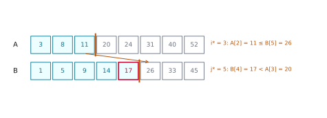
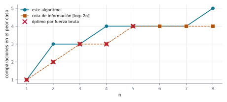
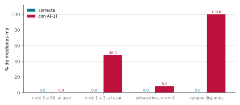
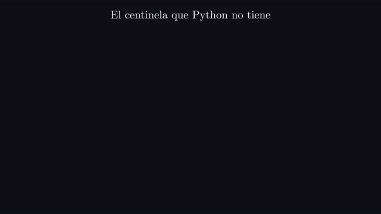

# Ejercicio 7 ★★★ · La mediana de dos arreglos ordenados

> Mediana de dos arreglos ordenados de largo $n$: el $n$-ésimo menor de los $2n$
> elementos. Diseña un algoritmo $O(\log n)$, demuestra su correctitud y da la cota de
> información.

La versión de este problema que circula en internet es una búsqueda binaria con seis
casos borde, y casi nadie sabe por qué funciona. Aquí la vamos a sacar de una sola
observación: los $n$ menores son un prefijo de cada arreglo, así que lo único que hay
que averiguar es cuántos aporta $A$, y esa cantidad es el punto donde una condición
monótona cambia de valor. Después comparamos con la cota de información, y para los
$n$ chicos calculamos el óptimo exacto probando todos los algoritmos. El problema es un
caso particular de la selección en conjuntos estructurados (Frederickson y Johnson,
1982; Knuth, 1998, §5.3.3), y aparece como ejercicio en Cormen et al. (2009, ejercicio
9.3-8).

Todos los números de este documento los imprime [`ejercicio-07.py`](ejercicio-07.py),
que además corre las pruebas y regenera las tres figuras. Solo necesita matplotlib:

```bash
python ejercicio-07.py
```

## 1. El problema

**Mediana de dos arreglos.** La entrada son dos arreglos $A$ y $B$ de largo $n$,
ordenados de forma no decreciente. La salida es el $n$-ésimo menor de los $2n$
elementos. Cada pregunta compara un elemento de $A$ con uno de $B$ y contesta sí o no.

Tres precisiones que un enunciado tiene que dar, y que casi nunca se dan:

- **Qué mediana.** Con $2n$ elementos hay dos centrales. El enunciado elige la de
  abajo, el $n$-ésimo menor, y no el promedio de las dos, que ni siquiera es un
  elemento.
- **Qué pasa con los repetidos.** Ordenamos por valor, y entre iguales el de $A$ va
  primero. Así "los $n$ menores" es un conjunto bien definido, y no solo un valor.
- **Qué se compara.** Solo un elemento de $A$ con uno de $B$. Comparar dos elementos del
  mismo arreglo no aporta nada, porque la respuesta ya se sabe.

## 2. Un ejemplo chico antes del algoritmo

Un ejemplo con $n = 8$. La tabla empareja cada $A[k]$ con $B[n-1-k]$ y pregunta si
$A[k] \le B[n-1-k]$. En la penúltima línea, $i^*$ es la cantidad de respuestas sí, y la
sección 3 muestra que es justo cuántos de los $n$ menores aporta $A$:

```
A = 3 8 11 20 24 31 40 52
B = 1 5 9 14 17 26 33 45
ordenados juntos: 1 3 5 8 9 11 14 17 20 24 26 31 33 40 45 52
 k  A[k]  B[n-1-k]  A[k] <= B[n-1-k]
 0     3        45  sí
 1     8        33  sí
 2    11        26  sí
 3    20        17  no
 4    24        14  no
 5    31         9  no
 6    40         5  no
 7    52         1  no
i* = 3: los n menores son A[0..2] y B[0..4]; la búsqueda binaria usó 3 comparaciones
mediana = max(A[2], B[4]) = max(11, 17) = 17, con 4 comparaciones en total; el oráculo dice 17
```

Los 8 menores son 1, 3, 5, 8, 9, 11, 14, 17: tres de $A$ y cinco de $B$. La columna de
la derecha empareja $A[k]$ con $B[n-1-k]$, el elemento de $B$ que tendría que salir si
$A$ aportara $k + 1$. Mientras $A[k]$ no supera a su pareja la respuesta es sí, y
después es no para siempre: $A$ sube y $B$, leído al revés, baja. Fíjate en que el punto
donde cambia, $i^* = 3$, es exactamente lo que aporta $A$.



*Figura 1. El corte del ejemplo: los tres primeros de $A$ y los cinco primeros de $B$
son los 8 menores. Las dos condiciones de la derecha son las que lo garantizan. La
mediana, en rojo, es el mayor de los dos últimos elementos de cada lado.*

## 3. El corte

**Cómo se le ocurre a uno.** Buscar la mediana directamente obliga a razonar sobre
valores. Pero los $n$ menores son un prefijo de cada arreglo, así que la respuesta está
determinada por un solo número, cuántos aporta $A$, y ese número está entre 0 y $n$.
Buscar un número en un rango es lo que hace la búsqueda binaria, si encontramos una
pregunta monótona que lo localice.

Para cada $i$ entre 0 y $n$, sea $S_i$ el conjunto formado por los $i$ primeros de $A$
y los $n - i$ primeros de $B$, y sea $c_k$ la condición $A[k] \le B[n-1-k]$, para
$0 \le k < n$.

**Lema.** Los $n$ menores son $S_i$ para algún $i$, y $S_i$ son los $n$ menores si y
solo si $c_{i-1}$ se cumple y $c_i$ no. (Una condición sobre un índice fuera de
$0..n-1$ se considera cumplida en el primer caso y no cumplida en el segundo.)

*Demostración.* Los $n$ menores son un prefijo de cada arreglo: si un elemento está
entre los $n$ menores, también lo están los que tiene antes en su arreglo. Así que son
$S_i$ para $i$ igual a la cantidad que aporta $A$. Dentro de cada arreglo el orden ya
es el correcto, así que $S_i$ son los $n$ menores si y solo si los dos cruces están
bien. El último de $A$ que entra no supera al primero de $B$ que queda fuera,
$A[i-1] \le B[n-i]$, que es $c_{i-1}$. Y el último de $B$ que entra va antes que el
primero de $A$ que queda fuera, $B[n-i-1] < A[i]$, que es "no $c_i$". Si $i = 0$ o
$i = n$, la condición que habla de un elemento que no existe se cumple sola. $\square$

**Teorema.** Las condiciones $c_k$ son primero verdaderas y después falsas. Si $i^*$ es
la cantidad de $c_k$ verdaderas, $S_{i^*}$ son los $n$ menores, y la mediana es el
mayor entre $A[i^*-1]$ y $B[n-i^*-1]$ (el que exista).

*Demostración.* Al subir $k$, $A[k]$ crece y $B[n-1-k]$ decrece, así que si $c_k$ es
falsa, también lo es $c_{k+1}$. Entonces $c_{i^*-1}$ es verdadera y $c_{i^*}$ es falsa,
y por el lema, $S_{i^*}$ son los $n$ menores. La mediana es el mayor elemento de
$S_{i^*}$, que es el último de alguno de sus dos prefijos. $\square$


*Animación 1. El ejemplo de la sección 2. La pregunta $A[k] \le B[n-1-k]$ da primero
todos sí y después todos no; la búsqueda binaria encuentra el borde, y con él la
mediana. En mejor calidad: [MP4](animaciones/ejercicio-07-corte.mp4).*

Por el teorema, $i^*$ se encuentra con una búsqueda binaria de invariante "$c_k$ vale
para $k < \mathit{lo}$ y no vale para $k \ge \mathit{hi}$" y potencial
$\mathit{hi} - \mathit{lo}$:

```python
def split_point(A, B):
    n = len(A)
    lo, hi = 0, n
    while lo < hi:
        m = (lo + hi) // 2
        if A[m] <= B[n - 1 - m]:
            lo = m + 1
        else:
            hi = m
    return lo

def median(A, B):
    n = len(A)
    i = split_point(A, B)
    if i == 0:
        return B[n - 1]
    if i == n:
        return A[n - 1]
    return max(A[i - 1], B[n - i - 1])
```

El script vigila todo esto en arreglos con repetidos: que las $c_k$ son monótonas, que
el corte cuenta los elementos de $A$ entre los $n$ menores, y que la mediana coincide
con la de ordenar todo:

```
20 000 pares de arreglos con repetidos: la condición es monótona, el corte cuenta los elementos de A entre los n menores, y la mediana es correcta
```

## 4. El costo

**Lema.** `median` hace a lo sumo $\lceil \log_2(n+1) \rceil + 1$ comparaciones y usa
memoria $O(1)$.

*Demostración.* La búsqueda binaria elige entre $n + 1$ valores posibles de $i^*$, y la
cantidad de bits del tamaño de la ventana baja al menos 1 por comparación, así que hace
a lo sumo $\lceil \log_2(n+1) \rceil$ comparaciones. El máximo final cuesta una
comparación más, y ninguna si $i^*$ cae en un extremo. La memoria son dos índices.
$\square$

## 5. La cota de información

**Teorema.** Todo algoritmo de comparaciones necesita, en el peor caso, al menos
$\lceil \log_2 2n \rceil = \lceil \log_2 n \rceil + 1$ comparaciones.

*Demostración.* Primero, cualquiera de los $2n$ elementos puede ser la mediana. Para que
lo sea $A[j]$, basta un intercalado en que los $n - 1 - j$ primeros de $B$ sean menores
que $A[0]$, seguidos de $A[0], \dots, A[j]$ y del resto. Los $n$ menores son entonces
$B[0..n-2-j]$ y $A[0..j]$, y el mayor es $A[j]$. Para $B[j]$ se intercambian los
papeles. Un algoritmo de comparaciones es un árbol de decisión binario, y cada una de
las $2n$ respuestas necesita su propia hoja. Un árbol binario de altura $h$ tiene a lo
sumo $2^h$ hojas, así que $h \ge \lceil \log_2 2n \rceil$. $\square$

Comparemos con el algoritmo. $\lceil \log_2(n+1) \rceil$ y $\lceil \log_2 n \rceil$ son
iguales salvo cuando $n$ es potencia de 2. Así que el algoritmo alcanza la cota para
casi todo $n$, y se pasa por una comparación cuando $n$ es potencia de 2. Para decidir
quién tiene razón en esos casos, calculamos el óptimo exacto para $n$ chico: probamos
todas las estrategias de preguntas posibles sobre todos los intercalados, eligiendo en
cada estado la pregunta que minimiza el peor caso.

```
  n  algoritmo  ceil(log2(n+1)) + 1  información  óptimo
  1          1                    2            1       1
  2          3                    3            2       2
  3          3                    3            3       3
  4          4                    4            3       3
  5          4                    4            4       4
  6          4                    4            4       —
  7          4                    4            4       —
  8          5                    5            4       —
      100: peor medido 8, ceil(log2(n+1)) + 1 = 8, información 8
    1 000: peor medido 11, ceil(log2(n+1)) + 1 = 11, información 11
1 000 000: peor medido 21, ceil(log2(n+1)) + 1 = 21, información 21
```

Para $n \le 5$ el óptimo es exactamente la cota de información. Cuando $n$ es 2 o 4, la
búsqueda binaria sobre el corte hace una comparación de más: existe un algoritmo que
elige mejor sus preguntas. (Con $n = 1$ no se pasa, porque los dos cortes posibles
están en los extremos y no necesitan la comparación final.) La diferencia es una sola
comparación, así que el algoritmo es óptimo salvo una constante aditiva de 1.



*Figura 2. El peor caso del algoritmo, medido sobre todos los intercalados, contra la
cota de información y el óptimo por fuerza bruta. Las tres coinciden salvo en las
potencias de 2.*

## 6. Lo que la cota no esconde

La cota cuenta respuestas en el modelo de comparaciones, y no siempre llega al óptimo.
Para el máximo de $n$ elementos, contar respuestas da $\log_2 n$, y el óptimo es
$n - 1$. Para la mediana de dos arreglos, en cambio, llega (al menos hasta donde pudimos
calcularlo). La razón es que aquí no hay trabajo de verificación escondido: una vez
encontrado el corte, la respuesta está justificada por solo dos comparaciones, las de
los dos cruces del lema de la sección 3. En el máximo, para convencer a alguien de que
un elemento es el mayor hay que haberle ganado a todos los demás.

## 7. El centinela que Python no tiene

La versión de la sección 3 trata aparte los cortes $i^* = 0$ e $i^* = n$. Es tentador
escribir directamente `max(A[i - 1], B[n - i - 1])`, pensando que $A[-1]$ hará de
$-\infty$. En Python, $A[-1]$ es el **último** elemento de $A$. Plantemos ese error y
probémoslo contra cuatro baterías:

```
               batería  casos  correcta  con A[-1]
  n de 5 a 50, al azar  4 000      0.0%       0.0%
   n de 1 a 3, al azar  4 000      0.0%      48.0%
    exhaustivo, n <= 4     98      0.0%       8.2%
      rangos disjuntos  4 000      0.0%     100.0%
en el exhaustivo, el corte cae en un extremo (i* = 0 o i* = n) en 8 casos, y la versión con A[-1] falla en 8
con n = 5, al azar, el corte cae en un extremo con probabilidad 2 / C(2n, n) = 7.94e-03
con n = 10, al azar, el corte cae en un extremo con probabilidad 2 / C(2n, n) = 1.08e-05
con n = 20, al azar, el corte cae en un extremo con probabilidad 2 / C(2n, n) = 1.45e-11
```



*Figura 3. Porcentaje de medianas mal calculadas por cada versión, según la batería.
Con arreglos al azar de tamaño mediano, la versión mala no falla nunca.*

**Lema.** Con valores distintos, la versión con $A[-1]$ falla si y solo si
$i^* \in \{0, n\}$, es decir, si un arreglo está entero por debajo del otro. Entre los
$\binom{2n}{n}$ intercalados, exactamente 2 tienen esa forma.

*Demostración.* Si $0 < i^* < n$, los índices $i^* - 1$ y $n - i^* - 1$ son válidos y
la versión coincide con la correcta. Si $i^* = 0$, $c_0$ es falsa: $A[0] > B[n-1]$,
todo $A$ está por encima de todo $B$, y la mediana es $B[n-1]$, pero la versión calcula
$\max(A[n-1], B[n-1]) = A[n-1] \ne B[n-1]$. Si $i^* = n$, $c_{n-1}$ es verdadera, todo
$A$ está por debajo de todo $B$, y la mediana es $A[n-1]$, pero la versión calcula
$\max(A[n-1], B[n-1]) = B[n-1] \ne A[n-1]$. Los intercalados con un arreglo entero
debajo del otro son dos: todo $A$ primero o todo $B$ primero. $\square$



*Animación 2. Con un arreglo entero por encima del otro, el corte cae en un extremo, y
`A[-1]` es el último elemento de $A$, no $-\infty$. En mejor calidad:
[MP4](animaciones/ejercicio-07-centinela.mp4).*

Con datos al azar de tamaño 10, el error aparece una vez cada cien mil pruebas, y la
batería que suele escribirse, con arreglos al azar de tamaño razonable, no lo ve. Lo
que indica qué probar es el lema de la sección 3: la frase "la condición que habla de
un elemento que no existe se cumple sola" dice que esos dos casos son distintos del
resto. Probarlos es probar con rangos disjuntos, y ahí el error aparece el 100 % de las
veces.

Antes de dibujar, el script se comprueba a sí mismo: 30 000 pares de arreglos de hasta
40 elementos, con valores en rangos chicos (muchos repetidos) y grandes, donde la
mediana coincide con la de ordenar todo y nunca se usan más de
$\lceil \log_2(n+1) \rceil + 1$ comparaciones; todos los intercalados para $n \le 9$; y,
para $n \le 8$, que cada uno de los $2n$ elementos es la mediana de algún intercalado,
como afirma la demostración de la cota:

```
96 204 comprobaciones, 0 fallos
```

La regla práctica que te llevas: **los casos que la demostración trata aparte son los
que hay que probar aparte.** Si una prueba dice "en el extremo la condición se cumple
sola", ese extremo es una entrada que las pruebas al azar casi nunca generan.

## 8. Resumen

- Los $n$ menores son un prefijo de $A$ más un prefijo de $B$, y la cantidad $i^*$ que
  aporta $A$ es el punto donde $A[k] \le B[n-1-k]$ deja de valer.
- Esa condición es monótona, así que $i^*$ sale por búsqueda binaria, y la mediana es
  $\max(A[i^*-1], B[n-i^*-1])$: a lo sumo $\lceil \log_2(n+1) \rceil + 1$
  comparaciones.
- La cota de información es $\lceil \log_2 2n \rceil$, porque cualquiera de los $2n$
  elementos puede ser la mediana. El algoritmo la alcanza salvo en las potencias de 2,
  donde usa una más, y la fuerza bruta muestra que el óptimo es la cota para $n \le 5$.
- Confiar en $A[-1]$ como $-\infty$ falla solo cuando un arreglo está entero debajo del
  otro, algo que al azar casi nunca pasa y que la demostración nombra.

<details>
<summary>Salida completa de <code>python ejercicio-07.py</code></summary>

```
§2. Ejemplo chico: n = 8
------------------------
A = 3 8 11 20 24 31 40 52
B = 1 5 9 14 17 26 33 45
ordenados juntos: 1 3 5 8 9 11 14 17 20 24 26 31 33 40 45 52
 k  A[k]  B[n-1-k]  A[k] <= B[n-1-k]
 0     3        45  sí
 1     8        33  sí
 2    11        26  sí
 3    20        17  no
 4    24        14  no
 5    31         9  no
 6    40         5  no
 7    52         1  no
i* = 3: los n menores son A[0..2] y B[0..4]; la búsqueda binaria usó 3 comparaciones
mediana = max(A[2], B[4]) = max(11, 17) = 17, con 4 comparaciones en total; el oráculo dice 17

§3. El corte, vigilado con assert
---------------------------------
20 000 pares de arreglos con repetidos: la condición es monótona, el corte cuenta los elementos de A entre los n menores, y la mediana es correcta

§4 y §5. Comparaciones en el peor caso
--------------------------------------
  n  algoritmo  ceil(log2(n+1)) + 1  información  óptimo
  1          1                    2            1       1
  2          3                    3            2       2
  3          3                    3            3       3
  4          4                    4            3       3
  5          4                    4            4       4
  6          4                    4            4       —
  7          4                    4            4       —
  8          5                    5            4       —
      100: peor medido 8, ceil(log2(n+1)) + 1 = 8, información 8
    1 000: peor medido 11, ceil(log2(n+1)) + 1 = 11, información 11
1 000 000: peor medido 21, ceil(log2(n+1)) + 1 = 21, información 21

§7. El centinela que Python no tiene
------------------------------------
               batería  casos  correcta  con A[-1]
  n de 5 a 50, al azar  4 000      0.0%       0.0%
   n de 1 a 3, al azar  4 000      0.0%      48.0%
    exhaustivo, n <= 4     98      0.0%       8.2%
      rangos disjuntos  4 000      0.0%     100.0%
en el exhaustivo, el corte cae en un extremo (i* = 0 o i* = n) en 8 casos, y la versión con A[-1] falla en 8
con n = 5, al azar, el corte cae en un extremo con probabilidad 2 / C(2n, n) = 7.94e-03
con n = 10, al azar, el corte cae en un extremo con probabilidad 2 / C(2n, n) = 1.08e-05
con n = 20, al azar, el corte cae en un extremo con probabilidad 2 / C(2n, n) = 1.45e-11

Pruebas
-------
96 204 comprobaciones, 0 fallos

figuras: ejercicio-07-corte.svg, ejercicio-07-comparaciones.svg, ejercicio-07-errores.svg
```

</details>

