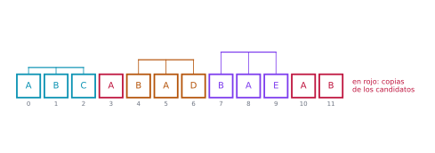
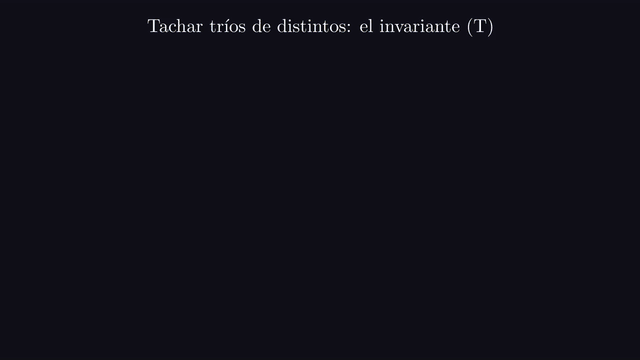
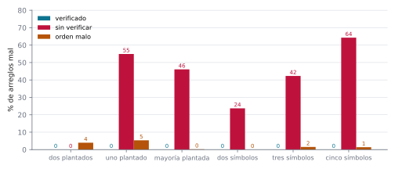
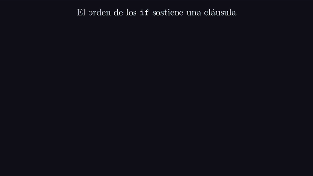

# Ejercicio 8 ★★ · Los elementos que aparecen más de $n/3$ veces

> El elemento que aparece más de $n/3$ veces. Generaliza Boyer-Moore con dos
> candidatos, enuncia el invariante reforzado y demuéstralo. Después escribe la versión
> que devuelve los candidatos con contador positivo sin verificarlos, y busca un
> generador de pruebas que no la atrape. Cuidado: el análogo del generador binario sí
> la atrapa.

El algoritmo de votación de Boyer y Moore (1991) encuentra la mayoría en una pasada, y
Misra y Gries (1982) lo generalizaron a los elementos que aparecen más de $n/k$ veces
con $k - 1$ contadores. Aquí hacemos el caso $k = 3$. El algoritmo es corto. Lo que
pide cuidado es el invariante: el que uno escribe primero no es inductivo, y el
reforzado tiene una cláusula que casi todo el mundo olvida y que es la que sostiene el
orden de los `if`. Después estudiamos qué generadores de pruebas ven el atajo que se
salta la verificación, y por qué el análogo del generador binario, que en el problema
de la mayoría no lo veía, aquí sí lo ve.

Todos los números de este documento los imprime [`ejercicio-08.py`](ejercicio-08.py),
que además corre las pruebas y regenera las dos figuras. Solo necesita matplotlib:

```bash
python ejercicio-08.py
```

## 1. El problema

**Elementos frecuentes.** Dado un arreglo $A$ de $n$ elementos, devolver todos los que
aparecen más de $n/3$ veces, en tiempo $O(n)$ y memoria extra $O(1)$.

Tres precisiones que un enunciado tiene que dar, y que casi nunca se dan:

- **Qué se puede preguntar sobre los elementos.** Solo si dos son iguales. No hay orden
  ni función de hash, así que ordenar o contar con un diccionario no vale, y con
  memoria $O(1)$ tampoco cabría el diccionario.
- **Qué devolver.** El enunciado dice "el elemento", pero puede haber ninguno, uno o
  dos. Hay que devolverlos todos.
- **"Más de" es estricto.** Con $n = 12$, aparecer 4 veces no alcanza. El ejemplo de la
  sección 2 depende de eso.

Que puedan ser a lo sumo dos es la primera cuenta:

**Lema.** A lo sumo dos elementos aparecen más de $n/3$ veces.

*Demostración.* Tres de ellos sumarían más de $3 \cdot n/3 = n$ apariciones. $\square$

## 2. Un ejemplo chico antes del algoritmo

La primera pasada del algoritmo de la sección 3 sobre `A B C A B A D B A E A B`. El
algoritmo tiene dos lugares, cada uno con un **candidato** ($c_1$ o $c_2$) y un
**contador** ($k_1$ o $k_2$) de copias vivas de ese candidato; un contador en 0 quiere
decir que el lugar está libre, y la tabla lo marca con –. Cada fila es el estado
después de leer $x = A[i]$. La línea de los tríos y la de "sin verificar" se explican
más abajo:

```
 i  x   c1  k1   c2  k2
 0  A    A   1    –   0
 1  B    A   1    B   1
 2  C    –   0    –   0
 3  A    A   1    –   0
 4  B    A   1    B   1
 5  A    A   2    B   1
 6  D    A   1    –   0
 7  B    A   1    B   1
 8  A    A   2    B   1
 9  E    A   1    –   0
10  A    A   2    –   0
11  B    A   2    B   1
tríos (posiciones): 0-1-2 5-4-6 8-7-9
cuentas: {'A': 5, 'B': 4, 'C': 1, 'D': 1, 'E': 1}  n/3 = 4
sin verificar devuelve ['A', 'B']; verificado devuelve ['A']; el oráculo dice ['A']
```



*Figura 1. La primera pasada sobre A B C A B A D B A E A B. Cada trío une un elemento
que no coincidió con ningún candidato con una copia de cada uno. Quedan sin tachar dos
A y una B, en rojo: son las copias que marcan los contadores al final.*

Al final, $B$ aparece 4 veces de 12, que no es más de un tercio, y sin embargo termina
como candidato con contador positivo. Fíjate en lo que eso dice: el candidato no es "el
que aparece más de $n/3$ veces", sino lo que sobrevive a la cancelación. Por eso hace
falta verificar.

## 3. El algoritmo y el invariante reforzado

**Cómo se le ocurre a uno.** Es la cancelación del problema de la mayoría, cambiando
parejas por tríos. Si tachamos tres elementos distintos, uno que aparecía $k > n/3$
veces pierde a lo sumo una copia y queda con $k - 1 > (n - 3)/3$: sigue apareciendo más
de un tercio de lo que queda. Podemos seguir tachando tríos de distintos hasta que no
se pueda más. Entonces quedan a lo sumo dos valores distintos, y los buscados tienen
que estar entre ellos. Recordar dos sobrevivientes pide dos pares candidato-contador.

```python
def first_pass(A):
    c1 = c2 = None
    k1 = k2 = 0
    for x in A:
        if k1 > 0 and x == c1:
            k1 += 1
        elif k2 > 0 and x == c2:
            k2 += 1
        elif k1 == 0:
            c1, k1 = x, 1
        elif k2 == 0:
            c2, k2 = x, 1
        else:                      # x distinto de los dos candidatos vivos
            k1 -= 1
            k2 -= 1
    return c1, k1, c2, k2

def more_than_third(A):
    c1, k1, c2, k2 = first_pass(A)
    candidatos = {c for c, k in ((c1, k1), (c2, k2)) if k > 0}
    return {c for c in candidatos if 3 * A.count(c) > len(A)}
```

El invariante que uno escribe primero es la frase que queremos al final: "si el prefijo
tiene un elemento con más de un tercio, es un candidato vivo". Como en el problema de la
mayoría, es verdadero pero no inductivo: un prefijo sin tal elemento no dice nada del
siguiente. El invariante reforzado describe el estado completo.

**Invariante (T).** Después de procesar $A[0..i]$, el prefijo se parte en tríos de tres
elementos distintos, más $k_1$ copias de $c_1$ y $k_2$ copias de $c_2$. Además, si
$k_1 > 0$ y $k_2 > 0$, entonces $c_1 \ne c_2$.

**Teorema.** (T) se cumple después de procesar cada prefijo.

*Demostración.* *Inicialización.* Prefijo vacío, cero tríos y $k_1 = k_2 = 0$.

*Mantenimiento.* Supongamos (T) y procesemos $x$. Hay cinco casos, uno por rama. Si
$k_1 > 0$ y $x = c_1$, $x$ es una copia más de $c_1$, y si $k_2 > 0$ sigue siendo
$c_1 \ne c_2$. Si $k_2 > 0$ y $x = c_2$, igual. Si $k_1 = 0$, $c_1$ pasa a ser $x$ con
una copia. Si además $k_2 > 0$, la rama anterior no se tomó, así que $x \ne c_2$ y la
cláusula de distintos se conserva. Si $k_2 = 0$ (y $k_1 > 0$), igual, porque la primera
rama no se tomó y $x \ne c_1$. Si no, $k_1 > 0$, $k_2 > 0$, $x \ne c_1$ y $x \ne c_2$.
Por (T), $c_1 \ne c_2$, así que $x$, una copia de $c_1$ y una de $c_2$ son **tres
distintos**: forman un trío, y quedan $k_1 - 1$ y $k_2 - 1$ copias. $\square$

El paso delicado es el último caso. El trío es de distintos **porque** $c_1 \ne c_2$, y
esa cláusula se sostiene gracias al orden de los `if`, en el que las dos ramas que
suben contadores van antes que las que llenan lugares libres.



*Animación 1. La primera pasada sobre A B C A B A D B A E A B. Cada elemento termina
como copia viva de un candidato o dentro de un trío de tres distintos, que es el
invariante (T). En mejor calidad: [MP4](animaciones/ejercicio-08-trios.mp4).*

**Teorema.** Al terminar la primera pasada, todo elemento que aparece más de $n/3$ veces
es un candidato vivo. En consecuencia `more_than_third` es correcta, con tiempo $O(n)$
y memoria $O(1)$.

*Demostración.* Por (T), al terminar, $A$ se parte en $t$ tríos de distintos y
$k_1 + k_2 = n - 3t$ copias de los candidatos. Si $m$ aparece más de $n/3$ veces y no es
un candidato vivo, solo aparece en los tríos, a lo sumo una vez en cada uno, así que a
lo sumo $t \le n/3$ veces: contradicción. La segunda pasada, que cuenta, deja solo los
candidatos que de verdad superan $n/3$. Son dos pasadas, y la memoria son dos
candidatos y dos contadores. $\square$

Para vigilar (T) con `assert` hace falta saber cuándo un multiconjunto se parte en
tríos de distintos.

**Lema.** Un multiconjunto de tamaño $3t$ se parte en $t$ tríos de elementos distintos
si y solo si ningún elemento aparece más de $t$ veces.

*Demostración.* La condición es necesaria porque cada trío tiene a lo sumo una copia de
cada elemento. Para la suficiencia, escribimos los elementos agrupados por valor en una
grilla de 3 filas y $t$ columnas, llenándola por filas. Cada columna ocupa las
posiciones $c$, $c + t$ y $c + 2t$, y un bloque de a lo sumo $t$ posiciones
consecutivas no puede contener dos que difieran en $t$. Así que cada columna es un trío
de distintos. $\square$

Las pruebas comparan este criterio con una búsqueda de la partición por fuerza bruta.
Con él, el script vigila (T) en cada prefijo:

```
invariante comprobado en 42 551 prefijos, sin fallos
```

## 4. El atajo sin verificar

El teorema va en una sola dirección: los elementos con más de un tercio son candidatos
vivos. No dice que los candidatos vivos tengan más de un tercio. El atajo que se salta
la segunda pasada,

```python
def unverified(A):
    c1, k1, c2, k2 = first_pass(A)
    return {c for c, k in ((c1, k1), (c2, k2)) if k > 0}
```

entonces nunca deja afuera a uno correcto, pero puede devolver de más. Comprobémoslo en
arreglos al azar:

```
en 20 000 arreglos de cinco símbolos, el atajo deja afuera un elemento correcto 0 veces
```

## 5. Qué generadores de pruebas detectan el atajo

El porcentaje de arreglos en que cada versión se equivoca, según el generador. Cada
generador fabrica arreglos de una forma distinta: **dos plantados** mete dos elementos
con más de $n/3$ apariciones cada uno, **uno plantado** mete uno solo, **mayoría
plantada** mete uno con más de $n/2$, y los de **dos**, **tres** y **cinco símbolos**
eligen cada elemento al azar entre esa cantidad de valores. La última columna es una
variante que estudiamos en la sección 6.

```
        generador  verificado  sin verificar  orden malo
    dos plantados        0.0%           0.0%        4.0%
     uno plantado        0.0%          54.9%        5.3%
 mayoría plantada        0.0%          46.1%        0.2%
     dos símbolos        0.0%          23.7%        0.0%
    tres símbolos        0.0%          42.3%        1.6%
   cinco símbolos        0.0%          64.3%        1.4%
```



*Figura 2. Porcentaje de arreglos en que cada versión se equivoca, según cómo se
generaron. El atajo sin verificar es indistinguible del algoritmo correcto solo con el
generador que planta dos elementos.*

**Lema.** Si el arreglo tiene dos elementos con más de $n/3$ apariciones cada uno, el
atajo sin verificar devuelve exactamente esos dos.

*Demostración.* Por el teorema de la sección 3, los dos son candidatos vivos. Hay solo
dos lugares, así que los candidatos vivos son exactamente esos dos, y los dos son
correctos. $\square$

El generador de **dos plantados** es entonces el que no detecta el atajo. Es el análogo
de la "mayoría plantada" del problema de la mayoría: solo produce arreglos donde el
teorema ya obliga a que todos los candidatos vivos sean respuestas correctas. Con
**un** solo plantado, en cambio, el segundo lugar queda libre para un candidato falso,
y el atajo se equivoca en el 54,9 % de los casos. Lo mismo con una mayoría plantada,
porque tener más de la mitad no alcanza para llenar los dos lugares.

**El generador binario sí lo detecta.** En el problema de la mayoría, con un solo
candidato, un arreglo de dos símbolos hacía que el contador final fuera la diferencia
de las dos cuentas, y el atajo era correcto. Aquí pasa lo contrario.

**Lema.** Sobre un arreglo de dos símbolos, los contadores de la primera pasada nunca
bajan y terminan valiendo las cuentas exactas. En particular, todo símbolo que aparece
queda vivo, y el atajo falla siempre que un símbolo aparece pero no supera $n/3$.

*Demostración.* La rama que baja los contadores necesita un $x$ distinto de dos
candidatos vivos y distintos entre sí, es decir, un tercer símbolo, que no existe. Así
que cada símbolo ocupa su lugar desde que aparece, su contador solo sube, y al final
vale su cuenta. $\square$

El contraejemplo más corto, buscado por fuerza bruta, tiene tres elementos:

```
dos símbolos: A A B -> cuentas {'A': 2, 'B': 1}, sin verificar ['A', 'B'], verdad ['A']
tres símbolos: A A B -> cuentas {'A': 2, 'B': 1}, sin verificar ['A', 'B'], verdad ['A']
```

El análogo exacto del caso binario sería un alfabeto con un símbolo más que lugares, es
decir, de tres símbolos. También lo detecta, en el 42,3 % de los arreglos. Con tres
símbolos, si $t$ es la cantidad de tríos, cada símbolo aparece $t$ veces más sus copias
vivas: un candidato vivo aparece más que el tercer símbolo, pero eso no lo pone por
encima de $n/3$.

## 6. El error que anuncia la cláusula olvidada

La última columna de la tabla de la sección 5 es otra variante: la que llena el primer
lugar libre **antes** de mirar si $x$ ya es el otro candidato. Parece un reordenamiento
inofensivo de los `if`, pero rompe la cláusula $c_1 \ne c_2$ de (T):

```
A B B C B A: candidatos (B, 0) y (B, 0); verificado con el orden malo [], verdad ['B']
```

Cuando llega la segunda $B$ de la posición 4, el primer lugar está libre y la variante
pone ahí a $B$, aunque $B$ ya es el segundo candidato. Quedan dos copias vivas de $B$ en
lugares distintos, y la $A$ final las "cancela" juntas en un trío que no es de
distintos. $B$ aparece 3 veces de 6, y el algoritmo verificado no la devuelve. Es un
error que deja **afuera** una respuesta correcta, y la verificación no lo puede
arreglar, porque solo filtra. Los generadores lo detectan pocas veces, entre un 0 % y
un 5,3 %. Lo que lo anuncia es la cláusula de (T) que dice que los dos candidatos vivos
son distintos, y el último caso del mantenimiento, que la usa.



*Animación 2. La variante que llena un lugar libre antes de mirar el otro candidato,
sobre A B B C B A: dos copias vivas de B en lugares distintos, que la A final cancela
juntas. En mejor calidad: [MP4](animaciones/ejercicio-08-orden-malo.mp4).*

Antes de dibujar, el script se comprueba a sí mismo: el algoritmo verificado contra el
oráculo en todos los arreglos de hasta 7 elementos sobre 4 símbolos; 20 000 arreglos de
hasta 60 elementos con alfabetos de 2 a 100 símbolos, donde el verificado acierta y el
atajo nunca deja afuera a uno correcto; 20 000 arreglos con dos plantados, donde el
atajo no se equivoca nunca; y el criterio de los tríos contra la fuerza bruta en todos
los multiconjuntos de hasta 9 elementos sobre 4 símbolos:

```
82 560 comprobaciones, 0 fallos
```

La regla práctica que te llevas: **antes de confiar en un generador de pruebas,
pregúntate si en las entradas que fabrica la respuesta correcta y la del atajo pueden
ser distintas.** Si el teorema ya las obliga a coincidir, como con dos plantados, el
generador no puede ver nada, por muchas pruebas que corra.

## 7. Resumen

- Tachar tres distintos conserva a los que aparecen más de un tercio. Dos pares
  candidato-contador recuerdan lo que sobrevive, y una segunda pasada verifica.
- El invariante reforzado es la partición en tríos de distintos más las copias vivas,
  **con los dos candidatos vivos distintos**. Esa cláusula es la que hace que cada
  cancelación sea un trío de distintos, y la sostiene el orden de los `if`.
- La conclusión va en una dirección: los que superan un tercio son candidatos vivos.
  El atajo sin verificar nunca deja afuera a uno correcto, pero devuelve de más.
- Plantar dos elementos con más de un tercio nunca detecta el atajo, porque llena los
  dos lugares con respuestas correctas. El generador de dos símbolos lo detecta en el
  23,7 % de los casos, al revés que en el problema de la mayoría.
- Llenar un lugar libre antes de comparar con el otro candidato rompe la cláusula de
  distintos y deja afuera respuestas correctas, algo que ninguna verificación arregla.

<details>
<summary>Salida completa de <code>python ejercicio-08.py</code></summary>

```
§2. Ejemplo chico: A B C A B A D B A E A B
------------------------------------------
 i  x   c1  k1   c2  k2
 0  A    A   1    –   0
 1  B    A   1    B   1
 2  C    –   0    –   0
 3  A    A   1    –   0
 4  B    A   1    B   1
 5  A    A   2    B   1
 6  D    A   1    –   0
 7  B    A   1    B   1
 8  A    A   2    B   1
 9  E    A   1    –   0
10  A    A   2    –   0
11  B    A   2    B   1
tríos (posiciones): 0-1-2 5-4-6 8-7-9
cuentas: {'A': 5, 'B': 4, 'C': 1, 'D': 1, 'E': 1}  n/3 = 4
sin verificar devuelve ['A', 'B']; verificado devuelve ['A']; el oráculo dice ['A']

§3. El invariante reforzado, vigilado con assert
------------------------------------------------
invariante comprobado en 42 551 prefijos, sin fallos

§5. Los contraejemplos más cortos
---------------------------------
dos símbolos: A A B -> cuentas {'A': 2, 'B': 1}, sin verificar ['A', 'B'], verdad ['A']
tres símbolos: A A B -> cuentas {'A': 2, 'B': 1}, sin verificar ['A', 'B'], verdad ['A']

§5 y §6. Qué generadores atrapan cada error
-------------------------------------------
        generador  verificado  sin verificar  orden malo
    dos plantados        0.0%           0.0%        4.0%
     uno plantado        0.0%          54.9%        5.3%
 mayoría plantada        0.0%          46.1%        0.2%
     dos símbolos        0.0%          23.7%        0.0%
    tres símbolos        0.0%          42.3%        1.6%
   cinco símbolos        0.0%          64.3%        1.4%
en 20 000 arreglos de cinco símbolos, el atajo deja afuera un elemento correcto 0 veces

§6. El orden de los if: el contraejemplo más corto
--------------------------------------------------
A B B C B A: candidatos (B, 0) y (B, 0); verificado con el orden malo [], verdad ['B']

Pruebas
-------
82 560 comprobaciones, 0 fallos

figuras: ejercicio-08-trios.svg, ejercicio-08-generadores.svg
```

</details>

