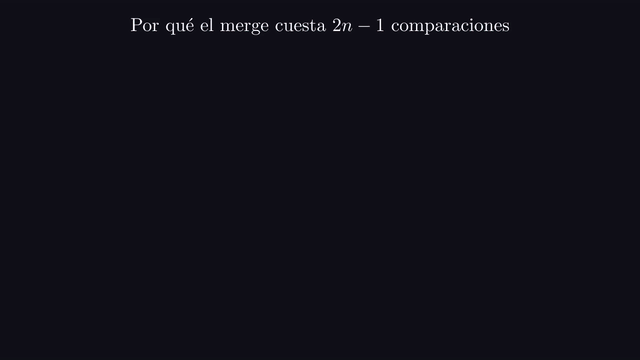
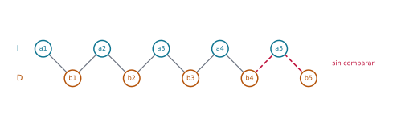
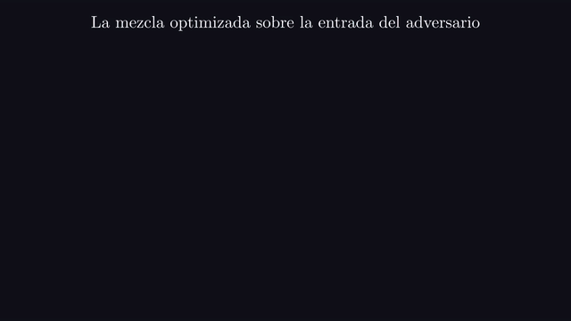
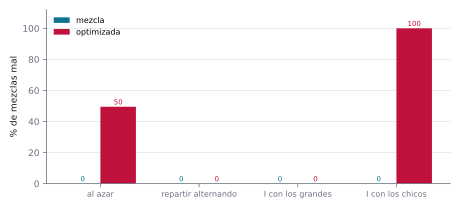

# Ejercicio 9 ★★ · Una mezcla "optimizada" que la cota inferior delata

> Una mezcla "optimizada" de dos listas ordenadas de largo $n$ deja de comparar cuando a
> la primera lista le queda un solo elemento, y lo pone al final. Cuenta cuántas
> comparaciones hace en el peor caso. Sin probarla, usa la cota mínima de la mezcla para
> decidir si es correcta, y construye con el adversario la entrada en la que falla.

Este ejercicio usa una cota inferior para algo distinto de lo habitual. En vez de decir
"no se puede hacer más rápido", la usamos como especificación: un algoritmo que afirma
hacer menos trabajo que una cota demostrada tiene que estar mal. Que mezclar dos listas
de largo $n$ cuesta $2n - 1$ comparaciones en el peor caso es un resultado clásico
(Knuth, 1998, §5.3.2). Vamos a contar las comparaciones de la variante, ver que son
menos, y concluir que es incorrecta sin ejecutarla. Después, la demostración de la cota
nos va a decir exactamente qué entrada la rompe.

Todos los números de este documento los imprime [`ejercicio-09.py`](ejercicio-09.py),
que además corre las pruebas y regenera las dos figuras. Solo necesita matplotlib:

```bash
python ejercicio-09.py
```

## 1. El problema

**Mezcla.** Dadas dos listas ordenadas $I$ y $D$ de largo $n$, devolver la lista
ordenada con sus $2n$ elementos. El costo es la cantidad de comparaciones entre
elementos. La mezcla usual (Cormen et al., 2009, §2.3.1) y la variante del enunciado:

```python
def mezcla(I, D):
    R, i, j = [], 0, 0
    while i < len(I) and j < len(D):
        if I[i] <= D[j]:
            R.append(I[i]); i += 1
        else:
            R.append(D[j]); j += 1
    return R + I[i:] + D[j:]

def mezcla_optimizada(I, D):
    R, i, j = [], 0, 0
    while len(I) - i > 1 and j < len(D):      # se detiene con un solo elemento en I
        if I[i] <= D[j]:
            R.append(I[i]); i += 1
        else:
            R.append(D[j]); j += 1
    if j == len(D):
        return R + I[i:]
    return R + D[j:] + I[i:]                  # el último de I, al final
```

La "optimización" supone que el último elemento de $I$ es mayor que todo lo que queda
de $D$, y se ahorra las comparaciones que lo confirmarían.

Tres precisiones que un enunciado tiene que dar, y que casi nunca se dan:

- **Qué quiere decir "dejar de comparar".** El ciclo sigue mientras a $I$ le queden al
  menos dos elementos y a $D$ al menos uno. Cuando a $I$ le queda uno, se coloca el
  resto de $D$ y después ese uno, como en el código.
- **Las dos listas tienen el mismo largo.** La cota $2n - 1$ es para listas de largo $n$
  y $n$. Con largos muy distintos la historia cambia.
- **Qué es "correcta" con repetidos.** Que la salida esté ordenada. Con valores
  distintos eso es lo mismo que coincidir con la mezcla usual, y la sección 5 usa
  valores distintos; las pruebas cubren también los repetidos.

## 2. Un ejemplo chico antes de la cuenta

Dos entradas hechas a mano:

```
I = [1, 4, 6, 9], D = [2, 3, 7, 8]: optimizada [1, 2, 3, 4, 6, 7, 8, 9] con 5 comparaciones; correcta
I = [2, 4, 6, 8], D = [1, 3, 5, 7]: optimizada [1, 2, 3, 4, 5, 6, 7, 8] con 6 comparaciones; correcta
```

Las dos salen bien, y la segunda es de peor caso para la variante: 6 comparaciones con
$n = 4$, es decir, $2n - 2$. Fíjate en que las dos tienen el máximo, 9 y 8, en $I$. La
cota inferior de la sección 4 muestra que estos dos éxitos no prueban nada.

## 3. Cuántas comparaciones hace

**Lema.** La mezcla optimizada hace a lo sumo $2n - 2$ comparaciones, y la cota se
alcanza.

*Demostración.* Cada comparación saca exactamente un elemento a la salida, y el ciclo
sigue mientras a $I$ le queden al menos dos elementos y a $D$ al menos uno. Si sale
porque $D$ se acaba, la última comparación sacó un elemento de $D$ cuando a $I$ le
quedaban al menos dos, así que de $I$ salieron a lo sumo $n - 2$, y en total a lo sumo
$n + (n - 2) = 2n - 2$. Si sale porque a $I$ le queda uno, de $I$ salieron $n - 1$ y de
$D$ a lo sumo $n - 1$, porque todavía le queda alguno, y en total a lo sumo $2n - 2$.
La cota se alcanza con

$$b_1 < a_1 < b_2 < a_2 < \dots < b_{n-1} < a_{n-1} < \dots,$$

donde las comparaciones sacan un elemento de cada lista alternadamente. $\square$

El script recorre todas las entradas sin repetidos para $n \le 10$:

```
  n  entradas  optimizada  2n - 2  mezcla  2n - 1  optimizada bien
  1         2           0       0       1       1            50.0%
  2         6           2       2       3       3            50.0%
  3        20           4       4       5       5            50.0%
  4        70           6       6       7       7            50.0%
  5       252           8       8       9       9            50.0%
  6       924          10      10      11      11            50.0%
  7     3 432          12      12      13      13            50.0%
  8    12 870          14      14      15      15            50.0%
  9    48 620          16      16      17      17            50.0%
 10   184 756          18      18      19      19            50.0%
```

El peor caso de la variante es $2n - 2$ y el de la mezcla usual $2n - 1$, para todo
$n$. La última columna ya delata el problema, pero el objetivo es llegar a esa
conclusión sin probar nada.

## 4. La cota inferior: la decisión sin ejecutar

**Cómo se le ocurre a uno.** ¿Qué entrada obliga a mirarlo todo? Una en la que cada
elemento está pegado a uno de la otra lista, de modo que el orden entre ellos no se
pueda deducir de ninguna otra comparación. Si los dos vecinos son de la misma lista, su
orden ya se sabe; si son de listas distintas y nadie los comparó, podrían estar al
revés. La entrada intercalada hace que **todos** los vecinos sean de listas distintas.

**Teorema.** Todo algoritmo correcto de mezcla por comparaciones hace al menos $2n - 1$
comparaciones en el peor caso.

*Demostración.* El adversario contesta como si la entrada fuera la intercalada
perfecta,

$$a_1 < b_1 < a_2 < b_2 < \dots < a_n < b_n ,$$

con $I = (a_1, \dots, a_n)$ y $D = (b_1, \dots, b_n)$. Esa cadena tiene $2n - 1$ pares
de vecinos, y cada par tiene un elemento de cada lista. Supongamos que un algoritmo
termina sin haber comparado algún par de vecinos $x < y$, e intercambiemos sus valores.
Las dos listas siguen ordenadas, porque $x$ e $y$ son vecinos en la cadena y no hay nada
entre ellos. Todas las comparaciones que el algoritmo hizo dan la misma respuesta,
porque ninguna enfrentó a $x$ con $y$ y el orden de cada uno con los demás no cambió.
Pero la salida correcta sí cambió: $x$ e $y$ tienen que aparecer en el orden inverso.
El algoritmo recibe las mismas respuestas en las dos entradas, da la misma salida, y se
equivoca en una. Así que todo algoritmo correcto compara los $2n - 1$ pares. $\square$



*Animación 1. Si un algoritmo no compara dos vecinos de la intercalada, intercambiarlos
deja las listas ordenadas y todas las respuestas iguales, pero cambia la salida
correcta. En mejor calidad: [MP4](animaciones/ejercicio-09-intercambio.mp4).*

**Corolario.** La mezcla optimizada no es correcta.

*Demostración.* Por el lema de la sección 3 nunca hace más de $2n - 2$ comparaciones, y
por el teorema todo algoritmo correcto hace al menos $2n - 1$ sobre la entrada
intercalada. $\square$

La conclusión se obtiene sin haber ejecutado la variante sobre una sola entrada.

## 5. La entrada que la rompe

La demostración del teorema indica dónde buscar: en la intercalada, la variante deja
algún par de vecinos sin comparar. Corrámosla ahí con $n = 5$:

```
salida de la optimizada: a1 b1 a2 b2 a3 b3 a4 b4 b5 a5
salida correcta:         a1 b1 a2 b2 a3 b3 a4 b4 a5 b5
comparaciones: 7; pares de vecinos: 9; sin comparar: (b4, a5), (a5, b5)
con a5 y b5 intercambiados: mismas respuestas a las comparaciones: True; la optimizada acierta: True
```



*Figura 1. La entrada intercalada con $n = 5$. Las líneas grises son los pares de
vecinos que la optimizada compara al correr sobre ella. Los dos pares rojos nunca se
comparan, y uno de ellos, $(a_5, b_5)$, queda en el orden equivocado.*



*Animación 2. La mezcla optimizada sobre la entrada intercalada: 7 comparaciones, dos
pares de vecinos sin comparar, y $b_5$ antes que $a_5$. En mejor calidad:
[MP4](animaciones/ejercicio-09-optimizada.mp4).*

Cuando a $I$ le queda solo $a_5$, la variante coloca $b_4$ y $b_5$ y después $a_5$,
pero $a_5 < b_5$. La última línea es la demostración del teorema hecha experimento: con
$a_5$ y $b_5$ intercambiados, las respuestas a todas las comparaciones son las mismas,
y ahí la variante sí acierta. No puede distinguir las dos entradas, así que falla en
una. ¿En cuáles exactamente?

**Lema.** Con valores distintos, la mezcla optimizada devuelve la mezcla correcta si y
solo si el máximo de los $2n$ elementos está en $I$.

*Demostración.* Mientras el ciclo corre, la variante hace lo mismo que la mezcla usual,
así que $R$ es la mezcla correcta de lo consumido, y todo lo consumido es menor que lo
que queda. Si sale porque $D$ se acabó, devuelve $R$ seguido del resto de $I$, que es
correcto, y en ese caso el máximo está en $I$. Si sale con un solo elemento $a_n$ en
$I$, devuelve $R$, el resto de $D$ y $a_n$. Como el resto de $D$ está ordenado, la
salida es correcta si y solo si $a_n$ es mayor que el último de $D$, es decir, si y
solo si el máximo está en $I$. $\square$

```
en las 250 952 entradas con n de 1 a 10, la optimizada acierta si y solo si el máximo está en I: se cumple en 250 952
```

Con datos al azar el máximo está en cualquiera de las dos listas con la misma
probabilidad, y por eso la tabla de la sección 3 da exactamente 50 %.

## 6. Qué baterías de pruebas ven el error

```
             batería  casos  mezcla  optimizada
             al azar   4000    0.0%       49.5%
 repartir alternando   4000    0.0%        0.0%
   I con los grandes   4000    0.0%        0.0%
    I con los chicos   4000    0.0%      100.0%
```



*Figura 2. Porcentaje de mezclas mal hechas, según cómo se generaron las listas.
Repartir una lista ordenada alternando, empezando por $D$, deja siempre el máximo en
$I$.*

Este error no es difícil de ver al azar: falla en la mitad de los casos. Pero hay
baterías naturales que no lo ven nunca. "Repartir alternando" toma una lista ordenada y
la reparte entre $D$ e $I$ empezando por $D$. Es una manera común de fabricar dos
listas ordenadas, y por el lema de la sección 5 deja siempre el máximo en $I$. Lo mismo
pasa si $I$ tiene los valores grandes. La cota inferior detectó el error sin correr
nada, y el adversario dijo qué probar: una entrada en la que el último de $I$ no es el
máximo.

Antes de dibujar, el script se comprueba a sí mismo: 20 000 pares de listas con
repetidos y largos distintos, donde la mezcla da lo mismo que ordenar y nunca usa más
de $|I| + |D| - 1$ comparaciones; todas las entradas con $n \le 10$, donde la variante
nunca pasa de $2n - 2$ y la mezcla compara exactamente los $2n - 1$ pares de vecinos de
la intercalada; y 20 000 pares con repetidos, donde la variante acierta si y solo si el
último de $I$ es al menos el último de $D$:

```
290 962 comprobaciones, 0 fallos
```

La regla práctica que te llevas: **una cota inferior es una especificación.** Un
algoritmo que dice hacer menos trabajo que una cota demostrada está mal, y la
demostración de la cota, que construye la entrada difícil, dice dónde.

## 7. Resumen

- La mezcla optimizada hace a lo sumo $2n - 2$ comparaciones, y ese peor caso se
  alcanza.
- Mezclar exige $2n - 1$: el adversario de la intercalada obliga a comparar cada par de
  vecinos, porque intercambiar un par no comparado cambia la respuesta sin cambiar
  ninguna comparación.
- Como $2n - 2 < 2n - 1$, la variante es incorrecta, y eso se decide sin probarla.
- En la intercalada deja sin comparar $(a_n, b_n)$ y los coloca al revés. En general
  acierta si y solo si el máximo está en la primera lista: la mitad de las entradas.
- Repartir alternando, empezando por la segunda lista, es una batería natural que no ve
  el error nunca.

<details>
<summary>Salida completa de <code>python ejercicio-09.py</code></summary>

```
§2. Ejemplo chico: n = 4
------------------------
I = [1, 4, 6, 9], D = [2, 3, 7, 8]: optimizada [1, 2, 3, 4, 6, 7, 8, 9] con 5 comparaciones; correcta
I = [2, 4, 6, 8], D = [1, 3, 5, 7]: optimizada [1, 2, 3, 4, 5, 6, 7, 8] con 6 comparaciones; correcta

§3. Comparaciones en el peor caso, sobre todas las entradas
-----------------------------------------------------------
  n  entradas  optimizada  2n - 2  mezcla  2n - 1  optimizada bien
  1         2           0       0       1       1            50.0%
  2         6           2       2       3       3            50.0%
  3        20           4       4       5       5            50.0%
  4        70           6       6       7       7            50.0%
  5       252           8       8       9       9            50.0%
  6       924          10      10      11      11            50.0%
  7     3 432          12      12      13      13            50.0%
  8    12 870          14      14      15      15            50.0%
  9    48 620          16      16      17      17            50.0%
 10   184 756          18      18      19      19            50.0%

§5. La entrada del adversario: a1 < b1 < a2 < b2 < ... < an < bn
----------------------------------------------------------------
salida de la optimizada: a1 b1 a2 b2 a3 b3 a4 b4 b5 a5
salida correcta:         a1 b1 a2 b2 a3 b3 a4 b4 a5 b5
comparaciones: 7; pares de vecinos: 9; sin comparar: (b4, a5), (a5, b5)
con a5 y b5 intercambiados: mismas respuestas a las comparaciones: True; la optimizada acierta: True

§5. Cuándo falla exactamente
----------------------------
en las 250 952 entradas con n de 1 a 10, la optimizada acierta si y solo si el máximo está en I: se cumple en 250 952

§6. Qué baterías de pruebas ven el error
----------------------------------------
             batería  casos  mezcla  optimizada
             al azar   4000    0.0%       49.5%
 repartir alternando   4000    0.0%        0.0%
   I con los grandes   4000    0.0%        0.0%
    I con los chicos   4000    0.0%      100.0%

Pruebas
-------
290 962 comprobaciones, 0 fallos

figuras: ejercicio-09-adversario.svg, ejercicio-09-baterias.svg
```

</details>

