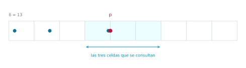
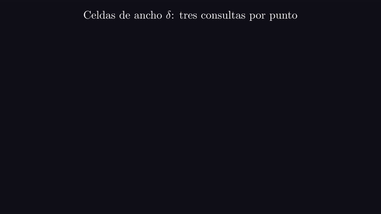
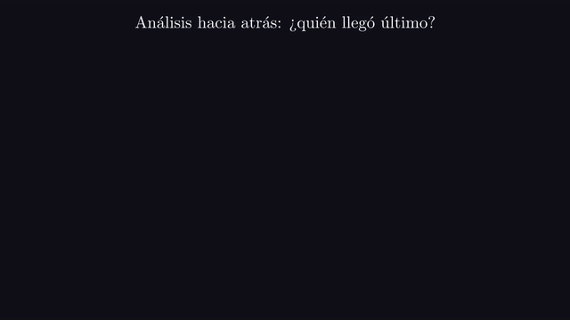
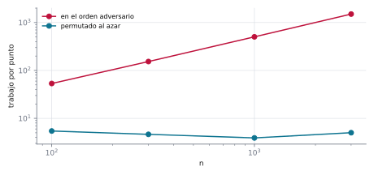
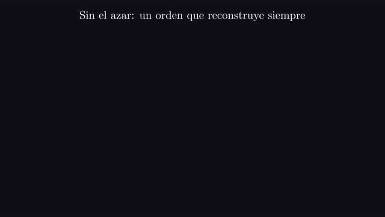

# Ejercicio 10 ★★ · El par más cercano en una dimensión

> Par más cercano en una dimensión. Demuestra $\Omega(n \log n)$ en árboles de decisión
> algebraicos por reducción desde distinción de elementos. Después di qué algoritmo
> rompe la cota, en qué modelo, y adáptalo a una dimensión.

Una cota inferior nunca es sobre un problema solo, sino sobre un problema **en un
modelo**. Este ejercicio lo muestra con un caso en que las dos cosas conviven: el par
más cercano requiere $\Omega(n \log n)$ en árboles de decisión algebraicos, y hay un
algoritmo que lo resuelve en tiempo esperado $O(n)$. No hay contradicción, y el trabajo
es decir exactamente qué operación usa el algoritmo que el modelo no tiene. Primero la
reducción, que en una dimensión no cuesta nada. Después el algoritmo con rejilla,
adaptado a una dimensión, con su correctitud, su costo esperado por análisis hacia
atrás y un error plantado.

Todos los números de este documento los imprime [`ejercicio-10.py`](ejercicio-10.py),
que además corre las pruebas y regenera las dos figuras. Solo necesita matplotlib:

```bash
python ejercicio-10.py
```

## 1. El problema

**Par más cercano en una dimensión.** Dados $n$ números reales, la menor distancia
$|x_i - x_j|$ entre dos de ellos, con $i \ne j$. **Distinción de elementos.** Dados $n$
números reales, decidir si hay dos iguales.

Tres precisiones que un enunciado tiene que dar, y que casi nunca se dan:

- **Qué modelo.** Un **árbol de decisión algebraico** es un algoritmo cuyo único acceso
  a la entrada es preguntar el signo (negativo, cero o positivo) de un polinomio de
  grado acotado en los números de la entrada, y ramificar según la respuesta. Su costo
  es la profundidad del árbol. El modelo incluye comparar, sumar, restar, multiplicar y
  comparar distancias, así que ordenar y recorrer, que resuelve el problema en
  $O(n \log n)$, está dentro.
- **Qué hay que devolver.** La distancia. Devolver el par no cambia nada: con el par, la
  distancia es una resta.
- **Reales o enteros.** La cota es para reales. Los puntos del script son enteros, para
  que la parte entera de la sección 4 sea exacta y ninguna celda reciba dos puntos por
  un redondeo.

## 2. La cota inferior

La herramienta estándar para las cotas $\Omega(n \log n)$ en geometría computacional es
un resultado que usamos sin demostrar:

**Teorema (Ben-Or, 1983).** Distinción de elementos requiere $\Omega(n \log n)$ en
árboles de decisión algebraicos.

**Teorema.** El par más cercano en una dimensión requiere $\Omega(n \log n)$ en árboles
de decisión algebraicos.

*Demostración.* Dada una entrada $x_1, \dots, x_n$ de distinción, se la pasa tal cual al
par más cercano: la distancia mínima es 0 si y solo si dos de los $x_i$ son iguales. Si
hubiera un árbol de decisión algebraico de profundidad $T(n) = o(n \log n)$ para el par
más cercano, agregándole al final la pregunta "¿el resultado es cero?" se obtendría uno
para distinción de profundidad $T(n) + 1 = o(n \log n)$, contra el teorema de Ben-Or.
$\square$

```
[31, 7, 19, 52, 7, 40]: par más cercano = 0; hay repetidos
[31, 7, 19, 52, 8, 40]: par más cercano = 1; todos distintos
```

Fíjate en que en una dimensión la reducción no cuesta nada: ni siquiera hay que
transformar la entrada, a diferencia del plano, donde hay que poner los números sobre
un eje.

## 3. Qué rompe la cota, y por qué no hay contradicción

El algoritmo incremental aleatorio con rejilla, que viene de ideas de Rabin (1976) y que
Kleinberg y Tardos (2006, §13.7) presentan en el plano con celdas cuadradas, resuelve
el problema en tiempo esperado $O(n)$. No contradice el teorema de la sección 2, porque
no es un árbol de decisión algebraico, y por dos razones. Calcula
$\lfloor x / \delta \rfloor$, la celda de un punto, y la parte entera no es un
polinomio. Y usa ese número como **dirección**, buscando en una tabla hash la celda
cuyo índice acaba de calcular, y un árbol de decisión no tiene direccionamiento
indirecto. Vive en el modelo RAM, que tiene las dos cosas.

El azar no está en esa lista: distinción de elementos sigue requiriendo
$\Omega(n \log n)$ en árboles de decisión algebraicos aleatorizados (Grigoriev, Karpinski,
Meyer auf der Heide y Smolensky, 1996). El azar le sirve al algoritmo para que se
esperen pocas reconstrucciones. Lo que lo saca del modelo son la parte entera y la
tabla.

En una dimensión esto se ve todavía más claro: con una tabla hash, distinción de
elementos se resuelve en tiempo esperado $O(n)$ sin ninguna rejilla, metiendo cada
número en un conjunto y mirando si ya estaba. La cota de Ben-Or habla del modelo, no del
problema.

## 4. El algoritmo en una dimensión

**Cómo se le ocurre a uno.** Si ya sabemos que la distancia mínima es $\delta$, partir
la recta en celdas de ancho $\delta$ hace que cada celda tenga a lo sumo un punto, y que
un punto nuevo solo pueda estar cerca de los de su celda y las vecinas. Así, insertar un
punto cuesta tres consultas, salvo cuando $\delta$ baja y hay que rehacer la rejilla. Si
los puntos llegan en orden al azar, eso pasa pocas veces.

Se permutan los puntos al azar y se insertan de a uno, manteniendo $\delta$, la
distancia mínima entre los ya insertados. La rejilla son celdas
$[k\delta, (k+1)\delta)$, guardadas en un diccionario, y la celda del punto $x$ es
$\lfloor x / \delta \rfloor$.

```python
def par_mas_cercano(xs, semilla=0):
    pts = list(xs)
    random.Random(semilla).shuffle(pts)
    d = abs(pts[0] - pts[1])
    if d == 0:
        return 0
    tabla = {pts[0] // d: pts[0], pts[1] // d: pts[1]}
    for i in range(2, len(pts)):
        p, c = pts[i], pts[i] // d
        mejor = min([d] + [abs(p - tabla[k]) for k in (c - 1, c, c + 1) if k in tabla])
        if mejor == 0:
            return 0
        if mejor < d:                          # delta bajó: reconstruir
            d = mejor
            tabla = {q // d: q for q in pts[:i + 1]}
        else:
            tabla[c] = p
    return d
```

**Invariante (R).** Después de insertar cada punto, $\delta$ es la distancia mínima
entre los puntos insertados, y cada celda de la tabla contiene a lo sumo un punto.

**Teorema.** (R) se cumple después de cada inserción, y el algoritmo devuelve la
distancia del par más cercano.

*Demostración.* *Una celda, un punto.* Dos puntos en la misma celda están a distancia
menor que su ancho, $\delta$, y $\delta$ es la distancia mínima entre los insertados. Al
reconstruir con un $\delta$ más chico, la propiedad se mantiene por la misma razón.
*Tres celdas bastan.* Si un punto $q$ ya insertado está a distancia menor que $\delta$
de $p$, entonces $|p/\delta - q/\delta| < 1$, y sus celdas difieren en a lo sumo 1: $q$
está en la celda de $p$ o en una de las dos vecinas. Así que, si ninguna de esas tres
celdas tiene un punto más cerca que $\delta$, $\delta$ no cambia; y si alguna lo tiene,
el algoritmo encuentra el más cercano entre ellos, que es la nueva distancia mínima. Por
inducción sobre los puntos insertados, $\delta$ es siempre la distancia mínima.
$\square$



*Figura 1. Una instantánea real del algoritmo, con $\delta = 13$: las celdas alrededor
del punto que se inserta, $p$, y los puntos ya insertados que caen cerca. El vecino que
está a menos de $\delta$ de $p$ está en la celda de al lado, no en la suya.*



*Animación 1. Los doce puntos insertados en orden al azar. Cada punto nuevo consulta su
celda y las dos vecinas, y cuando $\delta$ baja la rejilla se reconstruye. En mejor
calidad: [MP4](animaciones/ejercicio-10-rejilla.mp4).*

```
3 000 conjuntos al azar, con y sin repetidos: la rejilla acierta en 3 000
```

## 5. El costo esperado

Insertar sin reconstruir cuesta 3 consultas a la tabla, y reconstruir en el paso $i$
cuesta $i$. Todo depende de cuántas reconstrucciones hay.

**Teorema.** Con un orden de inserción uniforme, el paso $i$ reconstruye con
probabilidad a lo sumo $2/i$. El trabajo esperado es $O(n)$, y el número esperado de
reconstrucciones es a lo sumo

$$\sum_{i=3}^{n} \frac{2}{i} = 2(H_n - 1{,}5),$$

donde $H_n$ es el número armónico.

*Demostración.* Fijemos el conjunto de los primeros $i$ puntos insertados y olvidemos en
qué orden llegaron. Es el análisis hacia atrás. El par más cercano entre ellos está
determinado por el conjunto, y el paso $i$ reconstruye solo si el último punto en llegar
es uno de los dos de ese par. Como el orden es una permutación uniforme, condicionado al
conjunto, el último es cualquiera de los $i$ con la misma probabilidad, así que
$\Pr[\text{reconstruir en el paso } i] \le 2/i$. Por linealidad de la esperanza, el
trabajo esperado de las reconstrucciones es a lo sumo $\sum_i (2/i) \cdot i = O(n)$, y
el de las inserciones es $O(n)$. $\square$



*Animación 2. Fijado el conjunto, el último en llegar es cualquiera de los $i$ puntos, y
el paso reconstruye solo si es uno de los dos del par más cercano. En mejor calidad:
[MP4](animaciones/ejercicio-10-hacia-atras.mp4).*

```
       n  reconstrucciones  2(H_n - 1.5)  trabajo / n
   1 000              11.8          12.0         5.33
  10 000              17.6          16.6         5.40
 100 000              20.5          21.2         5.11
```

Cien mil puntos con una veintena de reconstrucciones, y unas 5 operaciones por punto sin
importar $n$: el algoritmo es lineal en la práctica, no solo en el análisis.

## 6. El papel del azar

El azar no hace falta para que el algoritmo sea correcto, sino para que sea rápido.

**Lema.** Sin la permutación al azar, existe un orden de inserción con trabajo
$\Theta(n^2)$.

*Demostración.* Insertemos, en este orden, puntos separados por huecos sucesivos de
$n - 1, n - 2, \dots, 1$. Cada punto nuevo está a distancia de su predecesor menor que
todos los huecos anteriores, así que $\delta$ baja en cada paso desde el tercero, y el
paso $i$ reconstruye con costo $i$. El total es $\sum_i i = \Theta(n^2)$. $\square$

```
     n  trabajo, en orden  trabajo, permutado  reconstrucciones en orden
   100              5 341                 544                         98
   300             46 041               1 391                        298
  1000            503 491               3 905                        998
  3000          4 510 491              15 046                       2998
```



*Figura 2. Trabajo por punto sobre la misma entrada, insertada en el orden adversario y
permutada al azar. En el orden adversario crece como $n$; permutada, se queda
constante.*



*Animación 3. Con huecos $7, 6, \dots, 1$ insertados en ese orden, $\delta$ baja en cada
paso y la tabla se reconstruye siempre. En mejor calidad:
[MP4](animaciones/ejercicio-10-orden-adversario.mp4).*

## 7. El error que anuncia el argumento de las tres celdas

La demostración de la sección 4 dice que el vecino cercano puede estar en la celda de al
lado. Plantemos el error de mirar menos celdas:

```
           celdas que mira  conjuntos mal
                  las tres           0.0%
la suya y la de la derecha          16.3%
              solo la suya          28.8%
```

Mirando solo la propia celda se equivoca en casi un tercio de los conjuntos, porque dos
puntos a distancia menor que $\delta$ caen en celdas distintas muy a menudo: basta que
haya un borde entre ellos. Y un par que no se detecta al insertar no se vuelve a mirar
nunca, porque reconstruir la tabla no calcula distancias.

Antes de dibujar, el script se comprueba a sí mismo: 10 000 conjuntos de hasta 120
puntos, con valores en rangos chicos (muchos repetidos) y grandes, donde la rejilla
coincide con ordenar y mirar vecinos; 10 000 entradas chicas en las que "la distancia
mínima es 0" coincide con "hay dos iguales"; y el orden adversario, que para $n$ de 3 a
199 reconstruye en cada uno de los $n - 2$ pasos:

```
20 197 comprobaciones, 0 fallos
```

La regla práctica que te llevas: **una cota inferior es una afirmación sobre un modelo.
Para romperla hay que nombrar la operación de fuera del modelo que se usa**, y aquí son
dos, la parte entera y la tabla hash; el azar no es una de ellas.

## 8. Resumen

- En una dimensión, distinción de elementos se reduce al par más cercano sin tocar la
  entrada: distancia 0 si y solo si hay repetidos. Con el teorema de Ben-Or, el par más
  cercano requiere $\Omega(n \log n)$ en árboles de decisión algebraicos.
- El algoritmo incremental con rejilla rompe la cota porque usa la parte entera y una
  tabla hash, que ese modelo no tiene. El azar no es lo que saca al algoritmo del
  modelo.
- En una dimensión, las celdas tienen ancho $\delta$, cada una guarda a lo sumo un
  punto, y basta consultar la celda del punto nuevo y sus dos vecinas.
- Con orden al azar, el paso $i$ reconstruye con probabilidad a lo sumo $2/i$, y el
  costo esperado es $O(n)$: unas 5 operaciones por punto. Sin el orden al azar, hay
  entradas que cuestan $\Theta(n^2)$.

<details>
<summary>Salida completa de <code>python ejercicio-10.py</code></summary>

```
§2. La reducción, con números
-----------------------------
[31, 7, 19, 52, 7, 40]: par más cercano = 0; hay repetidos
[31, 7, 19, 52, 8, 40]: par más cercano = 1; todos distintos

§4. La rejilla contra el oráculo
--------------------------------
3 000 conjuntos al azar, con y sin repetidos: la rejilla acierta en 3 000

§5. Reconstrucciones y trabajo, con la permutación al azar
----------------------------------------------------------
       n  reconstrucciones  2(H_n - 1.5)  trabajo / n
   1 000              11.8          12.0         5.33
  10 000              17.6          16.6         5.40
 100 000              20.5          21.2         5.11

§6. Sin la permutación: el orden adversario
-------------------------------------------
     n  trabajo, en orden  trabajo, permutado  reconstrucciones en orden
   100              5 341                 544                         98
   300             46 041               1 391                        298
  1000            503 491               3 905                        998
  3000          4 510 491              15 046                       2998

§7. Mirar menos celdas
----------------------
           celdas que mira  conjuntos mal
                  las tres           0.0%
la suya y la de la derecha          16.3%
              solo la suya          28.8%

Pruebas
-------
20 197 comprobaciones, 0 fallos

la figura de la rejilla: delta = 13, 38 celdas ocupadas
figuras: ejercicio-10-rejilla.svg, ejercicio-10-trabajo.svg
```

</details>

