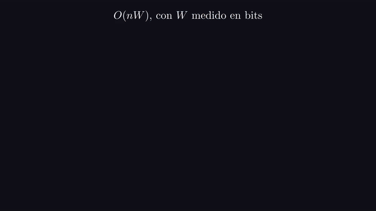
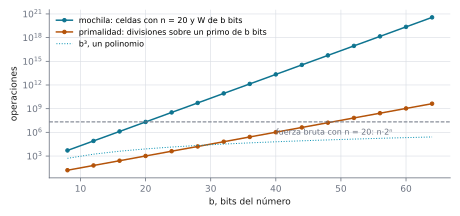
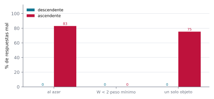

# Ejercicio 11 ★★ · La mochila en $O(nW)$ y el tamaño de la entrada medido en bits

> La mochila entera se resuelve con programación dinámica en $O(nW)$, donde $W$ es la
> capacidad. Mide el tamaño de la entrada en bits. ¿Es polinomial ese algoritmo? ¿En qué
> se parece a la primalidad por división?

$O(nW)$ parece un costo excelente: dos letras multiplicadas, sin exponentes. La trampa
está en qué es $W$. Es un número de la entrada, y lo que cuesta escribir un número no es
su valor sino su cantidad de bits. Medido así, el algoritmo es exponencial, y vamos a
verlo con experimentos en los que agregar dos bits a la entrada cuadruplica el trabajo.
La mochila es uno de los problemas NP-completos de Karp (1972), y este algoritmo es el
ejemplo estándar de algoritmo **pseudopolinomial** (Garey y Johnson, 1979). La
primalidad por división tiene exactamente el mismo defecto, con una diferencia de fondo
que también vamos a ver.

Todos los números de este documento los imprime [`ejercicio-11.py`](ejercicio-11.py),
que además corre las pruebas y regenera las dos figuras. Solo necesita matplotlib:

```bash
python ejercicio-11.py
```

## 1. El problema

**Mochila entera** (*0/1 knapsack*). Hay $n$ objetos con pesos $w_i$ y valores $v_i$
enteros positivos, y una capacidad $W$. Se busca el mayor valor total de un subconjunto
cuyo peso no pase de $W$, usando cada objeto a lo sumo una vez.

Tres precisiones que un enunciado tiene que dar, y que casi nunca se dan:

- **Qué es el tamaño de la entrada.** La cantidad de bits que hacen falta para
  escribirla: los $n$ pesos, los $n$ valores y $W$, en binario. No la cantidad de
  objetos.
- **Qué quiere decir "polinomial".** Que el costo esté acotado por un polinomio en ese
  tamaño. Ser polinomial "en $n$" no alcanza si la entrada tiene otros números que
  pueden ser enormes.
- **Qué es un paso.** Una actualización de una celda de la tabla. Cada una es una suma
  y un máximo sobre números que caben en la entrada, así que contarla como un paso solo
  cambia el costo en un factor polinomial, y no afecta la respuesta.

## 2. El algoritmo y un ejemplo chico

**Cómo se le ocurre a uno.** Decidimos objeto por objeto si entra o no. Lo que hay que
recordar de los objetos ya decididos no es qué subconjunto se eligió, sino solo cuánto
valor se puede juntar con cada capacidad. Así que guardamos, para cada capacidad $c$ de
0 a $W$, el mejor valor que cabe en $c$ con los objetos vistos hasta ahora:

```python
def knapsack(w, v, W):
    best = [0] * (W + 1)
    for wi, vi in zip(w, v):
        for c in range(W, wi - 1, -1):          # de mayor a menor: ver la sección 6
            best[c] = max(best[c], best[c - wi] + vi)
    return best[W]
```

**Invariante (M).** Después de procesar los objetos $1, \dots, i$, $\texttt{best}[c]$
es el mayor valor de un subconjunto de esos objetos, usando cada uno a lo sumo una vez,
con peso a lo sumo $c$.

**Teorema.** (M) se cumple después de cada objeto, y `knapsack` devuelve el óptimo, con
a lo sumo $n(W + 1)$ actualizaciones de celdas.

*Demostración.* Por inducción sobre $i$. Con $i = 0$ todas las celdas valen 0, el valor
del subconjunto vacío. Al procesar el objeto $i$, el mejor subconjunto de peso a lo sumo
$c$ o no usa el objeto $i$, con valor $\texttt{best}[c]$ anterior, o lo usa, con valor
$v_i$ más el mejor de peso a lo sumo $c - w_i$ **sin** el objeto $i$. Como el ciclo
recorre $c$ de mayor a menor, al actualizar $\texttt{best}[c]$ la celda
$\texttt{best}[c - w_i]$, con $c - w_i < c$, todavía no se actualizó, y guarda el valor
sin el objeto $i$. Cada objeto recorre a lo sumo $W + 1$ celdas. $\square$

Cuatro objetos y capacidad 12:

```
pesos [3, 4, 5, 9], valores [4, 5, 6, 11], capacidad 12: mejor valor 15 (el oráculo dice 15), 31 celdas actualizadas
bits de la entrada: 29
```

Fíjate en que la entrada ocupa 29 bits y el algoritmo actualiza 31 celdas: cantidades
parecidas. La pregunta es qué pasa cuando la entrada crece, y la respuesta depende de
**qué** crece.

## 3. El tamaño de la entrada se mide en bits

Un algoritmo es polinomial si su costo es polinomial en la cantidad de bits que ocupa la
entrada, porque eso es lo que hay que leer y guardar. Para escribir $W$ en binario hacen
falta $\lfloor \log_2 W \rfloor + 1$ bits. Así que, si $b$ es el tamaño total de la
entrada, $W < 2^b$, y lo único que se puede decir del costo en función de $b$ es

$$nW \ < \ b \cdot 2^{b},$$

que no es un polinomio en $b$. Veámoslo con los mismos 20 objetos (cada peso es una
fracción fija de $W$), con $W$ cada vez con más bits:

```
 bits de W          W  bits de la entrada       celdas  celdas / anterior
         7         64                 292          662                  —
         9        256                 333        2 559               3.87
        11      1 024                 375       10 140               3.96
        13      4 096                 417       40 468               3.99
        15     16 384                 459      161 784               4.00
        17     65 536                 501      647 040               4.00
        19    262 144                 543    2 588 078               4.00
```

Cada fila agrega 2 bits a $W$, y la entrada crece en unos 42 bits (2 por cada uno de
los 20 pesos más 2 de la capacidad): entre un 8 % y un 14 % más de entrada. Las celdas
se multiplican por 4. Si el algoritmo fuera polinomial en $b$, agregar tan poco a la
entrada no podría cuadruplicar el trabajo una y otra vez.



*Animación 1. Cada bit más de $W$ es un símbolo más en la entrada, y duplica la tabla.
En mejor calidad: [MP4](animaciones/ejercicio-11-bits.mp4).*

**Teorema.** Existe una familia de entradas de tamaño $b$ en la que el algoritmo
actualiza del orden de $2^{\sqrt b}$ celdas. En consecuencia el algoritmo no es
polinomial en el tamaño de la entrada.

*Demostración.* Tomemos $n$ objetos con pesos de $n$ bits, valores de 10 bits y
$W = 2^n$. La entrada ocupa del orden de $n^2$ bits, así que $n \approx \sqrt b$, y el
costo $nW = n \cdot 2^n$ es del orden de $2^{\sqrt b}$, que crece más rápido que
cualquier polinomio en $b$. $\square$

```
   n  bits de la entrada          n·W  2^sqrt(bits)
   8                 153    2,05·10^3     5,29·10^3
  16                 433    1,05·10^6     1,84·10^6
  24                 841    4,03·10^8     5,37·10^8
  32                1377   1,37·10^11    1,48·10^11
  40                2041   4,40·10^13    3,98·10^13
```

**Lo que sí es.** El costo es polinomial en $n$ y en el **valor** de $W$, y eso es lo
que se llama pseudopolinomial. Dicho de otro modo: si los números se escribieran en
unario, con $W$ marcas en vez de $\log_2 W$ bits, la entrada ocuparía al menos $W$
símbolos, y $O(nW)$ sí sería polinomial en ese tamaño. El algoritmo es eficiente cuando
los números son chicos, por ejemplo cuando $W$ está acotado por un polinomio en $n$.

## 4. Cuándo conviene la fuerza bruta

Con pocos objetos y una capacidad enorme, probar los $2^n$ subconjuntos es más barato
que la tabla, porque su costo no depende de $W$:

```
n = 20, W = 2^10: tabla 2,05·10^4 celdas, fuerza bruta 2,10·10^7 pasos
n = 20, W = 2^20: tabla 2,10·10^7 celdas, fuerza bruta 2,10·10^7 pasos
n = 20, W = 2^30: tabla 2,15·10^10 celdas, fuerza bruta 2,10·10^7 pasos
n = 20, W = 2^40: tabla 2,20·10^13 celdas, fuerza bruta 2,10·10^7 pasos
```

Con $W = 2^{40}$ la tabla tendría unas $2 \cdot 10^{13}$ celdas, y la fuerza bruta
resuelve el mismo problema en unos $2 \cdot 10^7$ pasos. Cada algoritmo es exponencial
en algo distinto: la fuerza bruta en la cantidad de objetos, la tabla en los bits de la
capacidad.

## 5. El parecido con la primalidad por división

**Lema.** Probar divisores hasta $\sqrt N$ sobre un primo de $b$ bits hace del orden de
$2^{b/2}$ divisiones.

*Demostración.* Un primo de $b$ bits vale al menos $2^{b-1}$, y la división de prueba no
encuentra divisores, así que prueba todos hasta $\sqrt N \ge 2^{(b-1)/2}$. Como
$N < 2^b$, son a lo sumo $2^{b/2}$. $\square$

Como función de $N$, $\sqrt N$ divisiones parece un costo bueno, porque crece más
despacio que $N$. Pero en función de los bits es exponencial. Es el mismo fenómeno que
la mochila:

```
   b  divisiones (primo de b bits)  celdas (n = 20, W de b bits)
  16                     2,56·10^2                     1,31·10^6
  32                     6,55·10^4                    8,59·10^10
  48                     1,68·10^7                    5,63·10^15
  64                     4,29·10^9                    3,69·10^20
```



*Figura 1. Costo en función de los bits del número, en escala logarítmica. La mochila y
la primalidad por división son rectas, es decir, exponenciales; un polinomio como $b^3$
se curva hacia abajo. La línea punteada es la fuerza bruta de la mochila con 20
objetos, que no depende de $b$.*

**En qué se parecen.** Los dos algoritmos tienen un ciclo que recorre todos los valores
hasta un número de la entrada: los divisores hasta $\sqrt N$, las capacidades hasta
$W$. Medidos contra el valor del número parecen polinomiales; medidos contra su
escritura, que es lo que cuenta, son exponenciales. En la escala logarítmica de la
figura 1 los dos son rectas, con pendiente $1/2$ la primalidad y 1 la mochila.

**En qué se diferencian.** Para la primalidad hay algoritmos polinomiales en $b$: el
test de Miller y Rabin, aleatorio (Miller, 1976; Rabin, 1980), y el de Agrawal, Kayal y
Saxena (2004), determinista. Para la mochila no se conoce ninguno, y no se espera que
exista: la versión de decisión (¿hay un subconjunto de peso a lo sumo $W$ y valor al
menos $V$?) es NP-completa, y un algoritmo polinomial para ella probaría P = NP. La
primalidad era "difícil" solo por el algoritmo que se usaba; la mochila parece serlo
por el problema.

## 6. El error plantado: recorrer las capacidades al revés

El ciclo interno recorre las capacidades **de mayor a menor**, y la demostración de la
sección 2 dice por qué: al actualizar $\texttt{best}[c]$ se lee
$\texttt{best}[c - w_i]$, que tiene que ser todavía el valor **sin** el objeto $i$. De
menor a mayor, esa celda ya se actualizó, y el objeto $i$ se puede volver a usar.
Probemos las dos versiones contra tres baterías:

```
             batería  casos  descendente  ascendente
             al azar   3000         0.0%       83.0%
   W < 2·peso mínimo   3000         0.0%        0.0%
      un solo objeto   3000         0.0%       75.3%
un objeto de peso 3 y valor 5, capacidad 9: descendente 5, ascendente 15
```



*Figura 2. Porcentaje de respuestas mal calculadas por cada versión, según la batería.
Cuando ningún objeto cabe dos veces, las dos versiones coinciden.*

**Lema.** La versión ascendente calcula la mochila con repetición, en la que cada objeto
se puede usar cualquier cantidad de veces. Si $W$ es menor que el doble del peso mínimo,
las dos versiones coinciden.

*Demostración.* De menor a mayor, al actualizar $\texttt{best}[c]$ la celda
$\texttt{best}[c - w_i]$ ya incluye al objeto $i$, así que la recurrencia es la de la
mochila con repetición: el mejor de peso a lo sumo $c$ o no usa el objeto $i$, o lo usa
una vez más sobre el mejor de peso a lo sumo $c - w_i$ con repetición. Si
$W < 2 \min_i w_i$, ningún objeto cabe dos veces, y las dos mochilas tienen los mismos
subconjuntos factibles. $\square$


*Animación 2. Un objeto de peso 3 y valor 5 sobre las capacidades 0 a 9. De mayor a
menor, cada celda lee una que todavía no usó el objeto; de menor a mayor, lee una que ya
lo usó, y en la capacidad 9 lo usa tres veces. En mejor calidad:
[MP4](animaciones/ejercicio-11-fila.mp4).*

Con un solo objeto de peso 3 y capacidad 9, la versión ascendente lo usa tres veces.
Una batería en la que la capacidad es menor que el doble del peso más chico no lo ve
nunca, porque ahí ningún objeto cabe dos veces: es lo que dice el lema.

Antes de dibujar, el script se comprueba a sí mismo: 3000 entradas de hasta 11 objetos
en las que el valor coincide con probar todos los subconjuntos y la cantidad de celdas
es exactamente $\sum_i (W - w_i + 1)$; 3000 entradas en las que la versión ascendente
coincide con la mochila con repetición, calculada aparte; y entradas con $W$ menor que
el doble del peso mínimo, donde las dos versiones coinciden siempre:

```
12 000 comprobaciones, 0 fallos
```

La regla práctica que te llevas: **antes de decir que un algoritmo es polinomial, busca
en su costo los números de la entrada que aparecen por su valor y no por sus bits.** Un
ciclo hasta $W$, o hasta $\sqrt N$, es exponencial en la escritura de la entrada, por
inocente que se vea la fórmula.

## 7. Resumen

- El tamaño de una entrada de la mochila es la cantidad de bits de sus números: la
  capacidad $W$ aporta $\log_2 W$ bits, no $W$.
- $O(nW)$ es exponencial en los bits de $W$: cada bit más duplica la tabla. En entradas
  con pesos de $n$ bits, el costo es del orden de $2^{\sqrt b}$. El algoritmo es
  pseudopolinomial, no polinomial.
- Escritos en unario, los números harían polinomial al mismo algoritmo: la diferencia es
  la escritura, no el ciclo.
- La primalidad por división es el mismo fenómeno: $\sqrt N$ divisiones son $2^{b/2}$.
  Pero la primalidad tiene algoritmos polinomiales, y la mochila es NP-completa.
- Recorrer las capacidades de menor a mayor permite usar un objeto varias veces. El
  invariante de la tabla dice cuándo se nota: solo si algún objeto cabe dos veces.

<details>
<summary>Salida completa de <code>python ejercicio-11.py</code></summary>

```
§2. Ejemplo chico: 4 objetos
----------------------------
pesos [3, 4, 5, 9], valores [4, 5, 6, 11], capacidad 12: mejor valor 15 (el oráculo dice 15), 31 celdas actualizadas
bits de la entrada: 29

§3. Mismo n, capacidad con cada vez más bits
--------------------------------------------
 bits de W          W  bits de la entrada       celdas  celdas / anterior
         7         64                 292          662                  —
         9        256                 333        2 559               3.87
        11      1 024                 375       10 140               3.96
        13      4 096                 417       40 468               3.99
        15     16 384                 459      161 784               4.00
        17     65 536                 501      647 040               4.00
        19    262 144                 543    2 588 078               4.00

§3. Una familia de entradas: n objetos con pesos de n bits
----------------------------------------------------------
   n  bits de la entrada          n·W  2^sqrt(bits)
   8                 153    2,05·10^3     5,29·10^3
  16                 433    1,05·10^6     1,84·10^6
  24                 841    4,03·10^8     5,37·10^8
  32                1377   1,37·10^11    1,48·10^11
  40                2041   4,40·10^13    3,98·10^13

§4. La fuerza bruta contra la tabla, con pocos objetos y W enorme
-----------------------------------------------------------------
n = 20, W = 2^10: tabla 2,05·10^4 celdas, fuerza bruta 2,10·10^7 pasos
n = 20, W = 2^20: tabla 2,10·10^7 celdas, fuerza bruta 2,10·10^7 pasos
n = 20, W = 2^30: tabla 2,15·10^10 celdas, fuerza bruta 2,10·10^7 pasos
n = 20, W = 2^40: tabla 2,20·10^13 celdas, fuerza bruta 2,10·10^7 pasos

§5. Primalidad por división contra la mochila, en función de los bits
---------------------------------------------------------------------
   b  divisiones (primo de b bits)  celdas (n = 20, W de b bits)
  16                     2,56·10^2                     1,31·10^6
  32                     6,55·10^4                    8,59·10^10
  48                     1,68·10^7                    5,63·10^15
  64                     4,29·10^9                    3,69·10^20

§6. Recorrer las capacidades de menor a mayor
---------------------------------------------
             batería  casos  descendente  ascendente
             al azar   3000         0.0%       83.0%
   W < 2·peso mínimo   3000         0.0%        0.0%
      un solo objeto   3000         0.0%       75.3%
un objeto de peso 3 y valor 5, capacidad 9: descendente 5, ascendente 15

Pruebas
-------
12 000 comprobaciones, 0 fallos

figuras: ejercicio-11-bits.svg, ejercicio-11-errores.svg
```

</details>

