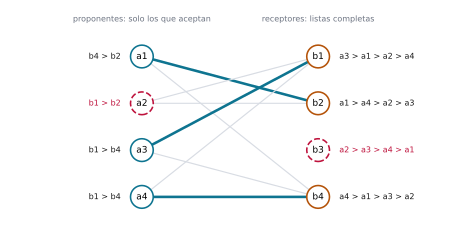
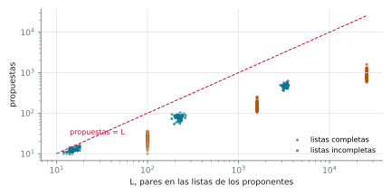
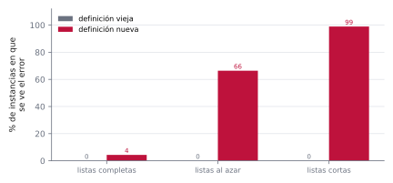

# Ejercicio 12 ★★★ · Emparejamiento estable con listas incompletas

> Gale-Shapley con listas incompletas: cada proponente lista solo a algunos receptores, y
> prefiere quedarse solo antes que con uno que no listó. Adapta el algoritmo, su
> potencial y la definición de pareja bloqueante. ¿Sigue siendo estable el resultado?
> Demuéstralo.

El algoritmo de aceptación diferida de Gale y Shapley (1962) encuentra un emparejamiento
estable cuando las listas de preferencias son completas. En los mercados reales, como
la asignación de residencias médicas, las listas casi nunca lo son, y la teoría de ese
caso está en Gusfield e Irving (1989). Adaptar el algoritmo cuesta una línea. Lo que
pide trabajo es todo lo que esa línea toca: el argumento que garantizaba que nunca se
leía más allá de una lista deja de valer, la definición de pareja bloqueante gana dos
cláusulas, y la demostración de estabilidad necesita un paso nuevo, que es exactamente
donde se comete el error plantado de la sección 7.

Todos los números de este documento los imprime [`ejercicio-12.py`](ejercicio-12.py),
que además corre las pruebas y regenera las tres figuras. Solo necesita matplotlib:

```bash
python ejercicio-12.py
```

## 1. El problema

Hay proponentes $a_1, a_2, \dots$ y receptores $b_1, b_2, \dots$. Cada proponente tiene
una lista estricta con **solo** los receptores que acepta, del mejor al peor. Cada
receptor tiene una lista estricta y completa con todos los proponentes.

**Emparejamiento.** Un conjunto de pares $(a, b)$ en el que cada agente aparece a lo
sumo una vez. Escribimos $M(a)$ para la pareja de $a$, y decimos que $a$ está solo si no
tiene.

Tres precisiones que un enunciado tiene que dar, y que casi nunca se dan:

- **Dónde va "quedarse solo".** En las preferencias de cada agente, justo después del
  último de su lista. Para $a$, cualquier receptor que listó es mejor que estar solo, y
  estar solo es mejor que cualquiera que no listó. Con esa opción agregada, "prefiere"
  tiene sentido aunque alguien no tenga pareja.
- **Quién tiene listas incompletas.** Aquí, solo los proponentes, como dice el
  enunciado. La sección 8 deja que los receptores también tachen, y muestra que nada
  cambia.
- **Cuántos hay de cada lado.** No necesariamente la misma cantidad, y ya no se puede
  pedir un emparejamiento perfecto: si nadie lista a $b_3$, nadie va a terminar con
  $b_3$.

## 2. Un ejemplo chico antes del algoritmo

Cuatro proponentes y cuatro receptores. Nadie lista a $b_3$, y cada proponente lista
solo a dos receptores:

```
a1: b4 > b2         b1: a3 > a1 > a2 > a4
a2: b1 > b2         b2: a1 > a4 > a2 > a3
a3: b1 > b4         b3: a2 > a3 > a4 > a1
a4: b1 > b4         b4: a4 > a1 > a3 > a2
```

La ejecución con la cola de libres, propuesta por propuesta:

```
paso  propone a   tenía  se queda con  qué pasa
   1  a1      b4  —      a1            acepta
   2  a2      b1  —      a2            acepta
   3  a3      b1  a2     a3            cambia; a2 queda libre
   4  a4      b1  a3     a3            rechaza a a4
   5  a2      b2  —      a2            acepta
   6  a4      b4  a1     a4            cambia; a1 queda libre
   7  a1      b2  a2     a1            cambia; a2 queda libre y sin nadie más en su lista: se queda solo
resultado: a1–b2, a2 solo, a3–b1, a4–b4; sin pareja: b3. 7 propuestas, L = 8 pares en las listas
pares bloqueantes: 0; emparejamientos estables de la instancia: 1
```



*Figura 1. La instancia del ejemplo. Las líneas grises son los pares que algún
proponente listó; las azules, el emparejamiento que devuelve el algoritmo. En rojo
punteado, los que quedan solos: $a_2$, que recorrió su lista entera, y $b_3$, a quien
nadie listó.*


*Animación 1. La instancia de la sección 2, propuesta por propuesta. Los rechazos se
tachan en la lista del proponente; $a_2$ agota la suya y se queda solo. En mejor
calidad: [MP4](animaciones/ejercicio-12-propuestas.mp4).*

Tres hechos de la ejecución organizan el resto. En el paso 7, $a_2$ queda libre y ya no
tiene a quién proponerle: le propuso a $b_1$ y a $b_2$, y los dos lo cambiaron por
alguien mejor. Con listas completas eso no podía pasar, y aquí el algoritmo tiene que
dejarlo solo. Además, $b_3$ queda solo aunque aceptaría a cualquiera, y ningún par con
$b_3$ puede bloquear, porque para bloquear el proponente tiene que haber listado al
receptor. Por último, el resultado es estable: $a_2$ listó a $b_1$ y a $b_2$, pero $b_1$
tiene a $a_3$ y $b_2$ a $a_1$, que esos receptores prefieren a $a_2$. El oráculo, que
prueba todos los emparejamientos, confirma que es el único estable de la instancia.

## 3. El algoritmo

La versión de listas completas, corrida tal cual sobre esta instancia, falla:

```
la versión de listas completas: IndexError al buscar el siguiente receptor de un proponente que ya agotó su lista
```

Con listas completas, todo proponente rechazado vuelve a la cola, y eso es seguro porque
siempre le queda alguien: si un proponente libre ya le hubiera propuesto a todos, todos
los receptores estarían comprometidos con tantos proponentes distintos como receptores
hay, y no quedaría lugar para que él estuviera libre. Fíjate en que esa cuenta usa que
la lista del proponente tiene a **todos** los receptores. Con listas incompletas, un
proponente puede haberle propuesto a toda su lista mientras otros receptores siguen
libres, y la cuenta no dice nada. No es un caso raro:

```
   n  instancias  IndexError
   5         300         183
  20         300         259
 100         300         293
```

La adaptación es una condición: un proponente entra a la cola solo si le queda alguien.

```python
def gale_shapley(pref_a, pref_b):
    rango = [{a: lugar for lugar, a in enumerate(pref_b[b])} for b in range(len(pref_b))]
    siguiente = [0] * len(pref_a)            # a qué lugar de su lista va a proponer a
    pareja_de_b = [None] * len(pref_b)
    le_queda = lambda a: siguiente[a] < len(pref_a[a])
    libres = deque(a for a in range(len(pref_a)) if le_queda(a))
    while libres:
        a = libres.popleft()
        b = pref_a[a][siguiente[a]]
        siguiente[a] += 1
        actual = pareja_de_b[b]
        if actual is None:
            pareja_de_b[b], rechazado = a, None
        elif rango[b][a] < rango[b][actual]:
            pareja_de_b[b], rechazado = a, actual
        else:
            rechazado = a
        if rechazado is not None and le_queda(rechazado):
            libres.append(rechazado)         # si no le queda nadie, se queda solo
    return pareja_de_b
```

La versión del script además deja elegir el orden de ejecución (cola, pila o al azar),
porque todo lo que se demuestre tiene que valer para cualquier orden.

**Invariante (Q).** Todo proponente que está en la cola de libres cumple
$\texttt{siguiente}[a] < |\text{lista}(a)|$.

**Lema.** (Q) se cumple en todo momento. En particular, cada lectura
$\texttt{pref\_a}[a][\texttt{siguiente}[a]]$ es válida. Además, un receptor comprometido
no vuelve a quedar libre y su pareja solo mejora, y cada proponente propone en el orden
de su lista.

*Demostración.* *Inicialización.* Entran a la cola solo los de lista no vacía, con
$\texttt{siguiente} = 0$. *Mantenimiento.* Un proponente solo vuelve a entrar si
`le_queda`, y mientras está en la cola su `siguiente` no cambia. *Conclusión.* Cada vez
que se lee la lista de $a$, el índice existe. Las otras dos afirmaciones se leen del
código: un receptor solo cambia de pareja si llega alguien que prefiere, y
`siguiente[a]` solo avanza. $\square$

## 4. Terminación y costo

**Teorema.** El algoritmo hace a lo sumo $L = \sum_a |\text{lista}(a)|$ propuestas y es
lineal en el tamaño de la entrada. La cota $L$ se alcanza.

*Demostración.* Sea $\Phi$ la cantidad de pares $(a, b)$, con $b$ en la lista de $a$,
tales que $a$ todavía no le propuso a $b$. Al principio $\Phi = L$. Cada vuelta del
ciclo es exactamente una propuesta, que no se repite porque `siguiente[a]` solo avanza,
y es a alguien de la lista de $a$, por (Q). Así que $\Phi$ baja 1 por vuelta y nunca es
negativo: a lo sumo $L$ vueltas. Con `siguiente` y la tabla `rango`, cada vuelta cuesta
$O(1)$, y construir `rango` cuesta la suma de los largos de las listas de los
receptores. Para ver que la cota se alcanza, basta que seis proponentes listen solo a
$b_1$: cada uno le propone una vez, $b_1$ se queda con su favorito y los otros cinco
quedan solos, con $6 = L$ propuestas. $\square$

Es el mismo potencial del caso de listas completas, con la cuenta inicial cambiada:
allí $L = n^2$. Comparemos las propuestas con $L$ en instancias al azar:

```
              listas    n  instancias  propuestas / L, máx  promedio
    listas completas   10          60                0.360     0.232
    listas completas   40          60                0.155     0.097
    listas completas  160          60                0.062     0.034
  listas incompletas   10          60                1.000     0.801
  listas incompletas   40          60                0.511     0.354
  listas incompletas  160          60                0.178     0.143
seis proponentes que solo listan a b1: 6 propuestas = L = 6
```



*Figura 2. Cada punto es una ejecución. Ninguno pasa la diagonal punteada, que es la
cota del potencial. Con listas incompletas los puntos quedan más cerca de la diagonal:
cuando las listas son cortas, una fracción mayor de cada lista se recorre entera.*

## 5. La pareja bloqueante y la estabilidad

Copiar la definición de listas completas no sirve, por dos lados. "$a$ prefiere $b$ a
su pareja" no tiene sentido si $a$ no tiene pareja, y un proponente solo que listó a $b$
estaría mejor con $b$ que solo: si a $b$ también le conviene, los dos ganan yéndose
juntos. Y si $a$ no listó a $b$, prefiere quedarse solo, así que un par $(a, b)$ con $b$
fuera de la lista de $a$ no puede bloquear nada. Por el mismo motivo, un emparejamiento
que pone a $a$ con alguien que no listó es inestable, porque $a$ se va solo. Con las
preferencias extendidas de la sección 1, las dos cosas se dicen igual que antes,
reemplazando "su pareja" por "su situación".

**Estabilidad.** $M$ es **estable** si nadie está con alguien que no aceptó, y no hay
**pareja bloqueante**: un par $(a, b)$, con $b$ en la lista de $a$ y no emparejados
entre sí, tal que $a$ está solo o prefiere $b$ a $M(a)$, y $b$ está solo o prefiere $a$
a $M(b)$.

**Teorema de estabilidad.** Para cualquier orden de ejecución, el resultado del
algoritmo es estable.

*Demostración.* *Nadie queda con alguien que no listó.* Un proponente solo le propone a
receptores de su lista, y los receptores aceptan a cualquiera.

*Un proponente que terminó solo le propuso a toda su lista.* Al final la cola está
vacía. Si $a$ termina solo, o su lista estaba vacía, o la última vez que lo rechazaron
no volvió a la cola, lo que solo pasa si ya no le quedaba nadie. En los dos casos le
propuso a todos los de su lista.

*Un proponente con pareja le propuso a todos los que prefiere a ella.* $a$ propone en el
orden de su lista, por el lema de la sección 3, y su última propuesta fue a $M(a)$: si
después lo hubieran rechazado, no terminaría con $M(a)$.

*La contradicción.* Supongamos que $(a, b)$ bloquea el resultado. Como $b$ está en la
lista de $a$ y $a$ está solo o prefiere $b$ a $M(a)$, por uno de los dos pasos
anteriores $a$ le propuso a $b$. No terminaron juntos, así que en algún momento $b$
rechazó a $a$, al recibir la propuesta o más tarde, a cambio de alguien que prefería.
Desde ese momento $b$ siempre tiene pareja y su pareja solo mejora, por el lema de la
sección 3. Al final, $b$ no está solo y prefiere $M(b)$ a $a$, lo que contradice que
$(a, b)$ bloquea. $\square$

Lo único nuevo respecto del caso de listas completas es el segundo paso. La cláusula
"$a$ está solo" de la definición necesita que un proponente solo haya recorrido toda su
lista, y eso es exactamente lo que garantiza la condición de `le_queda`. La sección 7
muestra qué pasa si esa condición está mal escrita. El script comprueba el teorema
contra el oráculo, que enumera todos los emparejamientos de pares aceptables de
instancias chicas y se queda con los estables:

```
4 500 ejecuciones (1500 instancias con hasta 6 por lado, tres órdenes):
  con alguna pareja bloqueante: 0
  con alguien emparejado con quien no listó: 0
  resultado que no está entre los estables del oráculo: 0
```

En particular, toda instancia con listas incompletas tiene un emparejamiento estable:
igual que con listas completas, el algoritmo es la demostración de que existe.

## 6. Optimalidad y los agentes que quedan solos

Una instancia puede tener varios emparejamientos estables.

**Pareja válida.** $b$ es **pareja válida** de $a$ si están juntos en algún
emparejamiento estable, y $\text{mejor}(a)$ es la pareja válida que $a$ prefiere entre
todas, si tiene alguna.

**Teorema de optimalidad.** Cada proponente con pareja válida termina con
$\text{mejor}(a)$, y los demás terminan solos, para cualquier orden de ejecución.

*Demostración.* Por el argumento del primer rechazo, con un caso más. Basta ver que
ningún proponente es rechazado nunca por una pareja válida. Supongamos lo contrario, y
tomemos el **primer** rechazo de ese tipo en el tiempo: $b$ rechaza a $a$ a cambio de
$a'$, y existe un emparejamiento estable $M'$ con $(a, b) \in M'$. Antes de proponerle a
$b$, $a'$ fue rechazado por todos los que prefiere a $b$. Esos rechazos son anteriores
al nuestro, que es el primero hecho por una pareja válida, así que ninguno de ellos es
pareja válida de $a'$. Si en $M'$ el proponente $a'$ está con algún $b'$, $b'$ es pareja
válida de $a'$ y no está entre los que $a'$ prefiere a $b$: $a'$ prefiere $b$ a $b'$.
Si en $M'$ el proponente $a'$ está solo (el caso nuevo), $a'$ listó a $b$, porque le
propuso, y prefiere $b$ a estar solo. En los dos casos $a'$ prefiere $b$ a su situación
en $M'$, y $b$ prefiere $a'$ a $a$, porque lo cambió por él: $(a', b)$ bloquea $M'$, que
era estable. Contradicción.

Entonces un proponente con parejas válidas nunca pasa de $\text{mejor}(a)$ en su lista,
y termina con alguien al menos tan bueno. Como el resultado es estable, ese alguien es
una pareja válida, así que es $\text{mejor}(a)$. Un proponente sin parejas válidas
termina solo, porque cualquier pareja que tuviera en un emparejamiento estable sería
válida. $\square$

**Teorema de los hospitales rurales.** Todos los emparejamientos estables dejan solos
exactamente a los mismos proponentes y a los mismos receptores.

*Demostración.* Sea $M_0$ el resultado del algoritmo y $M$ cualquier emparejamiento
estable. Si $a$ tiene pareja en $M$, también en $M_0$: $M(a)$ es una pareja válida, así
que $a$ tiene alguna, y por el teorema de optimalidad en $M_0$ está con
$\text{mejor}(a)$. Si $b$ tiene pareja en $M_0$, también en $M$. En efecto, sea
$a = M_0(b)$ y supongamos que $b$ está solo en $M$. Como $b = \text{mejor}(a)$ y
$M(a) \ne b$, $a$ está solo en $M$ o prefiere $b$ a $M(a)$, y $b$ está solo en $M$, así
que $(a, b)$ bloquea $M$, contradicción. Un emparejamiento tiene tantos proponentes con
pareja como receptores con pareja. Por el primer punto $|M| \le |M_0|$, y por el
segundo $|M_0| \le |M|$. Así que son iguales, y las dos inclusiones son igualdades.
$\square$

El nombre viene de la asignación de residencias médicas (Roth, 1986): un hospital que no
llena sus plazas en un emparejamiento estable no las llena en ninguno. En instancias al
azar casi siempre hay un solo emparejamiento estable, y ahí los dos teoremas se cumplen
sin decir nada. Por eso el script genera instancias hasta juntar trescientas con más de
uno:

```
300 instancias con más de un emparejamiento estable (de 2686 generadas):
  mismo resultado con las cuatro ejecuciones: 300 de 300
  cada proponente con su mejor pareja válida: 300 de 300
  los mismos solos en todos los emparejamientos estables: 300 de 300
```

## 7. El error que la demostración anuncia

El paso nuevo de la demostración de estabilidad es que un proponente que terminó solo le
propuso a toda su lista. Descansa en una sola comparación, la de `le_queda`, y ahí es
donde se comete un error de índice. Plantemos el error de rendirse una propuesta antes:

```python
le_queda = lambda a: siguiente[a] < len(pref_a[a]) - 1     # mal: nunca prueba al último
```

El proponente que llega al final de su lista se queda solo sin haberle propuesto a su
último receptor. Sobre el ejemplo:

```
en el ejemplo de la sección 2: a1–b4, a2 solo, a3–b1, a4 solo
  bloqueantes con la definición nueva: (a2, b2), (a4, b4); con la vieja: ninguna
```

$a_4$ quedó solo sin proponerle a $b_4$, y $b_4$ lo prefiere a $a_1$: $(a_4, b_4)$
bloquea. Pero un verificador que copió la definición de listas completas, y solo mira
pares en los que los dos tienen pareja, no ve nada:

```
           batería  casos  definición vieja  definición nueva
  listas completas   2000              0.0%              4.3%
    listas al azar   2000              0.0%             66.4%
     listas cortas   2000              0.0%             99.0%
```



*Figura 3. Porcentaje de instancias en que la versión con el error deja alguna pareja
bloqueante, según la definición que use el verificador. La definición vieja no la ve
nunca. Con listas completas, la nueva la ve poco, porque casi nadie llega al último de
su lista.*


*Animación 2. El error de rendirse una propuesta antes: sus dos parejas bloqueantes
tienen un proponente solo, y un verificador con la definición de listas completas no ve
ninguna. En mejor calidad: [MP4](animaciones/ejercicio-12-verificador.mp4).*

**Lema.** Con el error de rendirse una propuesta antes, toda pareja bloqueante del
resultado tiene un proponente solo. En consecuencia un verificador que solo examina
pares con los dos agentes emparejados no detecta el error nunca.

*Demostración.* En la demostración de estabilidad, el paso "un proponente con pareja le
propuso a todos los que prefiere a ella" no usa `le_queda`, así que sigue valiendo con
el error, y la contradicción sigue cerrando para todo proponente con pareja. Así que
ningún proponente con pareja está en una pareja bloqueante. $\square$

Las baterías dicen lo otro que importa. Las pruebas de listas completas detectan el
error en el 4,3 % de las instancias, porque con ocho receptores al azar casi nadie llega
al último de su lista, mientras que las listas cortas lo detectan casi siempre.

## 8. Receptores con listas incompletas

En la versión general, los receptores también tienen listas incompletas, y un receptor
rechaza a quien no listó aunque esté libre. El algoritmo cambia en una línea: antes de
comparar, si $a$ no está en la lista de $b$, $b$ lo rechaza. La definición de pareja
bloqueante pide además que $b$ haya listado a $a$.

**Teorema.** Con listas incompletas en los dos lados, el teorema de estabilidad, el de
optimalidad y el de los hospitales rurales siguen valiendo.

*Demostración.* En "la contradicción" de la demostración de estabilidad, $b$ rechazó a
$a$ en algún momento, y ahora puede haber sido porque no lo listó. Pero entonces
$(a, b)$ no puede bloquear, porque $b$ prefiere quedarse solo antes que estar con $a$.
En el otro caso el argumento es el de antes. En los otros dos teoremas, un receptor que
es pareja válida de $a$ listó a $a$, porque un emparejamiento estable no pone a nadie
con quien no aceptó. Así que nunca lo rechaza por no haberlo listado, y los argumentos
no cambian. $\square$

```
1 500 instancias con listas incompletas en los dos lados: 0 resultados inestables o fuera del oráculo
```

Antes de dibujar, el script se comprueba a sí mismo: 500 instancias con listas
completas, en las que la versión adaptada devuelve lo mismo que la de listas completas,
sin nadie solo y con a lo sumo $n^2$ propuestas; 300 instancias de hasta 60 por lado,
con los tres órdenes y la mitad con receptores que tachan, siempre con a lo sumo $L$
propuestas y resultado estable; y 500 instancias chicas en las que el resultado está
entre los estables que enumera el oráculo, y todos esos emparejamientos dejan solos a
los mismos proponentes:

```
3 800 comprobaciones, 0 fallos
```

La regla práctica que te llevas: **para probar una adaptación hay que generar los casos
que la adaptación agregó, y juzgarlos con la definición adaptada.** El error de la
sección 7 pasa intacto por las pruebas de listas completas y por el verificador de
listas completas, que son las dos cosas que uno ya tenía escritas.

## 9. Resumen

- Con listas incompletas, el algoritmo es el mismo con una condición: un proponente
  rechazado vuelve a la cola solo si le queda alguien en la lista; si no, se queda solo.
- Sin esa condición, la versión de listas completas lee más allá de la lista, porque el
  argumento que lo impedía usaba que las listas tenían a todos los receptores.
- El potencial son las propuestas que faltan dentro de las listas: empieza en $L$ y baja
  1 por propuesta. La cota $L$ se alcanza.
- La pareja bloqueante gana dos cláusulas, "$a$ está solo" y "$b$ está solo", y solo
  cuenta pares en los que $a$ listó a $b$. Un emparejamiento estable no pone a nadie con
  alguien que no listó.
- El resultado es estable porque $a$ le propuso a $b$ en los dos casos: si terminó solo,
  por haber recorrido su lista; si no, por preferir $b$ a su pareja.
- Sigue dando a cada proponente su mejor pareja válida, y todos los emparejamientos
  estables dejan solos a los mismos.
- El error de rendirse una propuesta antes solo fabrica parejas bloqueantes con un
  proponente solo. Un verificador con la definición vieja no lo ve nunca, y las pruebas
  con listas completas casi nunca.

<details>
<summary>Salida completa de <code>python ejercicio-12.py</code></summary>

```
§2. Ejemplo chico: 4 proponentes y 4 receptores
-----------------------------------------------
a1: b4 > b2         b1: a3 > a1 > a2 > a4
a2: b1 > b2         b2: a1 > a4 > a2 > a3
a3: b1 > b4         b3: a2 > a3 > a4 > a1
a4: b1 > b4         b4: a4 > a1 > a3 > a2

paso  propone a   tenía  se queda con  qué pasa
   1  a1      b4  —      a1            acepta
   2  a2      b1  —      a2            acepta
   3  a3      b1  a2     a3            cambia; a2 queda libre
   4  a4      b1  a3     a3            rechaza a a4
   5  a2      b2  —      a2            acepta
   6  a4      b4  a1     a4            cambia; a1 queda libre
   7  a1      b2  a2     a1            cambia; a2 queda libre y sin nadie más en su lista: se queda solo
resultado: a1–b2, a2 solo, a3–b1, a4–b4; sin pareja: b3. 7 propuestas, L = 8 pares en las listas
pares bloqueantes: 0; emparejamientos estables de la instancia: 1
la versión de listas completas: IndexError al buscar el siguiente receptor de un proponente que ya agotó su lista

§3. La versión de listas completas, con listas incompletas
----------------------------------------------------------
   n  instancias  IndexError
   5         300         183
  20         300         259
 100         300         293

§4. Propuestas contra L, el largo total de las listas
-----------------------------------------------------
              listas    n  instancias  propuestas / L, máx  promedio
    listas completas   10          60                0.360     0.232
    listas completas   40          60                0.155     0.097
    listas completas  160          60                0.062     0.034
  listas incompletas   10          60                1.000     0.801
  listas incompletas   40          60                0.511     0.354
  listas incompletas  160          60                0.178     0.143
seis proponentes que solo listan a b1: 6 propuestas = L = 6

§5. Estabilidad, contra el oráculo
----------------------------------
4 500 ejecuciones (1500 instancias con hasta 6 por lado, tres órdenes):
  con alguna pareja bloqueante: 0
  con alguien emparejado con quien no listó: 0
  resultado que no está entre los estables del oráculo: 0

§6. Lo que sigue valiendo: optimalidad y los que quedan solos
-------------------------------------------------------------
300 instancias con más de un emparejamiento estable (de 2686 generadas):
  mismo resultado con las cuatro ejecuciones: 300 de 300
  cada proponente con su mejor pareja válida: 300 de 300
  los mismos solos en todos los emparejamientos estables: 300 de 300

§7. El error plantado: rendirse una propuesta antes
---------------------------------------------------
           batería  casos  definición vieja  definición nueva
  listas completas   2000              0.0%              4.3%
    listas al azar   2000              0.0%             66.4%
     listas cortas   2000              0.0%             99.0%
en el ejemplo de la sección 2: a1–b4, a2 solo, a3–b1, a4 solo
  bloqueantes con la definición nueva: (a2, b2), (a4, b4); con la vieja: ninguna

§8. Si los receptores también tachan
------------------------------------
1 500 instancias con listas incompletas en los dos lados: 0 resultados inestables o fuera del oráculo

Pruebas
-------
3 800 comprobaciones, 0 fallos

figuras: ejercicio-12-instancia.svg, ejercicio-12-potencial.svg, ejercicio-12-errores.svg
```

</details>

