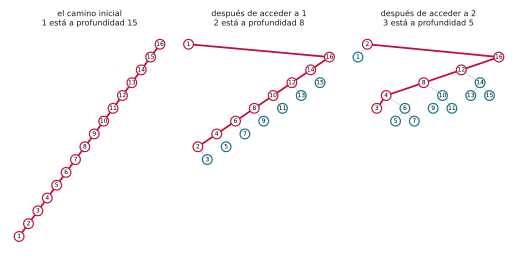
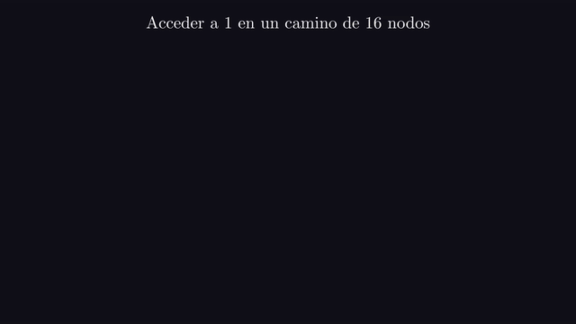
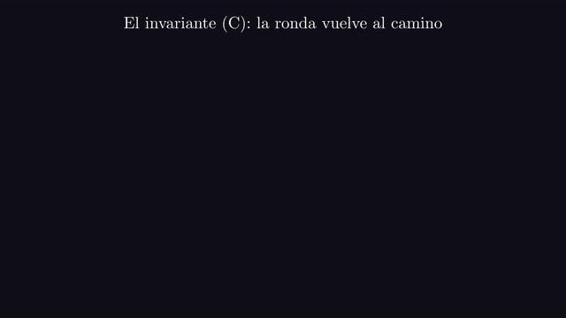
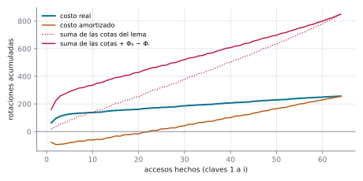
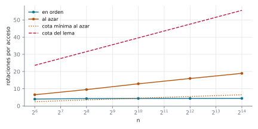

# Ejercicio 13 ★★ · Un splay tree que empieza como un camino, recorrido en orden

> En un splay tree que empieza como un camino de $n$ nodos se accede a las claves
> $1, \dots, n$ en orden. Acota el costo total con el lema de acceso, sumando los costos
> amortizados y pagando aparte el potencial inicial, y compáralo con lo que se mide al
> recorrer las claves en orden. ¿Es ajustada la cota?

Los splay trees de Sleator y Tarjan (1985) garantizan costo amortizado $O(\log n)$ por
acceso sin guardar ninguna información de balance, a diferencia de la heurística de
subir a la raíz con rotaciones simples (Allen y Munro, 1978). Aquí ponemos esa garantía
contra una secuencia concreta. La cuenta que pide el enunciado da $\Theta(n \log n)$, y
lo medido es de orden $n$. Vamos a ver por qué: un invariante muestra que las rondas se
repiten idénticas, y con eso podemos localizar exactamente dónde pierde la cota.
Después plantamos el error de olvidar el potencial inicial, y contestamos si la cota es
ajustada, que tiene dos respuestas según qué se le pida.

Todos los números de este documento los imprime [`ejercicio-13.py`](ejercicio-13.py),
que además corre las pruebas y regenera las tres figuras. Solo necesita matplotlib:

```bash
python ejercicio-13.py
```

## 1. El problema

Acceder a una clave es buscarla y hacerle **splay**, que la sube a la raíz con pasos de
tres tipos. Sea $x$ el nodo que sube, $p$ su padre y $g$ su abuelo. Un **zig** es una
rotación de $x$, y se hace solo cuando $p$ es la raíz. Un **zig-zig**, cuando $x$ y $p$
son hijos del mismo lado, rota primero $p$ y después $x$. Un **zig-zag**, cuando son
hijos de lados distintos, rota $x$ dos veces. Para cada nodo $x$, $s(x)$ es el número de
nodos de su subárbol y $r(x) = \log_2 s(x)$ su **rango**. El **potencial** del árbol es
$\Phi = \sum_x r(x)$, y el costo amortizado de una operación es su costo real más la
variación de $\Phi$.

Tres precisiones que un enunciado tiene que dar, y que casi nunca se dan:

- **Qué cuesta un acceso.** El número de rotaciones, que es la profundidad del nodo, y 1
  si ya era la raíz.
- **Cómo es el camino.** Con $n$ en la raíz y cada clave hija izquierda de la
  siguiente, así que la clave 1 está a profundidad $n - 1$. El camino al revés da otra
  historia.
- **Qué quiere decir "ajustada".** Puede ser para esta secuencia o para el peor caso
  entre todas las secuencias de $n$ accesos. La sección 7 contesta las dos, y las
  respuestas son distintas.

El resultado que el enunciado pide usar, sin demostrarlo:

**Lema de acceso (Sleator y Tarjan, 1985).** Hacer splay de $x$ en un árbol con raíz $t$
tiene costo amortizado a lo sumo $3(r(t) - r(x)) + 1$.

Como $r(t) = \log_2 n$ y $r(x) \ge 0$, eso es a lo sumo $3 \log_2 n + 1$.

## 2. Un ejemplo chico antes de la cuenta

Con $n = 16$, el costo de cada acceso, en orden, y una segunda ronda:

```
costo de cada acceso: 15 8 5 2 4 2 3 1 3 1 2 1 3 1 2 1
total 54, 3.38 por acceso; al terminar, el árbol es otra vez el camino: True
segunda ronda: 15 8 5 2 4 2 3 1 3 1 2 1 3 1 2 1
```



*Figura 1. El camino de 16 nodos, y el árbol después de acceder a 1 y a 2. Cada nodo
está a la altura de su profundidad. En rojo, el camino hasta la clave que se accede a
continuación: mide 15, después 8, después 5.*



*Animación 1. El acceso a 1 sobre el camino de 16 nodos, paso por paso: cada zig-zig
sube a 1 por encima de dos nodos, y el camino queda partido a la mitad. En mejor
calidad: [MP4](animaciones/ejercicio-13-primer-acceso.mp4).*

El ejemplo deja ver tres hechos. El primer acceso es caro y deja el camino partido a la
mitad. Acceder a 1 cuesta 15 rotaciones, todas en pasos zig-zig, y cada zig-zig sube a 1
por encima de dos nodos del camino, dejando el de abajo en el camino nuevo y colgando el
de arriba como su hijo derecho. En la figura 1 los pares quedan en el camino y cada
impar cuelga del par anterior; por eso el acceso a 2 cuesta 8 y el acceso a 3 cuesta 5.
Después, casi todos los accesos son baratos, porque la clave siguiente es siempre el
mínimo del subárbol derecho de la raíz. Y fíjate en que la segunda ronda es idéntica a
la primera: la sección 4 demuestra que eso pasa para todo $n$.

## 3. La cota del lema de acceso

Sea $c_i$ el costo real del acceso $i$ y $\hat c_i = c_i + \Phi_i - \Phi_{i-1}$ su costo
amortizado, con $\Phi_0$ el potencial del camino y $\Phi_i$ el potencial después del
acceso $i$.

**Teorema.** Acceder a $1, \dots, n$ en orden desde el camino cuesta a lo sumo
$n(3 \log_2 n + 1) + \log_2 n!$ rotaciones, que es $\Theta(n \log n)$.

*Demostración.* Sumando, el potencial se telescopia:

$$\sum_{i=1}^{n} c_i = \sum_{i=1}^{n} \hat c_i + \Phi_0 - \Phi_n.$$

El lema de acceso acota cada $\hat c_i$ por $3 \log_2 n + 1$. El potencial final es al
menos 0, y el del camino es $\log_2 1 + \log_2 2 + \dots + \log_2 n = \log_2 n!$, que es
$\Theta(n \log n)$. $\square$

Comparemos la cota con el costo medido:

```
     n    medido      cota  cota / medido  medido / n
   100       416     2 618            6.3        4.16
   200       840     6 032            7.2        4.20
   400     1 732    13 659            7.9        4.33
   800     3 490    30 512            8.7        4.36
  1600     7 024    67 419            9.6        4.39
  3200    14 100   147 632           10.5        4.41
```

La cota se cumple, pero el costo medido por acceso se estabiliza en 4,41 y la razón
entre los dos crece con cada duplicación de $n$: la cota es de orden $n \log n$ y el
costo, de orden $n$.

## 4. Las rondas se repiten

El experimento que recorre las claves en orden tres veces seguidas, desde el camino,
mide el costo promedio por acceso. Separémoslo por ronda:

```
     n  ronda 1  ronda 2  ronda 3  por acceso  camino al final de cada ronda
   100      416      416      416        4.16             [True, True, True]
   200      840      840      840        4.20             [True, True, True]
   400     1732     1732     1732        4.33             [True, True, True]
   800     3490     3490     3490        4.36             [True, True, True]
```

Las tres rondas cuestan exactamente lo mismo, y al final de cada una el árbol es el
camino del principio.

**Invariante (C).** Después de acceder a la clave $i$, la raíz es $i$ y su subárbol
izquierdo es el camino $i-1, i-2, \dots, 1$: cada clave hija izquierda de la siguiente,
sin hijos derechos.

**Teorema.** (C) se cumple después de cada acceso de la ronda, y al terminarla el árbol
es el camino inicial. En consecuencia las rondas se repiten idénticas,
$\Phi_n = \Phi_0$, y el costo real de una ronda es exactamente la suma de sus costos
amortizados.

*Demostración.* *Inicialización.* Después de acceder a 1, la raíz es 1, y como es la
clave más chica, su subárbol izquierdo está vacío: el camino de cero nodos.

*Mantenimiento.* Supongamos (C) después de acceder a $i < n$. La clave $i+1$ está en el
subárbol derecho de la raíz, y es su mínimo. Así que el camino de la raíz a $i+1$ va una
vez a la derecha y después siempre a la izquierda, y el splay solo rota nodos de ese
camino. Mientras sube, $i+1$ no tiene hijo izquierdo: al principio no lo tiene, porque
es un mínimo, y en un zig-zig con $i+1$ hijo izquierdo las dos rotaciones le dan un hijo
derecho sin tocarle el izquierdo. Como el camino desde la raíz dobla a la derecha una
sola vez, arriba de todo, el último paso es un zig ($i+1$ hijo derecho de $i$) o un
zig-zag ($i+1$ hijo izquierdo de un hijo derecho de $i$), nunca un zig-zig. En los dos
casos la última rotación sube a $i+1$ desde el lado derecho de $i$: $i$ pasa a ser su
hijo izquierdo, conserva su subárbol izquierdo, y su hijo derecho nuevo es el antiguo
hijo izquierdo de $i+1$, que está vacío. Después del acceso, la raíz es $i+1$, su hijo
izquierdo es $i$, sin hijo derecho, y debajo de $i$ sigue el camino $i-1, \dots, 1$: es
(C) para $i+1$.

*Conclusión.* Después de acceder a $n$, la raíz es $n$ con el camino $n-1, \dots, 1$ a
su izquierda, y nada a su derecha, porque $n$ es la clave más grande: es el camino
inicial. Entonces $\Phi_n = \Phi_0$, y la identidad de la demostración de la sección 3
da $\sum c_i = \sum \hat c_i$. $\square$



*Animación 2. La ronda completa, con el invariante (C) en verde: la raíz es la última
clave accedida y a su izquierda cuelga el camino de las anteriores. En mejor calidad:
[MP4](animaciones/ejercicio-13-vuelve-al-camino.mp4).*

El script vigila (C) con un `assert` después de cada acceso, en las tres rondas y en las
pruebas. Por el teorema, el costo por acceso que mide el experimento de tres rondas es
el de una sola, y toda la distancia entre la cota y lo medido está en cómo el lema acota
cada $\hat c_i$.

## 5. Dónde pierde la cota

Con $n = 64$, el script calcula, acceso por acceso, el costo real, el costo amortizado y
la cota del lema con los rangos verdaderos, $3(\log_2 n - r(x)) + 1$:

```
n = 64: potencial al empezar 296.0, al terminar 296.0
primer acceso: real 63, amortizado -77.4, lema 19.0
accesos 2 a 64: real 193, amortizado 333.4, lema 831.2
total: real 256, amortizado 256.0, lema 850.2; la cota del lema falla en 0 de 64 accesos
accesos en que el nodo tenía un subárbol de a lo sumo 3 nodos: 35 de 64
la cuenta completa: n (3 log2 n + 1) + log2 n! = 1216 + 296 = 1512
```



*Figura 2. Sumas acumuladas después de acceder a las claves 1 a $i$, con $n = 64$. El
costo real y el amortizado terminan en el mismo punto, porque el potencial vuelve a su
valor inicial. La línea roja continua es la cota que se puede afirmar después de $i$
accesos; la punteada es la misma sin el potencial inicial, de la que trata la sección
6.*

La salida dice dónde se va la diferencia entre 256 y 1512.

- **El primer acceso está bien pagado.** Cuesta 63 rotaciones, pero el potencial baja
  tanto que su costo amortizado es negativo, $-77{,}4$. El lema le permite 19.
- **Los accesos baratos son el problema.** Los accesos 2 a 64 cuestan 193 rotaciones en
  total, y el lema les permite 831,2. En 35 de los 64 accesos, el nodo accedido tenía un
  subárbol de a lo sumo 3 nodos, así que $r(x) \le \log_2 3$ y el lema le cobra al menos
  $3(6 - \log_2 3) + 1 \approx 14{,}2$, aunque el nodo esté a uno o dos niveles de la
  raíz. El lema mide qué tan **chico** es el subárbol de $x$, no qué tan **hondo** está
  $x$. Y en el recorrido en orden la clave siguiente es siempre el mínimo del subárbol
  derecho de la raíz, con un subárbol chico y cerca de la raíz.
- **El resto lo pierde la cuenta.** Reemplazar $r(x)$ por 0 lleva la suma de 850,2 a
  $64 \cdot 19 = 1216$, y pagar $\Phi_0$ aparte suma otros 296, que aquí sobran enteros
  porque $\Phi_n = \Phi_0$.

## 6. El error de olvidar el potencial inicial

El teorema de la sección 3 paga $\Phi_0$ aparte, una sola vez. Es tentador omitirlo y
afirmar $\sum c_i \le i\,(3 \log_2 n + 1)$ después de $i$ accesos, como si el potencial
nunca bajara de donde empezó. Plantemos ese error con $n = 1024$:

```
 accesos  costo real  i (3 log2 n + 1)  + Φ0 - Φi
       1       1 023                31      4 403
       2       1 535                62      6 219
       4       1 920               124      7 317
      16       2 075               496      7 835
      64       2 184             1 984      9 141
     256       2 655             7 936     13 967
    1024       4 478            31 744     31 744
```

La "cota" sin el potencial inicial es falsa: el primer acceso solo ya cuesta 1023
rotaciones, contra 31, y sigue siendo falsa después de 64 accesos. Al final de la ronda
vuelve a ser verdadera, y no por casualidad: ahí $\Phi_i = \Phi_0$, por el teorema de la
sección 4, y las dos últimas columnas coinciden. La columna con $\Phi_0 - \Phi_i$ es
siempre mayor que el costo real, como dice la identidad de la sección 3.

El término no sobra porque el camino es el árbol de potencial máximo, $\log_2 n!$, y el
primer acceso se paga con esa reserva: su costo amortizado es negativo. Una cuenta que
solo suma costos amortizados supone que nadie gastó potencial que no se ahorró antes, y
desde un camino eso es falso.

## 7. ¿Es ajustada la cota?

La respuesta depende de qué se le pida a la cota.

**Para esta secuencia, no.** La sección 3 mide un costo de orden $n$, 4,41 por acceso,
contra una cota de orden $n \log n$, y la razón crece como $\log n$. Que el recorrido en
orden cueste $O(n)$ desde cualquier árbol inicial es el teorema del acceso secuencial
(Tarjan, 1985), con una demostración más simple de Elmasry (2004). Aquí no lo
demostramos; lo medimos, y el teorema de la sección 4 explica por qué basta con medir
una ronda.

**Para todas las secuencias, sí, salvo constantes.** La cota de la sección 3 no depende
de qué claves se acceden ni en qué orden: es la misma para cualquier secuencia de $n$
accesos. Y hay secuencias que de verdad cuestan $\Omega(n \log n)$, no solo al splay
tree sino a cualquier árbol binario de búsqueda.

**Teorema.** Para cualquier árbol binario de búsqueda en el que acceder a una clave
cuesta al menos su profundidad, $n$ accesos a claves uniformes e independientes cuestan
en esperanza más de $n(\lfloor \log_2 n \rfloor - 1)/2$. En particular, alguna
secuencia de $n$ accesos cuesta al menos eso.

*Demostración.* Un árbol binario tiene a lo sumo $2^d$ nodos a profundidad $d$, así que
a lo sumo $2^{d+1} - 1$ a profundidad menor o igual que $d$. Con
$d = \lfloor \log_2 n \rfloor - 2$, eso es menos que
$2^{\lfloor \log_2 n \rfloor - 1} \le n/2$. Si la clave accedida es uniforme e
independiente del árbol actual, que solo depende de los accesos anteriores, con
probabilidad mayor que $1/2$ está a profundidad al menos $d + 1$, y su profundidad
esperada es mayor que $(d + 1)/2 = (\lfloor \log_2 n \rfloor - 1)/2$. Por linealidad de
la esperanza, $n$ accesos cuestan en esperanza más de
$n(\lfloor \log_2 n \rfloor - 1)/2$, y alguna secuencia cuesta al menos el promedio.
$\square$

Ninguna cota válida para todas las secuencias puede ser entonces de orden menor que
$n \log n$. Comparemos las dos secuencias desde el mismo camino:

```
     n  en orden   al azar  cota mínima al azar  cota del lema   (por acceso)
    64      4.00      6.53                  2.5           23.6
   256      4.28      9.53                  3.5           31.6
  1024      4.37     12.88                  4.5           39.6
  4096      4.41     15.97                  5.5           47.6
 16384      4.41     18.95                  6.5           55.6
```



*Figura 3. Rotaciones por acceso, con $n$ en escala logarítmica. El recorrido en orden
es plano. Los accesos al azar crecen como $\log n$, igual que la cota del lema y que la
cota mínima, que vale para cualquier árbol de búsqueda.*

En escala logarítmica, la cota del lema y el costo al azar son rectas: los dos son de
orden $\log n$ por acceso, con constantes distintas. La cota del lema es la del peor
caso entre todas las secuencias, y esa cota es ajustada. Lo que no puede hacer es
distinguir una secuencia buena de una mala, porque acota cada acceso por separado, sin
mirar los anteriores.

## 8. Lo que el splay tree hace y el lema no ve

El lema de acceso garantiza $O(\log n)$ amortizado por acceso **para toda secuencia**, y
en eso no se puede mejorar. Pero un splay tree se adapta a la secuencia: el recorrido en
orden le cuesta una constante por acceso. Un árbol balanceado no puede hacer eso.

**Corolario.** En un árbol binario de búsqueda que no cambia de forma al buscar, como un
AVL o un rojinegro, buscar cada una de las $n$ claves una vez cuesta $\Omega(n \log n)$,
en cualquier orden.

*Demostración.* Por el conteo de la demostración de la sección 7, más de la mitad de las
claves están a profundidad al menos $\lfloor \log_2 n \rfloor - 1$, y como el árbol no
cambia, cada una se busca a esa profundidad. $\square$

Ver la adaptación del splay con un argumento requiere otro análisis, que mire varios
accesos a la vez, como el de Tarjan (1985) o el de Elmasry (2004). El experimento la
muestra antes que la demostración.

Antes de dibujar, el script se comprueba a sí mismo: con $n$ = 5, 17, 50 y 120, en orden
y con $2n$ accesos al azar, el costo amortizado medido nunca pasa de
$3(\log_2 n - r(x)) + 1$; para todo $n$ de 1 a 300, (C) vale después de cada acceso, el
árbol final es el camino y el costo total no pasa de la cota de la sección 3; y en 200
árboles después de accesos al azar, el recorrido en orden sigue siendo
$1, 2, \dots, n$:

```
46 526 comprobaciones, 0 fallos
```

La regla práctica que te llevas: **una cota amortizada es una cota para el peor caso
entre todas las secuencias, y solo vale con el potencial inicial pagado.** Para saber
cuánto cuesta una secuencia en particular, mídela, o busca un análisis que mire varios
accesos a la vez.

## 9. Resumen

- El lema de acceso, sumado sobre los $n$ accesos y pagando aparte el potencial del
  camino, da $n(3 \log_2 n + 1) + \log_2 n! = \Theta(n \log n)$.
- Lo medido es 4,41 rotaciones por acceso: de orden $n$ en total. La cota pasa de ser
  6,3 veces lo medido con $n = 100$ a 10,5 veces con $n = 3200$.
- Después de acceder a $i$, la raíz es $i$ con el camino $i-1, \dots, 1$ a la izquierda.
  Al terminar la ronda el árbol es el camino inicial, así que las rondas se repiten
  idénticas y el costo real es exactamente la suma de los costos amortizados.
- La pérdida está en los accesos baratos: el lema cobra según el tamaño del subárbol del
  nodo, no según su profundidad, y la clave siguiente tiene un subárbol chico.
- Olvidar el potencial inicial da una cota falsa: desde un camino, el primer acceso
  cuesta $n - 1$ y se paga con el potencial que el camino traía.
- La cota no es ajustada para esta secuencia, pero sí para el peor caso: $n$ accesos al
  azar le cuestan $\Omega(n \log n)$ a cualquier árbol binario de búsqueda.

<details>
<summary>Salida completa de <code>python ejercicio-13.py</code></summary>

```
§2. Ejemplo chico: un camino de 16 nodos, claves 1 a 16 en orden
----------------------------------------------------------------
costo de cada acceso: 15 8 5 2 4 2 3 1 3 1 2 1 3 1 2 1
total 54, 3.38 por acceso; al terminar, el árbol es otra vez el camino: True
segunda ronda: 15 8 5 2 4 2 3 1 3 1 2 1 3 1 2 1

§3. La cota del lema de acceso contra lo que se mide
----------------------------------------------------
     n    medido      cota  cota / medido  medido / n
   100       416     2 618            6.3        4.16
   200       840     6 032            7.2        4.20
   400     1 732    13 659            7.9        4.33
   800     3 490    30 512            8.7        4.36
  1600     7 024    67 419            9.6        4.39
  3200    14 100   147 632           10.5        4.41

§4. Tres rondas, como el experimento que recorre las claves en orden
--------------------------------------------------------------------
     n  ronda 1  ronda 2  ronda 3  por acceso  camino al final de cada ronda
   100      416      416      416        4.16             [True, True, True]
   200      840      840      840        4.20             [True, True, True]
   400     1732     1732     1732        4.33             [True, True, True]
   800     3490     3490     3490        4.36             [True, True, True]

§5. Dónde pierde la cota, acceso por acceso
-------------------------------------------
n = 64: potencial al empezar 296.0, al terminar 296.0
primer acceso: real 63, amortizado -77.4, lema 19.0
accesos 2 a 64: real 193, amortizado 333.4, lema 831.2
total: real 256, amortizado 256.0, lema 850.2; la cota del lema falla en 0 de 64 accesos
accesos en que el nodo tenía un subárbol de a lo sumo 3 nodos: 35 de 64
la cuenta completa: n (3 log2 n + 1) + log2 n! = 1216 + 296 = 1512

§6. El error en la cuenta: olvidar el potencial inicial
-------------------------------------------------------
 accesos  costo real  i (3 log2 n + 1)  + Φ0 - Φi
       1       1 023                31      4 403
       2       1 535                62      6 219
       4       1 920               124      7 317
      16       2 075               496      7 835
      64       2 184             1 984      9 141
     256       2 655             7 936     13 967
    1024       4 478            31 744     31 744

§7. ¿Es ajustada? Otras secuencias de n accesos desde el mismo camino
---------------------------------------------------------------------
     n  en orden   al azar  cota mínima al azar  cota del lema   (por acceso)
    64      4.00      6.53                  2.5           23.6
   256      4.28      9.53                  3.5           31.6
  1024      4.37     12.88                  4.5           39.6
  4096      4.41     15.97                  5.5           47.6
 16384      4.41     18.95                  6.5           55.6

Pruebas
-------
46 526 comprobaciones, 0 fallos

figuras: ejercicio-13-mitad.svg, ejercicio-13-acumulado.svg, ejercicio-13-cota.svg
```

</details>

