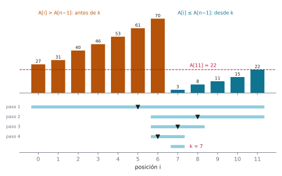
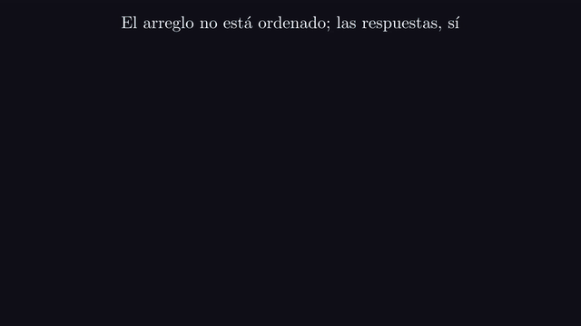
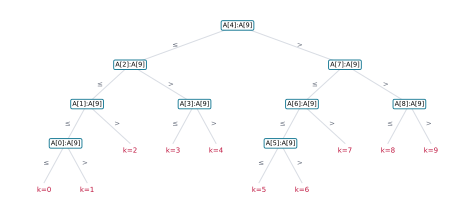
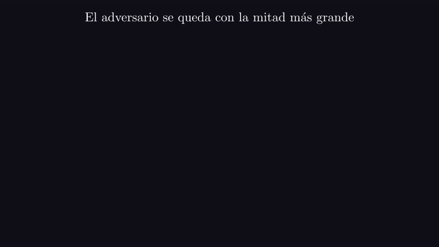
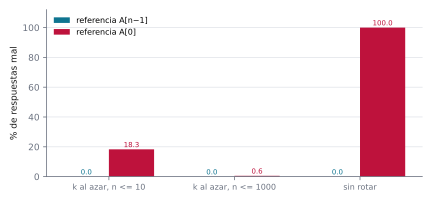

# Ejercicio 14 ★★★ · El punto de rotación de un arreglo ordenado y rotado

> Escoge un problema que no hayamos visto, recorre sobre él el ciclo completo (qué es el
> problema, qué algoritmo lo resuelve, si es correcto, cuánto cuesta y si se puede hacer
> mejor) y consigue que el algoritmo y la cota mínima coincidan.

Elegimos encontrar el punto de rotación de un arreglo que estaba ordenado y fue rotado.
Es una variante de la búsqueda binaria (Knuth, 1998, §6.2.1), y su cota inferior es un
argumento de árbol de decisión del mismo tipo que el de la ordenación por comparaciones
(Cormen et al., 2009, §8.1). Lo elegimos porque el ciclo cierra sin ninguna constante de
por medio: el algoritmo hace exactamente $\lceil \log_2 n \rceil$ comparaciones en el
peor caso, y ningún algoritmo puede hacer menos. Las cinco preguntas van en orden: el
problema en la sección 1, el algoritmo en las secciones 3 y 4, la correctitud en la 5,
el costo en la 6 y la cota en la 7. Después rompemos la cota, vemos qué escondía el
modelo, y plantamos un error que el invariante anuncia.

Todos los números de este documento los imprime [`ejercicio-14.py`](ejercicio-14.py),
que además corre las pruebas y regenera las tres figuras. Solo necesita matplotlib:

```bash
python ejercicio-14.py
```

## 1. El problema

**Punto de rotación.** La entrada es un arreglo $A[0..n-1]$, con $n \ge 1$ elementos de
un orden total, que se obtuvo rotando un arreglo ordenado de menor a mayor. Es decir,
existe $k \in \{0, \dots, n-1\}$ tal que

$$A[k] < A[k+1] < \dots < A[n-1] < A[0] < A[1] < \dots < A[k-1].$$

La salida es $k$: la posición del mínimo, que es también cuántas posiciones se rotó. Un
búfer circular que guarda números de secuencia crecientes tiene esta forma, y $k$ es la
entrada más vieja. Conocer $k$ permite además buscar cualquier valor con una búsqueda
binaria en el tramo que corresponda.

El **tramo alto** es $A[0..k-1]$ y el **tramo bajo** es $A[k..n-1]$. Cada tramo está
ordenado, y todo elemento del tramo alto es mayor que todo elemento del tramo bajo. El
tramo bajo nunca está vacío, porque contiene al mínimo; el alto está vacío exactamente
cuando $k = 0$.

Tres precisiones que un enunciado tiene que dar, y que casi nunca se dan:

- **Los elementos son distintos.** La cadena de arriba es de desigualdades estrictas.
  La sección 9 muestra que, sin esto, el problema cambia de costo.
- **El arreglo puede no estar rotado.** Con $k = 0$ la cadena se reduce a
  $A[0] < A[1] < \dots < A[n-1]$, y es una entrada válida. La sección 10 muestra que es
  justo la que se olvida.
- **Qué se cuenta.** El algoritmo solo accede a los datos comparando dos elementos,
  $A[i]$ contra $A[j]$. Como son distintos, cada comparación contesta $<$ o $>$, nunca
  $=$. Las cuentas con índices son gratis. El costo es el número de comparaciones.

## 2. Un ejemplo chico antes del algoritmo

Doce elementos, rotados para que el mínimo quede en la posición 7. La segunda línea es
la respuesta a "¿$A[i] \le A[11]$?" para cada $i$. Abajo, la búsqueda: guarda una
ventana $[\mathit{lo}, \mathit{hi}]$ de posiciones donde todavía puede estar $k$, y en
cada paso compara con $A[11]$ el elemento del medio,
$A[m]$ con $m = \lfloor (\mathit{lo} + \mathit{hi})/2 \rfloor$, y se queda con la mitad
que corresponde:

```
A = 27 31 40 46 53 61 70 3 8 11 15 22
A[i] <= A[11] = 22: no no no no no no no sí sí sí sí sí

paso  lo  hi   m  A[m]  respuesta
   1   0  11   5    61  61 > 22: k está después de m
   2   6  11   8     8  8 <= 22: k está en m o antes
   3   6   8   7     3  3 <= 22: k está en m o antes
   4   6   7   6    70  70 > 22: k está después de m
resultado: k = 7, con 4 comparaciones; la fuerza bruta usa 7; ceil(log2 12) = 4
```



*Figura 1. Arriba, el arreglo del ejemplo: en naranja el tramo alto, donde la respuesta
es "no", y en azul el tramo bajo, donde es "sí". La línea punteada es $A[11]$. Abajo, la
ventana $[\mathit{lo}, \mathit{hi}]$ en cada paso, con un triángulo en la posición que
se compara. La ventana siempre contiene a $k = 7$.*

Fíjate en que el arreglo no está ordenado, pero la fila de respuestas sí: primero todos
"no", después todos "sí", y $k$ es el primer "sí". Buscar el borde de una fila así es
una búsqueda binaria, y cada comparación descarta la mitad: la ventana pasa de 12
posiciones a 6, a 3, a 2 y a 1, con 4 comparaciones, que es $\lceil \log_2 12 \rceil$.

## 3. Fuerza bruta

Si $k \ge 1$, el único lugar donde el arreglo baja es entre $A[k-1]$, el último del
tramo alto, y $A[k]$. Si $k = 0$, no baja en ningún lado. Basta recorrer:

```python
def brute_force(n, c):
    for i in range(n - 1):
        if c.greater(i, i + 1):      # A[i] > A[i+1]
            return i + 1
    return 0
```

Es correcta por la definición del problema y cuesta $n - 1$ comparaciones en el peor
caso, el arreglo sin rotar. Sirve de oráculo para todo lo que sigue. `c` es un objeto
que contesta las comparaciones y las cuenta, de modo que el script mide el costo en el
modelo.

## 4. El algoritmo

**Cómo se le ocurre a uno.** El arreglo no está ordenado, así que la búsqueda binaria no
se aplica tal cual. Pero la búsqueda binaria no necesita que el arreglo esté ordenado:
necesita una pregunta cuyas respuestas estén ordenadas, primero todas "no" y después
todas "sí". Hay que buscar un elemento que separe los dos tramos, y el último sirve.

**Lema.** $A[i] > A[n-1]$ si y solo si $i < k$.

*Demostración.* Si $i < k$, $A[i]$ está en el tramo alto, que es mayor que todo el tramo
bajo, y $A[n-1]$ está en el tramo bajo. Si $i \ge k$, $A[i]$ está en el tramo bajo, que
es creciente y termina en $A[n-1]$, así que $A[i] \le A[n-1]$. $\square$



*Animación 1. El ejemplo de la sección 2, con cada elemento como una barra. El arreglo
no está ordenado, pero la fila de respuestas sí, y la búsqueda binaria encuentra el
primer sí. En mejor calidad: [MP4](animaciones/ejercicio-14-primer-si.mp4).*

$A[n-1]$ es la referencia adecuada porque siempre está en el tramo bajo, que nunca está
vacío. $A[0]$ parece igual de natural, pero solo está en el tramo alto si el arreglo
está rotado; la sección 10 muestra qué pasa si se usa.

```python
def rotation_point(n, c):
    lo, hi = 0, n - 1
    while lo < hi:
        m = (lo + hi) // 2
        if c.greater(m, n - 1):      # A[m] > A[n-1]: m está antes de k
            lo = m + 1
        else:
            hi = m
    return lo
```

## 5. Correctitud

El invariante describe lo que se sabe de lo que quedó fuera de la ventana.

**Invariante (I).** $0 \le \mathit{lo} \le \mathit{hi} \le n-1$, $A[i] > A[n-1]$ para
todo $i < \mathit{lo}$, y $A[\mathit{hi}] \le A[n-1]$.

Por el lema de la sección 4, (I) equivale a $\mathit{lo} \le k \le \mathit{hi}$.

**Teorema.** (I) se cumple al comienzo de cada vuelta, el ciclo termina, y
`rotation_point` devuelve $k$.

*Demostración.* *Inicialización.* Con $\mathit{lo} = 0$, la primera afirmación es sobre
un conjunto vacío. Con $\mathit{hi} = n-1$, la segunda es $A[n-1] \le A[n-1]$. **Aquí se
usa la elección de la referencia**: hace falta una posición donde la respuesta sea "sí",
y $n - 1$ siempre lo es.

*Mantenimiento.* Supongamos (I) y $\mathit{lo} < \mathit{hi}$. Entonces
$m = \lfloor (\mathit{lo} + \mathit{hi})/2 \rfloor$ cumple
$\mathit{lo} \le m < \mathit{hi}$. Si $A[m] > A[n-1]$, por el lema $m < k$, así que todo
$i \le m$ cumple $i < k$ y $A[i] > A[n-1]$. Poner $\mathit{lo} = m + 1$ conserva la
primera afirmación, y $m + 1 \le k \le \mathit{hi}$. Si $A[m] \le A[n-1]$, poner
$\mathit{hi} = m$ conserva la segunda afirmación, y $\mathit{lo} \le m$.

*Terminación.* El potencial es el tamaño de la ventana,
$s = \mathit{hi} - \mathit{lo} + 1$. Como $m - \mathit{lo} = \lfloor (s-1)/2 \rfloor$,
el tamaño nuevo es $m - \mathit{lo} + 1 = \lceil s/2 \rceil$ si la respuesta es "sí", y
$\mathit{hi} - m = \lfloor s/2 \rfloor$ si es "no". Con $s \ge 2$ los dos son menores
que $s$.

*Conclusión.* Al salir del ciclo, $\mathit{lo} \ge \mathit{hi}$, y con (I),
$\mathit{lo} = \mathit{hi}$. Todos los anteriores a $\mathit{lo}$ contestan "no" y
$\mathit{lo}$ contesta "sí". Por el lema, $\mathit{lo} = k$. $\square$

El script vigila (I) y el potencial con `assert` en cada vuelta, sobre 3000 arreglos al
azar: 16 718 vueltas, sin un solo fallo (está en la línea de pruebas del final de la
sección 10).

## 6. Costo

**Teorema.** `rotation_point` hace a lo sumo $\lceil \log_2 n \rceil$ comparaciones,
y el arreglo sin rotar alcanza esa cota. La memoria es $O(1)$.

*Demostración.* Sea $T(s)$ el máximo de comparaciones con una ventana de tamaño $s$. Una
ventana de tamaño 1 no compara, y cada comparación deja una de tamaño
$\lceil s/2 \rceil$ o $\lfloor s/2 \rfloor$, por la terminación de la sección 5. Así que

$$T(1) = 0, \qquad T(s) \le 1 + \max\big(T(\lceil s/2 \rceil),\ T(\lfloor s/2 \rfloor)\big).$$

Por inducción, $T(s) \le \lceil \log_2 s \rceil$. En efecto, si $2^{j-1} < s \le 2^j$,
entonces $2^{j-2} < \lceil s/2 \rceil \le 2^{j-1}$, así que
$\lceil \log_2 \lceil s/2 \rceil \rceil = j - 1$; y $\lfloor s/2 \rfloor$ es a lo sumo
$\lceil s/2 \rceil$, así que su techo de logaritmo tampoco pasa de $j - 1$. La
recurrencia da $T(s) \le j = \lceil \log_2 s \rceil$. Con el arreglo sin rotar, $k = 0$
y todas las respuestas son "sí": la ventana pasa siempre de $s$ a $\lceil s/2 \rceil$,
el camino más largo, y se hacen exactamente $\lceil \log_2 n \rceil$ comparaciones. La
memoria son dos índices. $\square$

El script lo comprueba con todas las rotaciones de todos los tamaños hasta 300:

```
45 150 arreglos (n de 1 a 300, todas las rotaciones): todos correctos, con floor(log2 n) o ceil(log2 n) comparaciones;
el peor caso es ceil(log2 n) para todo n, y lo alcanza el arreglo sin rotar
con n = 1 000 000 sin rotar: 20 comparaciones; la fuerza bruta haría 999 999
```

## 7. La cota mínima

La sección 6 dice cuánto cuesta **este** algoritmo. Ahora acotamos lo que cuesta
**cualquiera** en el modelo de comparaciones.

**Teorema.** Todo algoritmo de comparaciones hace al menos $\lceil \log_2 n \rceil$
comparaciones en el peor caso. En consecuencia, `rotation_point` es óptimo para todo
$n$, sin ninguna constante de por medio.

*Demostración.* Fijemos $n$ y un algoritmo de comparaciones. Su primera comparación no
depende de la entrada; la siguiente depende solo de la respuesta a la primera, y así.
Todas las ejecuciones forman un árbol binario: cada nodo interno es una comparación, con
una rama por respuesta ($<$ o $>$, porque los elementos son distintos), y cada hoja es
una salida. El peor caso es la altura del árbol. Para cada $k$ hay una entrada cuya
respuesta correcta es $k$: cualquier arreglo ordenado, rotado $k$ posiciones. Si dos
entradas con respuestas distintas llegaran a la misma hoja, el algoritmo devolvería lo
mismo para las dos y se equivocaría en una, así que el árbol tiene al menos $n$ hojas.
Un árbol binario de altura $h$ tiene a lo sumo $2^h$ hojas, de modo que $2^h \ge n$ y,
como $h$ es entero, $h \ge \lceil \log_2 n \rceil$. Con el teorema de la sección 6, el
algoritmo alcanza la cota. $\square$



*Figura 2. El árbol de decisión del algoritmo con $n = 10$, obtenido corriéndolo con
cada rotación. Cada nodo compara una posición con $A[9]$. Las diez hojas son distintas,
están en orden de $k$ de izquierda a derecha, y ninguna está a más de 4 comparaciones,
que es $\lceil \log_2 10 \rceil$.*

**El mismo argumento, como adversario.** Comparar $A[a]$ con $A[b]$, con $a < b$,
contesta exactamente esta pregunta: ¿está $k$ entre $a+1$ y $b$? Porque $A[a] > A[b]$
solo si entre las dos posiciones está el lugar donde el arreglo baja. Un adversario sin
arreglo puede mantener el conjunto de rotaciones compatibles con todo lo que contestó y,
a cada pregunta, contestar lo que deja más rotaciones vivas: al menos la mitad. Después
de $c$ comparaciones quedan al menos $n / 2^c$, y el algoritmo solo puede contestar
cuando queda una. El script corre ese adversario contra el algoritmo y contra la fuerza
bruta.



*Animación 2. El adversario contesta lo que deja más rotaciones vivas: la búsqueda
binaria necesita 4 preguntas, la fuerza bruta 11. En mejor calidad:
[MP4](animaciones/ejercicio-14-adversario.mp4).*

**Comprobación contra todos los algoritmos.** Como cada comparación es la pregunta
"¿está $k$ en tal intervalo?", lo que sabe un algoritmo en cualquier momento es el
conjunto de rotaciones todavía posibles. El mejor peor caso desde un conjunto $S$ es

$$\mathrm{opt}(S) = 0 \text{ si } |S| \le 1, \qquad
\mathrm{opt}(S) = 1 + \min_{a < b} \max\big(\mathrm{opt}(S \cap I_{ab}),\ \mathrm{opt}(S \setminus I_{ab})\big),$$

con $I_{ab} = \{a+1, \dots, b\}$ y el mínimo sobre las preguntas que parten a $S$ en
dos. El script lo calcula para todo $n \le 12$:

```
       n  algoritmo vs adversario  fuerza bruta vs adversario  ceil(log2 n)  óptimo por DP
       1                        0                           0             0              0
       2                        1                           1             1              1
       3                        2                           2             2              2
       4                        2                           3             2              2
       5                        3                           4             3              3
       7                        3                           6             3              3
       8                        3                           7             3              3
       9                        4                           8             4              4
      12                        4                          11             4              4
     100                        7                          99             7              —
    1000                       10                         999            10              —
  100000                       17                           —            17              —
DP sobre todos los algoritmos: óptimo = ceil(log2 n) para todo n <= 12: True
```

Las columnas del algoritmo, de la cota y del óptimo son iguales en toda la tabla. La
fuerza bruta, contra el adversario, hace $n - 1$: cada pregunta suya solo pregunta por
una rotación, y el adversario siempre puede contestar que no es esa.

## 8. Romper la cota

Supongamos que se sabe algo más de los datos: que los valores son exactamente
$0, 1, \dots, n-1$, como en un búfer de números de secuencia consecutivos. Entonces
$A[0] = (-k) \bmod n$, y $k$ sale de una sola lectura:

```
n = 12, A[0] = 5: k = (n - A[0]) mod n = 7, con 0 comparaciones y una lectura
n = 1 000, A[0] = 611: k = (n - A[0]) mod n = 389, con 0 comparaciones y una lectura
n = 1 000 000, A[0] = 876 544: k = (n - A[0]) mod n = 123 456, con 0 comparaciones y una lectura
```

No contradice el teorema de la sección 7. Ese algoritmo no compara elementos: lee un
valor, hace cuentas con él como número y usa el resultado como posición, y nada de eso
existe en el modelo de comparaciones. La cota de $\lceil \log_2 n \rceil$ dice que no se
puede hacer mejor **comparando**. Con más información sobre los valores, o con más
operaciones, la pregunta es otra.

## 9. Lo que el modelo escondía: los elementos distintos

El enunciado del problema pide elementos distintos, y la demostración lo usa dos veces:
para que cada comparación tenga dos respuestas, y para que valga el lema de la sección
4. Con repetidos se caen las dos cosas. Tomemos las rotaciones de `0 1 1 ... 1`, que son
arreglos ordenados y rotados con repetidos:

```
     n  sin repetidos falla en  con repetidos, peor  cota del adversario
     8                  6 de 8                    7                    4
    64                62 de 64                   63                   32
   512              510 de 512                  511                  256
```

**El algoritmo deja de ser correcto.** Salvo cuando el 0 está en el primer o en el
último lugar, $A[n-1] = 1$ y todos los elementos cumplen $A[i] \le A[n-1]$: la fila de
respuestas es toda "sí", y el algoritmo devuelve 0.

**Teorema.** Si se admiten elementos repetidos, todo algoritmo de comparaciones que
encuentre la posición del mínimo necesita al menos $\lceil (n-1)/2 \rceil$ comparaciones
en el peor caso. El problema con repetidos cuesta $\Theta(n)$.

*Demostración.* Un adversario contesta "$=$" a toda comparación sobre las rotaciones de
`0 1 1 ... 1`. Después de $c$ comparaciones, a lo sumo $2c$ posiciones fueron tocadas.
Si $2c \le n - 2$, quedan dos posiciones $p \ne q$ sin tocar, y "el 0 está en $p$" y
"el 0 está en $q$" son compatibles con todas las respuestas, porque todas las posiciones
tocadas valen 1. Las dos entradas tienen respuestas distintas, así que el algoritmo se
equivoca en una. Por lo tanto $c \ge \lceil (n-1)/2 \rceil$. La cota superior $n - 1$ la
da la fuerza bruta. $\square$

La versión que tolera repetidos compara con $A[\mathit{hi}]$ y, si son iguales, solo
descarta $\mathit{hi}$:

```python
r = c.compare(m, hi)            # -1, 0 o 1
if r > 0:   lo = m + 1
elif r < 0: hi = m
else:       hi -= 1              # A[m] = A[hi]: lo único seguro es soltar hi
```

Es correcta, y las pruebas lo comprueban, pero sobre estas entradas hace $n - 1$
comparaciones, lineal como dice el teorema. La cota de $\lceil \log_2 n \rceil$ no era
una propiedad del problema "encontrar el mínimo de un arreglo ordenado y rotado", sino
de ese problema **con elementos distintos**.

## 10. El error que el invariante anuncia

La sección 4 eligió $A[n-1]$ como referencia. La alternativa natural es $A[0]$: buscar
el primer $i$ con $A[i] < A[0]$, que para $k \ge 1$ también es $k$. Plantemos ese
error:

```python
if not c.greater(0, m):          # mal: A[m] >= A[0] no siempre dice "m está antes de k"
    lo = m + 1
else:
    hi = m
```

**Lema.** La versión con referencia $A[0]$ devuelve $k$ si y solo si $k \ge 1$ o
$n = 1$. Con el arreglo sin rotar y $n \ge 2$ devuelve $n - 1$.

*Demostración.* Si $k \ge 1$, $A[0]$ es el menor del tramo alto, así que
"$A[i] < A[0]$" es falsa antes de $k$ y verdadera desde $k$, y $A[n-1] < A[0]$ da la
inicialización que necesita (I): la demostración de la sección 5 vale con esa pregunta.
Si $k = 0$, ningún elemento es menor que $A[0]$: todas las respuestas dicen "más a la
derecha", $\mathit{lo}$ avanza hasta $n - 1$, y eso es incorrecto si $n \ge 2$.
$\square$

![La referencia A[0]](animaciones/ejercicio-14-referencia-cero.gif)

*Animación 3. El arreglo sin rotar: con $A[0]$ como referencia ninguna posición contesta
sí y la búsqueda termina en 11; con $A[n-1]$ todas contestan sí y termina en 0. En mejor
calidad: [MP4](animaciones/ejercicio-14-referencia-cero.mp4).*

La inicialización de (I) necesita una posición donde la respuesta sea "sí", y con la
referencia $A[0]$ esa posición existe solo si el arreglo está rotado. El invariante dice
entonces cuál es la prueba que hay que escribir: el arreglo sin rotar. Las baterías al
azar casi no lo generan:

```
               batería  casos  con A[n-1]  con A[0]
    k al azar, n <= 10   2000        0.0%     18.3%
  k al azar, n <= 1000   2000        0.0%      0.6%
             sin rotar   2000        0.0%    100.0%
exhaustiva con n de 1 a 59: con A[0] falla solo cuando k = [0] (y n >= 2)
sobre A = 3 8 11 15 22 27 31 40 46 53 61 70: con A[0] devuelve 11, con A[n-1] devuelve 0
```



*Figura 3. Porcentaje de respuestas mal de cada versión, según la batería. Con $k$ al
azar, la versión con $A[0]$ falla con probabilidad $1/n$: se nota con arreglos chicos y
casi nada con grandes.*

Con $n$ hasta 1000, la batería al azar falla en el 0,6 % de los casos: hay que tener
suerte para verlo. La batería exhaustiva sobre tamaños chicos sí lo encuentra, y dice
exactamente dónde está: en $k = 0$, el único caso en que el tramo alto está vacío.

Antes de dibujar, el script se comprueba a sí mismo: 3000 arreglos de hasta 200
elementos con valores y rotación al azar, en los que la búsqueda binaria, la fuerza
bruta y la posición del mínimo coinciden; 3000 arreglos en los que (I) y la bajada de la
ventana se comprueban con `assert` en cada vuelta; y 3000 arreglos ordenados y rotados
con valores entre 0 y 5, en los que la versión que tolera repetidos devuelve siempre una
posición del mínimo:

```
12 000 comprobaciones (16 718 vueltas vigiladas), 0 fallos
```

La regla práctica que te llevas: **la inicialización del invariante dice qué entrada hay
que probar.** Si el invariante necesita una posición con respuesta "sí", y esa posición
existe solo en algunas entradas, las que no la tienen son la prueba que falta.

## 11. Resumen

- El problema: la posición del mínimo de un arreglo de elementos distintos, ordenado y
  rotado. Modelo: comparaciones entre elementos.
- La fuerza bruta busca dónde baja el arreglo: $n - 1$ comparaciones.
- "¿$A[i] \le A[n-1]$?" contesta "no" antes de $k$ y "sí" desde $k$. La búsqueda binaria
  del primer "sí" es correcta por el invariante $\mathit{lo} \le k \le \mathit{hi}$, y
  termina porque la ventana se parte en dos.
- Cuesta exactamente $\lceil \log_2 n \rceil$ comparaciones en el peor caso, que alcanza
  el arreglo sin rotar.
- Todo algoritmo de comparaciones necesita $\lceil \log_2 n \rceil$: hay $n$ respuestas
  y el árbol de decisión es binario. Algoritmo y cota coinciden para todo $n$, y una
  programación dinámica sobre todos los algoritmos lo confirma hasta $n = 12$.
- Con los valores conocidos, una lectura basta: la cota es para comparaciones.
- Con repetidos, el problema cuesta $\Theta(n)$: la cota logarítmica dependía de que los
  elementos fueran distintos.
- Usar $A[0]$ como referencia falla solo con el arreglo sin rotar, que es justo el caso
  donde la inicialización del invariante no se cumple.

<details>
<summary>Salida completa de <code>python ejercicio-14.py</code></summary>

```
§2. Ejemplo chico: n = 12, rotado para que el mínimo quede en 7
---------------------------------------------------------------
A = 27 31 40 46 53 61 70 3 8 11 15 22
A[i] <= A[11] = 22: no no no no no no no sí sí sí sí sí

paso  lo  hi   m  A[m]  respuesta
   1   0  11   5    61  61 > 22: k está después de m
   2   6  11   8     8  8 <= 22: k está en m o antes
   3   6   8   7     3  3 <= 22: k está en m o antes
   4   6   7   6    70  70 > 22: k está después de m
resultado: k = 7, con 4 comparaciones; la fuerza bruta usa 7; ceil(log2 12) = 4

§6. El costo, para todo n hasta 300 y toda rotación
---------------------------------------------------
45 150 arreglos (n de 1 a 300, todas las rotaciones): todos correctos, con floor(log2 n) o ceil(log2 n) comparaciones;
el peor caso es ceil(log2 n) para todo n, y lo alcanza el arreglo sin rotar
con n = 1 000 000 sin rotar: 20 comparaciones; la fuerza bruta haría 999 999

§7. La cota mínima: el adversario y todos los algoritmos
--------------------------------------------------------
       n  algoritmo vs adversario  fuerza bruta vs adversario  ceil(log2 n)  óptimo por DP
       1                        0                           0             0              0
       2                        1                           1             1              1
       3                        2                           2             2              2
       4                        2                           3             2              2
       5                        3                           4             3              3
       7                        3                           6             3              3
       8                        3                           7             3              3
       9                        4                           8             4              4
      12                        4                          11             4              4
     100                        7                          99             7              —
    1000                       10                         999            10              —
  100000                       17                           —            17              —
DP sobre todos los algoritmos: óptimo = ceil(log2 n) para todo n <= 12: True

§8. Romper la cota: si se sabe que los valores son 0, 1, ..., n-1
-----------------------------------------------------------------
n = 12, A[0] = 5: k = (n - A[0]) mod n = 7, con 0 comparaciones y una lectura
n = 1 000, A[0] = 611: k = (n - A[0]) mod n = 389, con 0 comparaciones y una lectura
n = 1 000 000, A[0] = 876 544: k = (n - A[0]) mod n = 123 456, con 0 comparaciones y una lectura

§9. Con repetidos: rotaciones de 0 1 1 ... 1
--------------------------------------------
     n  sin repetidos falla en  con repetidos, peor  cota del adversario
     8                  6 de 8                    7                    4
    64                62 de 64                   63                   32
   512              510 de 512                  511                  256

§10. El error plantado: comparar con A[0] en vez de A[n-1]
----------------------------------------------------------
               batería  casos  con A[n-1]  con A[0]
    k al azar, n <= 10   2000        0.0%     18.3%
  k al azar, n <= 1000   2000        0.0%      0.6%
             sin rotar   2000        0.0%    100.0%
exhaustiva con n de 1 a 59: con A[0] falla solo cuando k = [0] (y n >= 2)
sobre A = 3 8 11 15 22 27 31 40 46 53 61 70: con A[0] devuelve 11, con A[n-1] devuelve 0

Pruebas
-------
12 000 comprobaciones (16 718 vueltas vigiladas), 0 fallos

figuras: ejercicio-14-predicado.svg, ejercicio-14-arbol.svg, ejercicio-14-errores.svg
```

</details>

